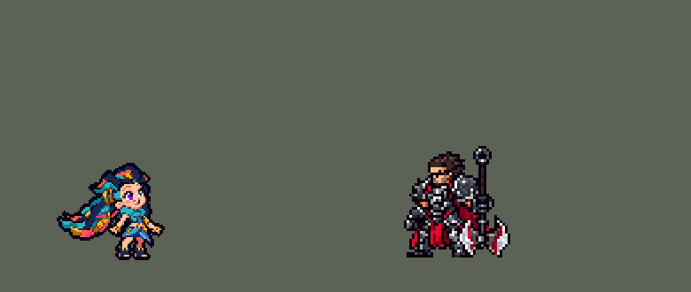

<!-- 本页上半部分由 tools/docs/gen_hero_docs.py 按仓库里现在的数据生成，手改会被覆盖；「开发记录」以下是手写的，生成时原样保留。 -->

# 佐伊 Zoe


| 项目 | 内容 |
|---|---|
| id | `league_zoe` |
| 所属的包 | 主包（mod_id `league`） |
| 分路 | 中单 |
| 分类 / 标签 | 法师（Magician） · AP / Magic / Range / CC |
| 高清帧 | PPU 1.5 |
| 附加包 | [佐伊附加包](#附加包)（`league_zoe`） |



其他预览：[逐帧预览](../preview/league_zoe_frames.png)、[特效表](../preview/league_zoe_effects.png)

## 现在的技能

下面是游戏里显示的技能说明（`league/text/champion.i18n` 的简体中文，去掉了颜色和图标），冷却、距离来自 `league/champion/league_zoe.data_champion`；1 秒 = 60 tick。

### 普攻 / 被动

*攻击间隔 1.47 秒 · 攻击距离 55000*

射出一颗小星星。烟火四射！：每放一个技能，下一次普攻多造成40 + 50% 法强魔法伤害。

### 技能1 · 飞星乱入！

*冷却 6 秒 · 施放距离 80000 · 施放：指定目标 · 敌人（不含防御塔）*

掷出一颗飞星，打中第一个敌人造成105 + 60% 法强魔法伤害；飞得越远伤害越高，最远250%。

### 技能2 · 催眠气泡

*冷却 15 秒 · 施放距离 75000 · 施放：指定目标 · 敌方英雄*

踢出气泡，打中敌方英雄造成60 + 40% 法强魔法伤害，困倦（减速30%）1.4秒后睡眠2秒，受到任何伤害就醒，打醒的那一下伤害提高100%；没打中就留在原地。

### 大招 · 折返跃迁

*冷却 30 秒 · 施放距离 110000 · 施放：指定目标 · 敌方英雄*

跳进传送门闪向敌方英雄，掷出飞星造成200 + 90% 法强魔法伤害；窃法巧手：再射3颗飞弹，每颗45 + 15% 法强，加速40%。1.2秒后跳回原地。

### 数值

攻击力 76（每级 +6）、法强 40（每级 +20）、生命 960（每级 +95）、护甲 18（每级 +7）、魔抗 22（每级 +4）、移速 920（每级 +9）。

## 附加包

附加包是可选的原生代码 mod（都在附加包合集 `league_addons` 里），**不装主包里的英雄也是完整的**。

### 佐伊附加包

[佐伊附加包](../../addons/league_zoe/README.md)：`league_zoe` v0.5.0

|  | 主包（纯数据） | 装了附加包 |
|---|---|---|
| 催眠气泡的睡眠 | 1.4 秒困倦后游戏的官方睡眠 2 秒：受到任何伤害就醒，打醒的那一下伤害 +100% | 一样是官方睡眠，2.25 秒（英雄联盟的时长）；睡着时头上有睡泡，醒了就摘掉，被打醒的放醒来的画面 |
| 飞星的伤害 | 飞行时间分三档：近 100%、中 170%、远 250% | **按真实飞行距离**：出手点 20000 以内 100%，到 85000 线性加到 250% |
| 窃法巧手 | 只跟着大招射 3 颗飞弹 | 另外：**敌方英雄放大招时原地掉下一块法术碎片**（20 秒，最多 3 块），她走到 18000 以内就捡起来，射 3 颗飞弹（打 70000 内最近的敌方英雄，每颗 45 + 15% 法强）并加速 40% 2.5 秒（英雄联盟：捡起召唤师技能和主动装备的碎片；团战经理没有召唤师技能，用大招代替） |
| 召唤师技能（0.2.0） | — | 用户：「可以改成召唤师技能那种效果吗 随机的」「能做成智能释放吗」：窃法巧手每次发动（大招射飞弹的那一刻、捡起碎片时）先放一个召唤师技能，按局面挑：被控 → **净化**；残血、敌方英雄贴脸 → **闪现**躲开（引擎的击退，停在墙边）；残血或身边有快死的队友 → **治疗**（90 + 30% 法强，她和那个队友，加速 30% 1 秒）；身边有快死的敌方英雄 → **点燃**（5 秒 5 跳，每跳 25 + 8% 法强真实伤害，受治疗 −40%）；被贴脸 → **虚弱**（移速、攻击、法强 −30%，2.5 秒）；打架掉了不少血 → **屏障**（110 + 45% 法强护盾 2.5 秒）；附近没有敌方英雄 → **幽灵疾步**（移速 +45% 4 秒）；都不是就在点燃 / 虚弱 / 屏障 / 幽灵疾步里随机（比赛的种子定的，服务端预模拟和画面一样）。判断在 `src/summon.rs`（单元测试），日志 `SUMMON`。0.3.0（用户：「加啊」「地面上最好也要有图标显示」「直接拿英雄联盟客户端里面的图标啊」「所有的效果技能要做到位啊」「创意工坊里面有双召mod你直接参考」「屏障罩住人啊」）：数字照创意工坊的 Summoner Spells 对齐——**闪现**改成她自己瞬移 45000（背着贴脸的人，落点避开墙和地图外：`summon::flash_spot`，单元测试），**幽灵疾步** +30% 6 秒，**治疗**加速 20% 2 秒，**屏障**护盾为最大生命的 25%、3 秒，**虚弱**减速 45%、攻击 / 法强 −35%、3 秒。画面：放的时候她脚下的地上亮起那个技能的图标（英雄联盟客户端的原图标，`tools/lol/extract_summoner_icons.py` 取出、`assets/source/zoe/summoner_icons/`），地上的碎片上七个图标轮流闪（捡起来才按局面定是哪个）；闪现在起点和落点各一闪，点燃在目标身上烧，虚弱在目标头顶一团灰尘、两侧往下沉的箭头，治疗绿色十字往上飘（她和那个队友），屏障一个金色的罩子把她整个罩住、护盾没了就摘掉，幽灵疾步脚下蓝色的灵体绕圈，净化一道光环从脚扫到头。图：`tools/art/draw_zoe_spells.py`（`league_zoe_spells` PPU 2、`league_zoe_spell_icons` PPU 3，league.dll 登记成高清特效表），对照动图 `tools/art/review_zoe_spells.py`。0.5.0（用户：「闪现现在怎么看不出效果？」——原来起点、落点各一团 0.2 秒的小星芒，看着像原地闪了下光；大招里闪出去半秒后又被传送门送回原地）：**闪现**的星芒放大到和她一样高、地上一圈光环、0.5 秒，起点到落点之间一串金色拖影（`s_flash_trail`，4 团），落点也亮闪现的图标；**大招里不挑闪现**（残血被贴脸时改成治疗），只有捡碎片时才会闪。对照动图里闪现的距离也改对了（45000 = 45 像素，以前画成 22）。 |

装上附加包后游戏里显示的说明（和主包不同的部分）：

- **技能1 · 飞星乱入！**：【扩展包】掷出一颗飞星，打中第一个敌人造成105 + 60% 法强魔法伤害；按真实飞行距离越远越高，最远250%。
- **技能2 · 催眠气泡**：【扩展包】踢出气泡，打中敌方英雄造成60 + 40% 法强魔法伤害，困倦（减速30%）1.4秒后睡眠2.25秒；受到任何伤害就醒，打醒的那一下伤害提高100%。
- **大招 · 折返跃迁**：【扩展包】跳进传送门闪向敌方英雄，掷出飞星造成200 + 90% 法强魔法伤害，再射3颗飞弹。窃法巧手：每次先按局面放一个召唤师技能（闪现、点燃、虚弱、治疗、屏障、疾步、净化），飞弹每颗45 + 15% 法强，加速40%；敌方放大招掉碎片，捡起再来一次。

## 相关脚本和素材

- [`tools/kit/build_zoe.py`](../../tools/kit/build_zoe.py)
- [`tools/kit/setup_zoe.py`](../../tools/kit/setup_zoe.py)
- [`tools/lol/extract_zoe.py`](../../tools/lol/extract_zoe.py)
- [`tools/art/preview_zoe.py`](../../tools/art/preview_zoe.py)
- [`tools/art/rig_zoe.py`](../../tools/art/rig_zoe.py)
- [`assets/source/zoe/`](../../assets/source/zoe)

## 开发记录

> 下面是原来 README 里「英雄：佐伊」一节，原样搬过来（只改了相对链接）。

| 部分 | 内容 |
|---|---|
| 定位 | 中单（Magician，标签 AP / Magic / Range / CC），第 133 位英雄。暮光星灵 佐伊：深藏青色的长发里飘着青绿、金黄、珊瑚橙、粉红的星光彩带，一紫一蓝的大眼睛，咧嘴大笑的小女孩（10-17 的分组计划 C 组的中单）。用户的选择：「技能方案 A（Q / E / R+Q）」「做附加包」。团战经理只有三个主动技能位：技能 1 = Q 飞星乱入！，技能 2 = E 催眠气泡，大招 = R 折返跃迁（从传送门扔一颗飞星）；被动烟火四射！在普攻里，**W 窃法巧手没有自己的格子，它的 3 颗飞弹跟着每次大招射出**（她的「召唤师技能」）。技能名照英雄联盟 16.20 的官方中文 |
| 普攻 / 被动 | 弹出一颗小星星（射程 55000，100% 攻击）。**烟火四射！**：每放一个技能（Q / E / R），5 秒内下一次普攻换成大星星（`attack_p`，英雄联盟的 Empowered_Attack），多造成 40 + 50% 法强 魔法伤害 |
| 技能1 | **Q 飞星乱入！**（对小兵、野怪也放，射程 80000）：飞星直线飞向目标，第一个碰到的敌人吃伤害。英雄联盟按飞行距离加伤（最多 +150%）；数据读不到距离，按飞行时间分三档：30000 以内 105 + 60% 法强，60000 以内 170%，更远 250%。冷却 6 秒 |
| 技能2 | **E 催眠气泡**，只对敌方英雄放（射程 75000）：气泡直线飞出，打中 60 + 40% 法强 魔法伤害，困倦（减速 30%）1.4 秒后睡眠 2 秒（游戏 0.7.0 起是游戏的官方睡眠——催眠师 E 的原生效果，任何伤害都打醒，打醒那一下 +100%；以前是眩晕，打不醒，昏睡中第一次被她的飞星打中那一下翻倍）。没打中就留在飞到的地方当陷阱 5 秒，第一个走进去的敌方英雄同样困倦、昏睡。冷却 15 秒 |
| 大招 | **R 折返跃迁**（射程 110000）：原地留下传送门（伊克的锚点），跳进去闪向目标（最多 57500，停在第一个英雄 50000 外），落地后从门口扔一颗满距离的飞星（200 + 90% 法强），再用**窃法巧手**扔出 3 颗天蓝色飞弹（每颗 45 + 15% 法强）并加速 40% 2.5 秒；约 1.2 秒后从远处跳起、穿过传送门回到原地（死了就不回）。冷却 30 秒（英雄联盟的 R 冷却只有 11–5 秒、只有位移，这里把飞星和窃法巧手合进来做成大招） |
| 附加包 | 可选的附加包 [`addons/league_zoe`](../../addons/league_zoe/README.md)（在附加包合集里，原生代码，主包不装它也完整），照英雄联盟：睡眠 2.25 秒（0.4.0 起和主包一样是官方睡眠，睡着时头上有睡泡，醒了摘掉；以前是自己的昏睡，受任何伤害就醒，那一下再来一遍真实伤害，最多 100 + 60% 法强）；**飞星按真实飞行距离加伤**（出手点 20000 以内不加，到 85000 加到 250%）；**窃法巧手捡碎片**：敌方英雄放大招时原地掉下一块法术碎片（20 秒），她走过去捡起来就射 3 颗飞弹并加速。0.2.0（用户：「可以改成召唤师技能那种效果吗 随机的」「能做成智能释放吗」）：窃法巧手每次发动先按局面放一个召唤师技能——被控净化、残血被贴脸闪现、残血或队友快死治疗、敌人快死点燃、被贴脸虚弱、打架掉血屏障、附近没人幽灵疾步，都不是就在点燃 / 虚弱 / 屏障 / 幽灵疾步里随机（比赛的种子定）。日志 `league_zoe.log`（STAR、WAKE、SHARD、PICK） |
| 数值 | 攻击 76（+6）、法强 40（+20）、生命 960（+95）、护甲 18（+7）、魔抗 22（+4）、移速 920（+9）、射程 55000 |
| 平衡 | 10 分钟经典引擎模拟，中路对五个原版法师（pyromancer / ice_mage / lightning_mage / wind_mage / white_mage），三套阵容、两边各打，每档两批种子（1–8、9–16）：初稿（生命 880、Q 70 + 50%、R 170 + 80% 每 40 秒、昏睡 1.5 秒）-1.37（同批吉格斯 +1.70）；Q 90 + 60%、R 停在 50000 外、昏睡 1.75 秒 +0.67；再加生命 920、R 每 30 秒、飞弹 45 +0.36；再加飞星远档 250%、被动 40 + 50% +1.07 / +1.18；Q 105 +1.41 / +1.47；按动作条的时间（门口的飞星在 Q 的出手帧、窃法巧手的扔飞弹动作、跳走动作：她在远处多待了一会儿）+1.30 / +0.16；昏睡 2 秒、生命 960、门口飞星 200 + 90% 定稿 +1.17 / +1.47（约 +1.3，沃利贝尔 +1.39） |
| 精灵图（高清帧 PPU 1.5） | Codex 第 0 步画了待机（A：英雄联盟的待机，3/4 正面、上身后仰、头发向身后飘）和站直（B）两张原画（[`tools/art/pack_zoe_picture.py`](../../tools/art/pack_zoe_picture.py)），[`tools/art/design_zoe_hd.py`](../../tools/art/design_zoe_hd.py) 按各自的格子读回（8.5 px 一格），[`tools/art/review_zoe_size.py`](../../tools/art/review_zoe_size.py) 和中单、小个子女孩按游戏大小并排，用户：「A」「35 像素」「PPU 1.5」（发髻顶到脚底 53 格）。第 1 步 Codex 在游戏格子上画了待机 A、侧面 S 各两稿（[`tools/art/pack_zoe_model.py`](../../tools/art/pack_zoe_model.py)，每格 19 px），[`tools/art/design_zoe_model.py`](../../tools/art/design_zoe_model.py) 按各自的格子读回、整行整列删到 53 行（脸的行列不删），用户选了 A-1（59 × 53）和 S-1（48 × 53，脸同样朝右前方、两只眼睛都看得见），两张共用一套调色板。动作不找 Codex：[`tools/art/rig_zoe.py`](../../tools/art/rig_zoe.py) 用造型自己的像素无损摆，只整格平移、四分之一转、镜像，每个动作对照英雄联盟的动画（`tools/lol/anim_graph.py Zoe`、`pose_ref.py`，渲染时藏掉跳绳、球拍、溜溜球、冰淇淋）：待机（A 的身子坐下一行再起来）、跑（侧面的两条小腿整块迈步，蹦蹦跳跳）、普攻（蹲下、跳起、手一扬弹出星星，然后整个人头朝前扑出去、落地弯着腰，Zoe_attack1）、强化普攻（跳得更高再扔，Empowered_Attack）、Q（跳起、在空中前空翻一圈，翻到倒立时把飞星甩出去，落地后仰，Spell1）、E（跳起、在空中倒过来，然后上身后仰、一条腿笔直地往前蹬出去飞踢气泡，Spell3）、R（蹲下、跳起、头朝前扑进传送门，从远处的门里头朝下扑出来、落地张开手臂站稳，spell4_enter / Spell4）、W 扔飞弹（`skill_w`，spell2_missile）、从远处跳走（`ult_exit`，Spell4_Exit）和落回原地（`ult_back`，Spell4_B）、挨打（闪白后退）、阵亡 8 帧（往后倒、躺在头发上、回弹一下）。审查时用户：「你在对照一下英雄联盟有没有少动作帧的」——补了 W 扔飞弹和 R 跳走两个动作；「动作可以」。之后用户：「还有佐伊 感觉少了扑出去的动作？」（普攻、Q、E、R 都选了）——普攻加了往前扑、Q 改成前空翻、E 改成后仰飞踢（往前蹬的那条腿照她小腿自己的颜色重画）、R 改成头朝下扑进传送门，帧数和时长不变（技能数据的时机照旧）；「佐伊可以了」。手臂只往前、往后转（往上转会挡住脸），手臂离开后头发尖上留下的一小块碎片随手臂移走。2026-10-22 补全动作（用户：「佐伊只需要 完善动作帧 我觉得动作帧是不全的」，造型不动）：跑步的小腿原来几乎不动、空翻和倒地一两帧就跳过去。[`tools/art/rig_zoe.py`](../../tools/art/rig_zoe.py) 重写成奥莉安娜的做法：头连同整片头发一块整格移动，围巾、上衣、裙子是侧面造型自己的格子整块移动（前倾是上半身整行平移），手臂和腿用造型自己的肤色画成带描边的圆柱，手镯和手（8 个无损方向）、靴子照抄造型；每帧对照英雄联盟同一时刻的动作（`LOL` 表）。待机 8 帧（3/4 造型腰以上沉一行、裙子和腿不动，头发尾巴上下飘）、跑步 8（卡特琳娜的跑法，两脚交替，换脚时双脚离地蹦一下，手臂前后摆）、普攻 8（蹲、跳、手往后、第 4 帧甩出星星 = a_rel 10、抱膝前空翻三帧、落地）、强化普攻 8（跳到最高、双臂张开扔出、落地蹲下再站起）、Q 8（直着往上飘、手往后、第 4 帧扔出 = q_rel 13、抱膝前空翻、落地）、E 9（蹲、跳、直体空翻三帧、第 6 帧飞踢 = e_rel 13、落地）、R 8（蹲、起跳、第 3 帧跃起 = r_rel 8、头朝前、头朝下扑进传送门、从远端落下站稳）、W 7（右侧、正面、左侧、左前方转一圈，第 3 / 5 / 7 帧各飞出一颗飞弹 = w_rel 4 + w_gap 5）、从远端跳走 4、落回原地 6、受击 2、阵亡 10（受击、转一圈、手臂甩开往后倒、仰面躺下抬腿、躺平）；每个动作的总时长和出手帧都和技能数据一致，空翻和倒地都是整个人四分之一转（无损，任意角度会把脸转坏），手臂离开后背后露出来的缝补成头发的深色。对照动图：[`tools/art/review_zoe_actions.py`](../../tools/art/review_zoe_actions.py)；待机和 BP 卡片的小动作（[`tools/art/hero_reels.py`](../../tools/art/hero_reels.py)）改从新的 E、R 落地帧里截。主包 0.190.1、`league.dll` 0.7.109 |
| 特效 | 第 3 步 18 张特效（[`tools/art/pack_zoe_fx.py`](../../tools/art/pack_zoe_fx.py)，颜色照英雄联盟：她的星星是金白色的星光、带粉紫色的星点和蓝色的星尘，催眠气泡是蓝、紫、粉的彩虹肥皂泡，传送门是一圈白光围着深紫色的星空，窃法巧手的飞弹是天蓝色）。弹道图（星星、气泡、飞弹）朝右画、上下对称（游戏按飞行方向转），其余全部左右对称（游戏不镜像特效图）。[`tools/art/import_zoe_fx.py`](../../tools/art/import_zoe_fx.py) 写成 `league_zoe_fx` 和 `league_zoe_big` |
| 音效 | 英雄联盟的音效和配音（[`tools/lol/extract_zoe.py`](../../tools/lol/extract_zoe.py)，20 段）：普攻出手 / 打中，强化普攻出手 / 打中，Q 出手 / 飞行 / 打中，E 出手 / 飞行 / 打中 / 陷阱破开 / 昏睡 / 打醒，R 出手 / 回来，飞弹出手 / 打中；Q、E、R 的配音（片段名 `league_zoe_sfx_*`，和声音名不同）。2026-10-22 用户：「佐伊的音效也照奥莉安娜的办法调响」——第一版峰值 −11 到 −16 dBFS、音量 0.3–0.55，游戏里实际约 0.09（拉克丝约 0.53）：提取峰值 +8 dB（最高 −2），技能音量 0.7–0.9、普攻 0.5–0.65，实际中位约 0.40；配音不变 |
| 图标 | 官方技能图标（飞星乱入！、催眠气泡、折返跃迁，另有窃法巧手和被动），从本地客户端取 |

重新生成（素材来自本机的英雄联盟客户端，音频不进仓库）：

```bash
python tools/lol/extract_zoe.py --lol "D:\WeGameApps\lol" --vgmstream <vgmstream-cli.exe>
python tools/kit/build_zoe.py                       # 技能数据，数字都在脚本的参数表 P 里
python tools/kit/setup_zoe.py                       # 五种语言的文字、音效配置、共享文件里她的键
python tools/art/design_zoe_model.py                # Codex 第 1 步的造型读回（A-1 / S-1）
python tools/art/rig_zoe.py                         # 1 倍帧和 1.5 的原帧（逐帧照英雄联盟摆）
python tools/art/ppu_restyle.py --hero zoe          # 外描边（不要加 --preview）
python tools/art/ppu_hd.py --hero zoe               # hd_ / lo_ 帧
python tools/art/import_zoe_fx.py                   # 特效
python tools/art/preview_zoe.py                     # 预览和演示 GIF
python addons/league_zoe/make_override.py           # 附加包的副本（主包的佐伊改了就重跑）
```

逐帧预览：[`docs/preview/league_zoe_frames.png`](../preview/league_zoe_frames.png?v=1019b)，特效：[`docs/preview/league_zoe_effects.png`](../preview/league_zoe_effects.png?v=1019a)。
