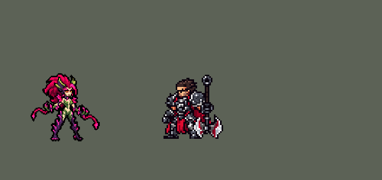

<!-- 本页上半部分由 tools/docs/gen_hero_docs.py 按仓库里现在的数据生成，手改会被覆盖；「开发记录」以下是手写的，生成时原样保留。 -->

# 婕拉 Zyra


| 项目 | 内容 |
|---|---|
| id | `league_zyra` |
| 所属的包 | 主包（mod_id `league`） |
| 分路 | 中单 |
| 分类 / 标签 | 法师（Magician） · AP / Magic / Range / CC |
| 高清帧 | PPU 1.7 |
| 附加包 | [婕拉附加包](#附加包)（`league_zyra`） |



其他预览：[逐帧预览](../preview/league_zyra_frames.png)、[特效表](../preview/league_zyra_effects.png)

## 现在的技能

下面是游戏里显示的技能说明（`league/text/champion.i18n` 的简体中文，去掉了颜色和图标），冷却、距离来自 `league/champion/league_zyra.data_champion`；1 秒 = 60 tick。

### 普攻 / 被动

*攻击间隔 1.43 秒 · 攻击距离 55000*

甩出一颗荆棘种子。荆棘花园：她每次放Q、E都先种下一颗种子，长成植物作战5秒，每1秒攻击一个敌人，造成20 + 12% 法强魔法伤害。

### 技能1 · 致命棘刺

*冷却 7 秒 · 施放距离 80000 · 施放：指定目标 · 敌人（不含防御塔）*

地面炸出棘刺，范围内的敌人受到80 + 55% 法强魔法伤害。种子长成荆棘喷射者，远距离攻击。

### 技能2 · 缠绕之根

*冷却 11 秒 · 施放距离 90000 · 施放：指定目标 · 敌人（不含防御塔）*

放出贯穿地面的藤蔓，路径上的敌人受到70 + 45% 法强魔法伤害并被禁锢1.25秒。种子长成藤蔓鞭击者，近距离攻击并减速30%。

### 大招 · 绞杀之藤

*冷却 50 秒 · 施放距离 70000 · 施放：指定目标 · 敌方英雄*

召唤扭曲的密林，造成180 + 70% 法强魔法伤害，2秒后击飞仍在其中的敌人1秒。植物被激怒5秒，伤害提高50%。

### 数值

攻击力 70（每级 +6）、法强 40（每级 +20）、生命 900（每级 +95）、护甲 18（每级 +7）、魔抗 22（每级 +4）、移速 900（每级 +9）。

## 附加包

附加包是可选的原生代码 mod（都在附加包合集 `league_addons` 里），**不装主包里的英雄也是完整的**。

### 婕拉附加包

[婕拉附加包](../../addons/league_zyra/README.md)：`league_zyra` v0.1.1

|  | 主包（纯数据） | 装了附加包 |
|---|---|---|
| 荆棘花园 / 狂野生长 | 每次 Q、E 当场长一株植物 | 主包的照旧；另外**种子掉在她身边的地上**：每 10 秒一颗（有敌方英雄在附近就掉在朝他的方向），在地上留 30 秒、最多 4 颗；**她参与击杀敌方英雄时马上掉一颗**（英雄联盟：击杀缩短狂野生长的充能） |
| Q 致命棘刺 | 落点长一株荆棘喷射者 | 落点 24000 内的种子**也都长成荆棘喷射者** |
| E 缠绕之根 | 落点长一株藤蔓鞭击者 | **藤蔓经过的线上**（她到落点再往前 20000）的种子都长成藤蔓鞭击者 |
| 种子长的植物 | — | 活 5 秒，每秒出手一次，**先打范围内最近的敌方英雄**，没有英雄才打小兵、野怪（不打塔）；**伤害随她的等级成长**（1 级 20、18 级 100，+12% 法强，英雄联盟 20–100）；荆棘喷射者**吐出一根看得见的刺**、飞到才扣血，藤蔓鞭击者抽打并减速 30% 1 秒 |
| R 绞杀之藤 | 植物 5 秒内伤害提高 50% | 主包的照旧；密林范围里种子长的植物 5 秒内**出手间隔减半**（英雄联盟：密林里的植物攻速提高） |

装上附加包后游戏里显示的说明（和主包不同的部分）：

- **普攻 / 被动**：【扩展包】甩出一颗荆棘种子。荆棘花园：每10秒在身边掉一颗种子（留30秒），参与击杀时马上掉一颗；Q、E 落在种子旁边会让种子长成植物，植物先打英雄，伤害随等级成长。
- **技能1 · 致命棘刺**：【扩展包】地面炸出棘刺，造成80 + 55% 法强魔法伤害。落点和旁边的种子长成荆棘喷射者，向敌人吐刺。
- **技能2 · 缠绕之根**：【扩展包】贯穿地面的藤蔓造成70 + 45% 法强魔法伤害并禁锢1.25秒。落点和藤蔓经过的种子长成藤蔓鞭击者，抽打并减速。

## 相关脚本和素材

- [`tools/kit/build_zyra.py`](../../tools/kit/build_zyra.py)
- [`tools/kit/setup_zyra.py`](../../tools/kit/setup_zyra.py)
- [`tools/lol/extract_zyra.py`](../../tools/lol/extract_zyra.py)
- [`tools/art/preview_zyra.py`](../../tools/art/preview_zyra.py)
- [`tools/art/rig_zyra.py`](../../tools/art/rig_zyra.py)
- [`assets/source/zyra/`](../../assets/source/zyra)

## 开发记录

> 下面是原来 README 里「英雄：婕拉」一节，原样搬过来（只改了相对链接）。

| 部分 | 内容 |
|---|---|
| 定位 | 中单（Magician，标签 AP / Magic / Range / CC），第 140 位英雄。荆棘之兴 婕拉：植物化成的女人，一大蓬深红-品红的头发、两片黄绿色的叶角，绿叶抹胸和短裤，深紫色带刺的长腿，手腕上垂着品红色的鞭藤（10-17 的分组计划 D 组的辅助）。用户的选择：「技能方案 A」「中单」（不按计划做辅助）「做附加包」。团战经理只有三个主动技能位：技能 1 = Q 致命棘刺，技能 2 = E 缠绕之根，大招 = R 绞杀之藤；W 狂野生长和被动荆棘花园进了 Q、E：**每次 Q、E 先种一颗种子、马上长成植物**（英雄联盟的 W → Q / W → E 连招）。技能名照英雄联盟 16.20.1 的 Data Dragon（五种语言） |
| 普攻 / 植物 | 鞭梢甩出一颗荆棘种子（射程 55000，100% 攻击）。**植物**：数据没有召唤物，一株植物就是落点上的周期区域，画面是一段和它一样长（5 秒）的动画：长出来、每秒出手一次（第一次在 0.33 秒）、最后枯萎。区域会打里面所有人，植物只打一个：每一下第一个轮到的敌人挂 1 tick 的标记，其余的读到就跳过（小兵可能排在英雄前面）。**荆棘喷射者**（Q）打 50000 内的敌人，20 + 12% 法强魔法伤害；**藤蔓鞭击者**（E）打 32000 内的，20 + 12% 法强并减速 30% 1 秒 |
| 技能1 | **Q 致命棘刺**（对小兵、野怪也放，射程 80000）：甩手 0.5 秒后目标脚下炸出棘刺，半径 22000 内 80 + 55% 法强魔法伤害，落点长出一株荆棘喷射者。冷却 7 秒 |
| 技能2 | **E 缠绕之根**（对小兵、野怪也放，射程 90000）：藤蔓贴着地面直线冲出 105000，穿过路上所有敌人：70 + 45% 法强魔法伤害并禁锢 1.25 秒；藤蔓到目标那里时长出一株藤蔓鞭击者。冷却 11 秒 |
| 大招 | **R 绞杀之藤**（只对敌方英雄，射程 70000）：英雄脚下长出扭曲的密林（半径 32000；10-20 加大到 44000，10-21 改回，用户：「改到3w2」），180 + 70% 法强魔法伤害；2 秒后密林合拢，把还在里面的敌人击飞 1 秒。之后 5 秒她的植物被激怒，每一下伤害 ×1.5。冷却 50 秒（原来 35 秒，全包大招冷却的中位数是 50 秒，用户：「大招CD这么快？」） |
| 连招 | 用户要求：「有连招要做连招」「都要帮我补」。英雄联盟的 **E→Q**：缠绕之根禁锢敌方英雄时（只打英雄、同一条线的隐形孪生藤蔓）给她挂 75 tick（= 禁锢时长）的连招窗口；窗口里放 Q，出手时先找 90000 内被控制的敌方英雄（通常就是刚被缠住的那个），棘刺 4 tick 后就在他脚下炸开（平时出手后 30 tick），落点照样长出荆棘喷射者，窗口随之用掉；没找到就和原来一样落在 Q 的目标上。伤害、冷却都不变；装了附加包时种子照样在落点长成植物（标记挂在打到的英雄身上）。生成脚本 `tools/kit/build_zyra.py`（参数 `e_combo`、`q_fast`），附加包用 `make_override.py` 重新生成 |
| 附加包 | 可选的附加包 [`addons/league_zyra`](../../addons/league_zyra/README.md)（在附加包合集里，原生代码，主包不装它也完整），照英雄联盟：**种子掉在她身边的地上**（每 10 秒一颗，有敌方英雄在附近就掉在朝他的方向，留 30 秒、最多 4 颗；参与击杀敌方英雄时马上掉一颗），Q 落点 24000 内、E 藤蔓经过的种子**也长成植物**：活 5 秒、每秒出手，**先打范围内最近的敌方英雄**，伤害随她的等级成长（1 级 20、18 级 100，+12% 法强），荆棘喷射者**吐出一根看得见的刺**；R 的密林里种子长的植物出手间隔减半。日志 `league_zyra.log`（SEED、GROW、STRIKE、RAGE、TAKEDOWN） |
| 数值 | 攻击 70（+6）、法强 40（+20）、生命 900（+95）、护甲 18（+7）、魔抗 22（+4）、移速 900（+9）、射程 55000 |
| 平衡 | 10 分钟经典引擎模拟，中路对五个原版法师（pyromancer / ice_mage / lightning_mage / wind_mage / white_mage），三套阵容两边各打：初稿（植物 25 + 15% 活 6 秒，Q 90 + 60%，E 80 + 50%）+2.10；单项削弱（植物 18 + 12%、Q / E −15、植物 4 秒、生命 820 配 R 150 + 60%）+1.95～+2.56、禁锢缩短 +2.99——都在噪声里（一批约 ±0.7）；伤害和植物一起削（植物 18 + 12% 活 4 秒，Q 75 + 50%，E 65 + 40%）+0.65 / +0.78；植物 20 + 12% 活 5 秒、Q 80 + 55%、E 70 + 45% +1.09；按动作条的时间（普攻、Q、E、R 都在第 3 帧出手）+1.07 / +1.62；E 的藤蔓贴着站位线走 +1.30 / +1.52（种子 1–16 / 17–32）；R 半径加到 44000 定稿 **+1.46 / +1.56**（约 +1.5，薇古丝 +1.1） |
| 精灵图（高清帧 PPU 1.7） | Codex 第 0 步画了 3/4 正面和正侧面两种角度，鞭藤长、英雄联盟那样的大蓬头发（A）或收紧的头发、短鞭藤（B）（[`tools/art/pack_zyra_picture.py`](../../tools/art/pack_zyra_picture.py)，读回 [`design_zyra_hd.py`](../../tools/art/design_zyra_hd.py)，大小对比 [`review_zyra_size.py`](../../tools/art/review_zyra_size.py)），用户：「A」「44 像素」「PPU 1.5」。第 1 步 Codex 在游戏格子上画 A / SA 各两稿（[`pack_zyra_model.py`](../../tools/art/pack_zyra_model.py) / [`design_zyra_model.py`](../../tools/art/design_zyra_model.py)）；先删到 66 行、逐格重画了脸，用户：「提高点ppu像素吧 如果太糊的话」「脸部完全变形了啊」——改成 PPU 1.7，A-1 原样 74 行，Codex 自己画的脸不动。动作我自己照英雄联盟一帧一帧摆（用户：「动作帧不是你自己做吗 其他英雄都是照着英雄联盟慢慢走出来的啊」「动作帧要全啊别少 慢慢做好了 做完美了喊我review」）：先在侧面造型上画四肢，用户：「侧面太奇怪了 而且难做 就用四分之三面来做啊」——[`rig_zyra.py`](../../tools/art/rig_zyra.py) 改在 3/4 正面造型上摆：手臂是造型自己的像素，只绕肩无损地整块转；鞭藤按英雄联盟的骨骼画成曲线、末端接上造型自己的矛尖；腿除了 E 跪地、R 下蹲、跑和阵亡都是造型自己的（画出来的腿照造型的长度、宽度和叶片刺，脚是造型的脚）；英雄联盟的关节在同样的 3/4 镜头下导出（[`tools/lol/league_joints.py`](../../tools/lol/league_joints.py) 的 zyra，[`assets/source/zyra/poses.json`](../../assets/source/zyra/poses.json)）。待机（除了腿全身下沉一行再起来）、跑（凯特琳那种交叉步，近侧的鞭藤拖在身后）、普攻（鞭藤往前一甩）、Q（双臂张开、鞭藤甩平）、E（跪下、鞭藤砸进地面）、R（下蹲、两条鞭藤从两边扬起）、挨打、阵亡（倒下躺平），每个动作对照英雄联盟的动画（[`review_zyra_actions.py`](../../tools/art/review_zyra_actions.py) 一张 GIF 左右对比），用户：「可以 下一步吧」 |
| 特效 | 第 3 步 16 张特效（[`tools/art/pack_zyra_fx.py`](../../tools/art/pack_zyra_fx.py)，颜色照英雄联盟：她的魔法是品红-粉红色的刺，绿色的叶子和汁液，长在深紫色的藤蔓上；参考是英雄联盟里她自己的特效贴图和三种植物，只在本地用）：荆棘种子和它打中，棘刺从地面炸开、刺中，**荆棘喷射者**（种子裂开 → 长出粉红花苞头 → 摇摆 → 张开花苞吐刺 → 枯萎）和它的刺打中，贴地冲出的藤蔓、缠住双腿的树根，**藤蔓鞭击者**（长出带矛尖的长藤 → 摇摆 → 甩成 S 形抽打 → 枯萎）、抽中、脚下减速的汁液，**绞杀之藤**的符文环 → 藤蔓 → 扭曲的密林 → 合拢成笼子 → 散开，打中，把人顶起来的藤蔓；附加包的地上的种子和吐出的刺。植物从正面画（游戏不镜像特效图），弹道图（种子、藤蔓、吐的刺）朝右画、上下对称，其余全部左右对称。[`tools/art/import_zyra_fx.py`](../../tools/art/import_zyra_fx.py) 按清单的帧大小切开、照技能播放的位置摆好（再查一遍对称），每株植物拼成一段和它一样长的 5 秒动画（长到第一次出手、每秒一帧出手加四帧摇摆、最后两帧枯萎），密林一直摇到 2 秒时合拢，写成 `league_zyra_fx` 和 `league_zyra_big`（棘刺、两种植物）。**密林**单独一张 `league_zyra_thicket`，Codex 的每格就是一个游戏像素，环宽 58 格，配 R 的半径 32000（10-20 曾放大 1.5 倍配合 44000：每格画成 3×3、按 PPU 2 显示，每格落在 1.5 个游戏像素上，局内发糊——用户：「婕拉的大招特效局内怎么这么模糊」，10-21 和半径一起改回）。Codex 交的第 5、6 帧环高了 6 行、底下串进了下一行的碎块，清掉后移回原位。植物和地面一样画在人身后（`z` −1）：长在目标脚下时人还站在它前面 |
| 音效 | 英雄联盟的音效和配音（[`tools/lol/extract_zyra.py`](../../tools/lol/extract_zyra.py)，19 段）：普攻出手 / 打中，Q 出手 / 棘刺炸开 / 刺中，荆棘喷射者长出 / 吐刺打中，E 出手 / 禁锢，藤蔓鞭击者长出 / 抽中，R 出手 / 密林 / 击飞 / 激怒，附加包的种子落地；Q、E、R 的配音（片段名 `league_zyra_sfx_*`，和声音名不同） |
| 图标 | 官方技能图标（致命棘刺、缠绕之根、绞杀之藤，另有狂野生长和荆棘花园），从本地客户端取 |

重新生成（素材来自本机的英雄联盟客户端，音频不进仓库）：

```bash
python tools/lol/extract_zyra.py --lol "D:\WeGameApps\lol" --vgmstream <vgmstream-cli.exe>
python tools/kit/build_zyra.py                      # 技能数据，数字都在脚本的参数表 P 里
python tools/kit/setup_zyra.py --face 1,-32 --banpick -10   # 五种语言的文字、音效配置、共享文件里她的键
python tools/art/design_zyra_model.py               # Codex 第 1 步的造型读回（待机 A-1、侧面 SA-1）
python tools/lol/league_joints.py assets/source/zyra/poses.json --out <dir>   # 英雄联盟的关节（3/4 镜头）
python tools/art/rig_zyra.py --joints <dir>/zyra_joints.json                  # 1 倍帧和 1.7 的原帧
python tools/art/ppu_restyle.py --hero zyra         # 外描边（不要加 --preview）
python tools/art/ppu_hd.py --hero zyra              # hd_ / lo_ 帧
python tools/art/import_zyra_fx.py                  # 特效
python tools/art/preview_zyra.py                    # 预览和演示 GIF
python addons/league_zyra/make_override.py          # 附加包的副本（主包的婕拉改了就重跑）
```

美术提示词见 [`assets/source/zyra/`](../../assets/source/zyra) 里的 `PICTURE_PROMPT.md`、`MODEL_PROMPTS.md`、`PROMPTS_FX.md`；Codex 的交付在 `codex_picture/`、`codex_model/`、`codex_fx/`。

逐帧预览：[`docs/preview/league_zyra_frames.png`](../preview/league_zyra_frames.png?v=1020a)，特效：[`docs/preview/league_zyra_effects.png`](../preview/league_zyra_effects.png?v=1020a)。
