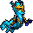

<!-- 本页上半部分由 tools/docs/gen_hero_docs.py 按仓库里现在的数据生成，手改会被覆盖；「开发记录」以下是手写的，生成时原样保留。 -->

# 敖兴 Ao Shin



| 项目 | 内容 |
|---|---|
| id | `tft_aoshin` |
| 所属的包 | tft 包（金铲铲之战系列，mod_id `tft`） |
| 分路 | 中单 |
| 分类 / 标签 | 法师（Magician） · AP / Magic / Range / CC |
| 高清帧 | PPU 2 |
| 附加包 | 无 |

其他预览：[skills](../preview/tft_aoshin_skills.gif)、[逐帧预览](../preview/tft_aoshin_frames.png)、[特效表](../preview/tft_aoshin_effects.png)

## 现在的技能

下面是游戏里显示的技能说明（`tft/text/champion.i18n` 的简体中文，去掉了颜色和图标），冷却、距离来自 `tft/champion/tft_aoshin.data_champion`；1 秒 = 60 tick。

### 普攻 / 被动

*攻击间隔 1.5 秒 · 攻击距离 55000*

吐出球状闪电，造成100% 攻击力物理伤害。风暴龙威：交战3秒后天雷劈中周围所有敌方英雄，造成12%最大生命真实伤害并眩晕0.83秒；随后自身法术强度+30%（6秒，每20秒一次）。

### 技能1 · 雷息

*冷却 4 秒 · 施放距离 60000 · 施放：指定目标 · 敌人（不含防御塔）*

喷出一道雷息，直线上的敌人受到80 + 50% 法强魔法伤害并被沉默0.67秒。

### 技能2 · 腾云

*冷却 8 秒 · 施放距离 42000 · 施放：指定目标 · 敌方英雄*

驾云飞离附近的敌方英雄，获得110 + 40% 法强的风暴护盾（3秒）。

### 大招 · 闪电暴雨

*冷却 50 秒 · 施放距离 70000 · 施放：指定目标 · 敌方英雄*

召来雷暴：12道闪电接连劈向周围随机的敌方英雄，每道造成55 + 32% 法强魔法伤害并沉默0.3秒。

### 数值

攻击力 80（每级 +6）、法强 40（每级 +20）、生命 920（每级 +96）、护甲 18（每级 +7）、魔抗 22（每级 +4）、移速 900（每级 +9）。

## 相关脚本和素材

- [`tools/kit/build_aoshin.py`](../../tools/kit/build_aoshin.py)
- [`tools/kit/setup_aoshin.py`](../../tools/kit/setup_aoshin.py)
- [`tools/lol/extract_aoshin.py`](../../tools/lol/extract_aoshin.py)
- [`tools/art/preview_aoshin.py`](../../tools/art/preview_aoshin.py)
- [`tools/art/rig_aoshin.py`](../../tools/art/rig_aoshin.py)
- [`assets/source/aoshin/`](../../assets/source/aoshin)

## 开发记录

| 部分 | 内容 |
|---|---|
| 定位 | tft 包（`tft_aoshin`）的第十二个英雄，中单（Magician，法师）。风暴龙神：青绿鳞片的蛇形长身竖直悬浮在空中，背上和尾巴上一路浅青尖刺鬃毛，尾巴尖拖着青色风雾；金面具、竖起的金棱、两只弯角、浅青胡子，金护肩、棕铜护腕、蓝紫龙爪。金铲铲第 7 赛季（巨龙之巢）的五费（`TFT7_AoShin`「敖兴」，风暴龙 / 龙神，法师，射程 4，生命 800，法力 0/160），技能「闪电暴雨」：20 道闪电劈向随机敌人，每道魔法伤害并抽掉 10 点法力；羁绊风暴龙：开战 8 秒后闪电劈中全场，按最大生命造成真实伤害并眩晕 1 秒，之后风暴龙增伤。用户选了**中路**和方案 A「风暴龙神」：大招照金铲铲，被动按风暴龙羁绊改成他自己的，普攻球状闪电、技能1 雷息、技能2 腾云是我们加的。tft 包第一个第 7 赛季的英雄。模型在 Riot 客户端的 `TFTSet7.wad.client`（`tft7_aoshin.skn`，104 根骨骼：没有骨盆，身体根部是 `Tail0`，脖子四节、尾巴十二节；十一段动作只有路径哈希，按内容命名） |
| 普攻 / 被动 | 吐出球状闪电（远程追踪，100% 攻击，打塔），从嘴的高度射出。**风暴龙威**：敌方英雄进入 70000 以内开始计时（离开不超过 2 秒不重置），满 3 秒时天雷劈中 85000 以内所有敌方英雄：12% 最大生命的真实伤害，眩晕 0.83 秒；随后他 6 秒内法强 ×1.3。每 20 秒一次。tft.dll 的被动做（数据只按动作运行，数不了一场交战的时长），天雷和电光挂成 buff 的画面（tft.dll 直接播的画面游戏里看不到，巴德的门的教训） |
| 技能1 | **雷息**（冷却 4 秒，距离 60000，小兵野怪也放）：从嘴里喷出一道闪电，穿过目标的一条直线（长 75000、宽 12000）上的敌人受到 80 + 50% 法强的魔法伤害并沉默 0.67 秒。金铲铲的抽法力在这里是沉默：引擎只能缩短冷却，不能拉长。伤害在闪电飞到目标时结算（直线出现后第 8 帧），画面是一道只用来显示的闪电弹道（直线自己的画面画在脚下而且不动） |
| 技能2 | **腾云**（冷却 8 秒，敌方英雄在 42000 以内时放）：驾云向后飞开 24000，获得 110 + 40% 法强的风暴护盾（3 秒） |
| 大招 | **闪电暴雨**（冷却 50 秒，敌方英雄在 70000 以内时放）：头顶召来雷云，0.4 秒后 12 道闪电每 0.1 秒一道，各劈向 75000 以内随机一个敌方英雄：55 + 32% 法强的魔法伤害，沉默 0.3 秒 |
| 数值 | 攻击 80（+6）、法强 40（+20）、生命 920（+96）、护甲 18（+7）、魔抗 22（+4）、移速 900（+9），攻击间隔 1.5 秒，射程 55000（和其他中单一样） |
| 平衡 | 经典引擎模拟（中路，对火、冰、雷、风、白法师，两边三套阵容，纯数据版：天雷挂在雷息上，雷息放出时有敌方英雄在附近就开始计时）：草稿 −2.96（同一批 tft_alune +1.20、league_ziggs +1.38）；雷息 55 + 45%、大招 45 + 28% 后 −2.07；生命 920、腾云 110 每 8 秒、天雷 12% 每 20 秒 +30% 后 −1.95；雷息每 4 秒 60 + 50% 后 −0.34；大招 12 × 55 + 32%、攻击 80 后 +1.40 / +1.14（种子 1–8 / 9–16）；雷息的画面改成只显示的闪电 +1.31 / +1.34。帧做好以后伤害改在闪电飞到目标时结算（立即结算 +0.97 / +1.43 / +1.52，种子 1–24），弱了约 0.4，雷息 60 → 80 补回，**定稿** +0.64 / +1.23 / +1.17（平均 +1.01；tft_alune +1.20 / +1.19）。tft.dll 里真正按时长计的天雷没有进模拟 |
| tft.dll | 数据做不到的部分在 tft 包自己的代码里（[`addons/tft/src/aoshin.rs`](../../addons/tft/src/aoshin.rs)，和石甲虫、蔚奥莱、范德尔、可酷伯、洛里斯、麦迪、希尔科、拉露恩、诺拉一起编成 `tft.dll`）：被动 `tft_aoshin:storm`，每次劈下写一行 `STORM` 到 `%APPDATA%/TeamSamoyed/TeamfightManager2/data/tft_aoshin.log`。`build_aoshin.py` 每次核对代码的默认参数和数据一致 |
| 塞拉斯 / 佛耶戈 / 妮蔻 / 俄洛伊 / 悠米 | 他的大招是纯数据，塞拉斯直接偷到（特效表复制进附加包；`sylas_steal_check.py` 模拟里落雷出现 80 次）。佛耶戈 / 妮蔻的表（法师类）、俄洛伊的幽灵图和悠米骑上去的高度都加上了他 |
| 精灵图（高清帧 PPU 2.0） | Codex 第 0 步画了 A（金铲铲的竖直悬浮待机）和 B（前扑），格子约 10.5 px，按它自己的格子读回；B 横着太长，用户定 **A-1、高 38、PPU 2.0**（[`tools/art/design_aoshin_model.py`](../../tools/art/design_aoshin_model.py)：74×76）。姿势包的骨架是他自己的动作按帧投影出来的（[`tools/art/pack_aoshin_poses.py`](../../tools/art/pack_aoshin_poses.py)：脖子、尾巴、两只爪、两条短后腿），Codex 画了 15 个姿势，这次守住了 12 px 格子和定稿的颜色、高度和参考一致，[`tools/art/design_aoshin_poses.py`](../../tools/art/design_aoshin_poses.py) 一格一格读回；[`tools/art/rig_aoshin.py`](../../tools/art/rig_aoshin.py) 按身体根部的列对齐（姿势包为了不出画布挪过的几帧挪回去），拼成飞行（四帧波浪起伏）、普攻（缩身 → 前扑吐雷球 → 收势）、技能1（仰头蓄力 → 伸颈喷雷 → 收势）、技能2（收势 → 后仰飞起）、大招（举爪 → 张臂召雷）、受击、阵亡（被击中挺起 → 仰面翻过去 → 转身垂落） |
| 特效 | 11 张 + 3 个技能图标，Codex 画的（[`tools/art/pack_aoshin_fx.py`](../../tools/art/pack_aoshin_fx.py) 的提示词，参考是第 7 赛季敖兴自己的球状闪电、闪电形状和风暴符印贴图，加上沃利贝尔的雷云 [`tools/lol/fx_ref_aoshin.py`](../../tools/lol/fx_ref_aoshin.py)）。八张直接用 Codex 的游戏尺寸；风暴护盾和天雷后的电光被它压成了方框、沉默的电火花只剩几个白点，[`tools/art/clean_aoshin_fx.py`](../../tools/art/clean_aoshin_fx.py) 从原稿重新缩成游戏格子（弯曲的风云带、两道往上窜的闪电和地面光环、头顶一圈锯齿电火花）。[`tools/art/import_aoshin_fx.py`](../../tools/art/import_aoshin_fx.py) 切成 `tft_aoshin_fx` / `tft_aoshin_big`；雷球和雷息的画面沿飞行方向往前画，从嘴开始 |
| 音效 | 第 7 赛季没有音效包。峡谷的云端亚龙（攻击、击中、吼声、起飞、叫声），雷息、眩晕（风暴之印）和落雷的击中借凯南，雷云和落雷借沃利贝尔，风暴护盾借迦娜（风暴之眼）（[`tools/lol/extract_aoshin.py`](../../tools/lol/extract_aoshin.py)，14 段，用到 13 段） |
| 选人卡片 | 角尖到尾巴最低处 38 游戏像素：`banpick_center` −11，不另设缩放。脸 (4, −27)（金面具下两眼之间）。待机按 `tools/art/hero_reels.py` 停在定稿帧（他的动作都比待机宽，没有剪进小动作），卡片轮播技能1、技能2、大招、普攻 |

重新生成（素材来自本机的金铲铲客户端，音频和 Riot 的渲染不进仓库）：

```bash
python tools/lol/extract_aoshin.py --riot "D:\Riot Games\League of Legends" --vgmstream <vgmstream-cli.exe>
python tools/kit/build_aoshin.py                  # 技能数据（被动调用 tft.dll），数字都在脚本的参数表 P 里；--plain 是平衡模拟用的纯数据
python tools/kit/setup_aoshin.py                  # 五种语言的文字、音效配置、tft 包共享文件里他的键
python tools/art/design_aoshin_hd.py              # Codex 第 0 步的原图读回
python tools/art/design_aoshin_model.py           # 定稿 A-1 缩到 76 行
python tools/art/design_aoshin_poses.py           # Codex 的姿势（一格一格读回）
python tools/art/clean_aoshin_fx.py               # Codex 的特效：三张从原稿重新缩
python tools/art/import_aoshin_fx.py              # 特效 -> tft_aoshin_fx / tft_aoshin_big，图标
python tools/art/rig_aoshin.py                    # 1 倍帧和 2.0 的原帧
python tools/art/ppu_restyle.py --hero aoshin     # 外描边
python tools/art/ppu_hd.py --hero aoshin          # hd_ / lo_ 帧（要在 hero_reels 之前）
python tools/art/hero_reels.py --hero aoshin      # 待机和选人卡片的小动作
python tools/art/preview_aoshin.py                # 预览和每个技能单独的 GIF
python tools/art/review_aoshin_actions.py --out <文件夹> --sheet   # 和金铲铲原版逐个动作对照的 GIF
python addons/league_sylas/make_override.py       # 塞拉斯偷到的闪电暴雨
cargo test --manifest-path addons/Cargo.toml -p tft   # tft.dll 的单元测试
```
