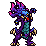

<!-- 本页上半部分由 tools/docs/gen_hero_docs.py 按仓库里现在的数据生成，手改会被覆盖；「开发记录」以下是手写的，生成时原样保留。 -->

# 纳什男爵 Baron Nashor

| 项目 | 内容 |
|---|---|
| id | `tft_baronnashor` |
| 所属的包 | tft 包（金铲铲之战系列，mod_id `tft`） |
| 分路 | 打野 |
| 分类 / 标签 | 近战（Melee） · AD / Melee / Tank / CC |
| 高清帧 | PPU 2.04 |
| 附加包 | 无 |

其他预览：[skills](../preview/tft_baronnashor_skills.gif)

## 现在的技能

下面是游戏里显示的技能说明（`tft/text/champion.i18n` 的简体中文，去掉了颜色和图标），冷却、距离来自 `tft/champion/tft_baronnashor.data_champion`；1 秒 = 60 tick。

### 普攻 / 被动

*攻击间隔 1.33 秒 · 攻击距离 32000*

撕咬目标，并对从自己穿过目标的一条直线上的敌人造成20% 攻击力物理伤害。虚空裂隙：战斗中每6秒，在附近随机一名敌方英雄脚下喷出触手，造成40 + 60% 攻击力物理伤害并击飞0.75秒。

### 技能1 · 腐蚀吐息

*冷却 7 秒 · 施放距离 40000 · 施放：指定目标 · 敌人（不含防御塔）*

向前方喷出扇形酸液，造成40 + 70% 攻击力物理伤害，并使敌人护甲和魔抗降低20%（4秒）。

### 技能2 · 钻地突袭

*冷却 12 秒 · 施放距离 75000 · 施放：指定目标 · 敌人（不含防御塔）*

钻入地下冲向目标（期间免疫控制），破土而出，对周围敌人造成50 + 80% 攻击力物理伤害并击飞0.75秒。

### 大招 · 虚空之怒

*冷却 50 秒 · 施放距离 40000 · 施放：指定目标 · 敌方英雄*

施放期间免疫控制。猛击地面竖起尖刺，对周围敌人造成100 + 120% 攻击力物理伤害；随后连续吐出10团酸液，落在附近随机敌人身上，每团造成15 + 30% 攻击力物理伤害并腐蚀护甲和魔抗。

### 数值

攻击力 82（每级 +15）、生命 1200（每级 +115）、护甲 40（每级 +8）、魔抗 34（每级 +6）、移速 1000（每级 +10）。

## 相关脚本和素材

- [`tools/kit/build_baronnashor.py`](../../tools/kit/build_baronnashor.py)
- [`tools/kit/setup_baronnashor.py`](../../tools/kit/setup_baronnashor.py)
- [`tools/lol/extract_baronnashor.py`](../../tools/lol/extract_baronnashor.py)
- [`tools/art/preview_baronnashor.py`](../../tools/art/preview_baronnashor.py)
- [`tools/art/rig_baronnashor.py`](../../tools/art/rig_baronnashor.py)
- [`assets/source/baronnashor/`](../../assets/source/baronnashor)

## 开发记录

| 部分 | 内容 |
|---|---|
| 定位 | tft 包（`tft_baronnashor`）的英雄，打野（近战，虚空巨兽，物理伤害，击飞，腐蚀护甲魔抗）。金铲铲第 16 赛季的五费 `TFT16_BaronNashor`「纳什男爵」（虚空 / 纳什男爵，占两个队伍栏位，繁中「巴龍納什」，英文 Baron Nashor，射程 2，原技能「虚空之怒」）：从地里立起来的 S 形虚空巨蛇，紫色鳞甲、正面一整条青绿分节腹甲，蓝紫硬甲头、黄眼红嘴白獠牙，洋红鳍尖的头冠，两侧两只小蛇头，底部两只象牙白大弯爪。金铲铲的模型没有腿，用户让 Codex 加了两条短腿（「画个腿，不然怎么看出来走动」）。技能是我们按金铲铲第 16 赛季的原技能、它的虚空裂隙和英雄联盟大龙的酸液自己设计的，用户 2026-11-03 定为打野（「方案A 打野」） |
| 普攻 / 被动 | **腐蚀撕咬**（距离 32000，打塔）：第 24 tick 咬下，目标受 100% 攻击力，再从自己穿过目标的一条线（70000 长、12000 宽，不打塔）上每个敌人受 20% 攻击力（目标也算在内）。**虚空裂隙**（tft.dll）：60000 以内有敌方英雄就算进入战斗，进入战斗 2 秒后、之后每 6 秒，在这个范围里随机一名敌方英雄脚下喷出触手：40 + 60% 攻击力物理伤害、击飞 0.75 秒（纯数据版：每次放技能1带一条触手） |
| 技能1 | **腐蚀吐息**（冷却 7 秒，距离 40000，打兵和野怪）：第 18 tick 从嘴里喷出一股酸液（只有画面的直线弹道，跟着方向转，红方不会反），前方扇形（46000，两边各约 53°）的敌人受 40 + 70% 攻击力，护甲和魔抗 -20% 4 秒 |
| 技能2 | **钻地突袭**（冷却 12 秒，距离 75000，打兵和野怪）：蹲下钻地（免疫控制直到冒出来），只露头冠鳍刺在地下游到目标（`MoveToTarget`，每 tick 3500），破土而出：30000 以内的敌人受 50 + 80% 攻击力并击飞 0.75 秒（金铲铲「距离内没有敌人就钻地冲向下一个目标，到达时击飞邻格敌人」） |
| 大招 | **虚空之怒**（金铲铲原技能，冷却 50 秒，距离 40000，打英雄）：整个施放 3.6 秒免疫控制（金铲铲「免疫控制」）；先高高立起，第 30 tick 猛砸地面，45000 以内一圈尖刺：100 + 120% 攻击力；然后每 18 tick 吐一团酸液，共 10 团，落在 60000 以内随机的敌人身上，每团 15 + 30% 攻击力并附带技能1 的腐蚀。塞拉斯偷到的就是它（不用 tft.dll） |
| 数值 | 攻击 82（+15）、生命 1200（+115）、护甲 40（+8）、魔抗 34（+6）、移速 1000（+10），攻击间隔 80 tick，距离 32000 |
| 平衡 | 经典引擎模拟（打野，纯数据版：每次技能1带一条触手）：初稿（攻击 90，技能1 90%，技能2 100%，大招 150%，直线 30%）+4.06，太强；v2（攻击 82，技能1 70%，技能2 80%，大招 120%，直线 20%）种子 1–8 +2.11、9–16 +2.23；v3 +0.95；v4 +1.86。定 v2，和绯红印记树怪（+2.15 / +1.34）、远古石甲虫（+2.06 / +1.89）同一档。真正的触手只在游戏里有 |
| tft.dll | [`addons/tft/src/baronnashor.rs`](../../addons/tft/src/baronnashor.rs)：被动 `tft_baronnashor:rift`（看身边有没有敌方英雄算进出战斗，按时挑一个喷触手：伤害、击飞、`p_tent` 特效和音效；倒下时播沉入虚空的声音）。日志 `data/tft_baronnashor.log`（SPAWN / TENTACLE / DEAD） |
| 塞拉斯 / 佛耶戈 / 俄洛伊 / 悠米 | 塞拉斯偷到的「虚空之怒」原样（纯数据），按近战类；佛耶戈的灵魂（近战）、妮蔻、俄洛伊的灵魂、悠米坐在它头上的高度 34 |
| 精灵图（高清帧 PPU 2.04） | 参考是金铲铲客户端 TFTSet16 里它的模型（`tft16_baronnashor_16`，103 个关节：S 形脊柱、两只小头 L/R_MiniBaron、两只大爪 L/R_LargeArm）和它的 13 段动作（待机、咬、大招砸地吐酸、钻地、地下游走、破土、出场、倒下）。第 0 步 Codex 画了 A（待机）和 B（大招前立起），用户让它加了腿；用户选 A-1（按 Codex 自己 11 px 的格子读回，58×94）46 像素高、PPU 2.04（94 行，1:1） |
| 动作 | 身体照它自己的动作，腿借同赛季海克斯霸龙的两条腿（[`tools/art/pack_baronnashor_poses.py`](../../tools/art/pack_baronnashor_poses.py)，两个模型在定稿第 70 行的屁股处接上）。[`design_baronnashor_poses.py`](../../tools/art/design_baronnashor_poses.py)：Codex 的姿势每张格子 8–13 px，按蓝头和身体面积读回到定稿大小，贴回定稿的头和黄眼睛（嘴不贴：随动作开合）；倒地那张按其他动作的比例校正。**跑步重画过一次**：海克斯霸龙自己的跑步在这个角度同一只脚一直在前，第一版跑步两条腿从不换；[`pack_baronnashor_run.py`](../../tools/art/pack_baronnashor_run.py) 改成两条腿都走海克斯霸龙同一条腿的步子、近侧晚半个循环（第 1、5 帧换腿，第 2–4 帧远侧腿在前，第 6–8 帧近侧腿在前），Codex 重画；读回时八帧共用一个大小（和待机一样高），近侧腿压暗一档到待机腿的颜色，第 5 帧那只脚画低了 4 行就剪短小腿，整圈头只上下 2 行。[`rig_baronnashor.py`](../../tools/art/rig_baronnashor.py)：普攻后仰再咬；技能1 后仰再喷；技能2 蹲下、`dig`（地下只露鳍刺，左右晃一格）、`rise`（破土）；大招立起、猛砸、吐酸时一前一后晃十次 |
| 特效 | 用户给的一张 Gemini 图（10 张特效、3 个图标）由 [`tools/art/process_baronnashor_fx.py`](../../tools/art/process_baronnashor_fx.py) 处理：棋盘格是画出来的不是透明，按跟画面边缘相连的浅灰抠掉（盆地中间的奶白光保留）；多数特效只画了一两张，缺的帧按颜色和裁切补（尖刺从下往上露出来、酸液球三个高度落下、咬合的上下两排牙合拢）；被腐蚀那张中间的灰色人形占位删掉，只留身体两侧往下滴的酸；被击飞那张用右半边加镜像；触手每帧统一往一边弯、不做左右对称（长在敌人脚下，没有朝向）；其余左右对称，喷出的酸液上下对称、朝右。金铲铲里它的酸液是紫色的，所以酸液都是紫色 |
| 音效 | [`tools/lol/extract_baronnashor.py`](../../tools/lol/extract_baronnashor.py) 的 14 段：金铲铲第 16 赛季它自己的撕咬、钻地、破土、破土撞击、尖刺猛砸、酸液弹；召唤师峡谷大龙自己的击飞触手、吐酸、吐息、酸液落地、出场咆哮、沉入虚空（阵亡：客户端里没有命名的死亡音效） |
| 选人卡片 | 46 游戏像素高；卡片动图轮流放技能1、技能2、大招、普攻，待机停在站姿（它的动作都比待机高，没有能插进待机的小动作）；图鉴中心按英雄联盟的规则（−19），选人卡片 −4 |
