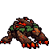

<!-- 本页上半部分由 tools/docs/gen_hero_docs.py 按仓库里现在的数据生成，手改会被覆盖；「开发记录」以下是手写的，生成时原样保留。 -->

# 绯红印记树怪 Brambleback



| 项目 | 内容 |
|---|---|
| id | `tft_brambleback` |
| 所属的包 | tft 包（金铲铲之战系列，mod_id `tft`） |
| 分路 | 打野 |
| 分类 / 标签 | 近战（Melee） · AD / Melee / Dot / Heal |
| 高清帧 | PPU 1.7 |
| 附加包 | 无 |

其他预览：[skills](../preview/tft_brambleback_skills.gif)、[逐帧预览](../preview/tft_brambleback_frames.png)、[特效表](../preview/tft_brambleback_effects.png)

## 现在的技能

下面是游戏里显示的技能说明（`tft/text/champion.i18n` 的简体中文，去掉了颜色和图标），冷却、距离来自 `tft/champion/tft_brambleback.data_champion`；1 秒 = 60 tick。

### 普攻 / 被动

*攻击间隔 1.1 秒 · 攻击距离 25000*

大爪横扫，造成100% 攻击力物理伤害。红霸符：普攻灼烧目标3秒（每秒1.2% 最大生命真实伤害），回复1.5%生命；击杀后扑向下一个敌人，造成60 + 120% 攻击力物理伤害。

### 技能1 · 荆棘飞扑

*冷却 7 秒 · 施放距离 55000 · 施放：指定目标 · 敌人（不含防御塔）*

跃起扑向目标，造成60 + 150% 攻击力物理伤害并减速30%（1秒）。

### 技能2 · 绯红咆哮

*冷却 10 秒 · 施放距离 30000 · 施放：指定目标 · 敌人（不含防御塔）*

人立怒吼：周围敌人减速30%、攻击力降低20%，自己受到的伤害降低25%，持续3秒。

### 大招 · 猩红之怒

*冷却 50 秒 · 施放距离 40000 · 施放：指定目标 · 敌方英雄*

狂暴6秒：攻击力+55%、攻速+35%，无视目标40%护甲。

### 数值

攻击力 92（每级 +16）、生命 1100（每级 +108）、护甲 34（每级 +8）、魔抗 28（每级 +6）、移速 1040（每级 +10）。

## 相关脚本和素材

- [`tools/kit/build_brambleback.py`](../../tools/kit/build_brambleback.py)
- [`tools/kit/setup_brambleback.py`](../../tools/kit/setup_brambleback.py)
- [`tools/lol/extract_brambleback.py`](../../tools/lol/extract_brambleback.py)
- [`tools/art/preview_brambleback.py`](../../tools/art/preview_brambleback.py)
- [`tools/art/rig_brambleback.py`](../../tools/art/rig_brambleback.py)
- [`assets/source/brambleback/`](../../assets/source/brambleback)

## 开发记录

| 部分 | 内容 |
|---|---|
| 定位 | tft 包（`tft_brambleback`）的英雄，打野（狂战士，物理伤害）。金铲铲第 18 赛季的四费 `DA_Brambleback18`「绯红印记树怪」（峡谷野怪 / 狂战士，繁中「樹精長老」）：峡谷红 Buff 的树皮野兽，像大猩猩一样四肢着地，深红褐的树皮甲片上有发光的红纹，两条长前臂、三根红橙大爪，脖子上一圈绿叶，背上弯曲的树枝中间透出红核，楔子形的脑袋压在叶子下面，两只红眼、额头一个橙色螺旋。金铲铲原技能「猩红之怒」做大招，原版被动「目标阵亡扑向下一个」和「红霸符」（普攻灼烧、回血）做被动，其余按用户选的方案 A「猩红之怒」（2026-10-31）自己设计 |
| 普攻 / 被动 | **荆爪横扫**（射程 25000，打塔）：用后腿立起、一只大爪举高，第 16 tick 往前往下扫，100% 攻击力。**红霸符**（tft.dll）：每下普攻回复自己最大生命的 1.5%；打的不是塔就让目标灼烧 3 秒，每 0.5 秒一次目标最大生命 0.6% 的真实伤害（一次最多 40，大龙、先锋不至于被烧穿），再打一下只续时间、不叠两份。**扑向下一个**（金铲铲原被动，tft.dll）：它杀了英雄（或清野时杀了野怪）就扑向 60000 以内最近的敌方英雄（没有英雄、杀的是野怪时扑向最近的野怪；杀小兵不扑），每 tick 跳 4000，落地 60 + 120% 攻击力物理伤害，1 秒一次 |
| 技能1 | **荆棘飞扑**（冷却 7 秒，距离 55000，打兵和野怪）：跃起扑到目标身上（`MoveToTarget` 3500），落地 60 + 150% 攻击力物理伤害，被荆棘缠住减速 30%（1 秒） |
| 技能2 | **绯红咆哮**（冷却 10 秒，距离 30000）：第 14 tick 人立怒吼：34000 以内的敌人减速 30%、攻击力降低 20%，自己受到的伤害降低 25%（树皮护体），都是 3 秒 |
| 大招 | **猩红之怒**（金铲铲原技能，冷却 50 秒，距离 40000，有敌方英雄时）：第 12 tick 全身红纹烧起来，6 秒内攻击力 +55%、攻速 +35%、无视目标 40% 护甲（`defence_penetration`） |
| 数值 | 攻击 92（+16）、生命 1100（+108）、护甲 34（+8）、魔抗 28（+6）、移速 1040（+10），攻击间隔 66 tick（1.1 秒），射程 25000 |
| 平衡 | 经典引擎模拟（打野，对原版忍者、恶魔、猎人、狼人、吸血鬼，两边三套阵容，纯数据版：灼烧换成 `AddCasted` 火焰（塔也烧）、回血换成固定 20，扑向下一个没有）：草稿（攻击 88、Q 60 + 130%、大招 +45%）+1.48；攻击 92、Q 150%、大招 +55%：**+2.15 / +1.34**（种子 1–8 / 9–16）；再加（攻击 95、Q 155%、咆哮减伤 30%）+1.72 / +1.73，和前一档差在误差（±0.47）以内，没采用。克鲁格纯数据同种子 +2.06 / +1.89、蓝 Buff +2.20 / +3.00：模拟里略低，游戏里另有 tft.dll 的击杀后扑向下一个 |
| tft.dll | [`addons/tft/src/brambleback.rs`](../../addons/tft/src/brambleback.rs)：原生效果 `tft_brambleback:red`（普攻命中时回血、给不是塔的目标挂灼烧）、`tft_brambleback:burn`（每次命中排好的灼烧 tick，按周期去重，一个周期只烧一次）、`tft_brambleback:hop`（扑击一 tick 一 tick 地跳）；被动 `tft_brambleback:fury`（`on_kill` / `on_unit_kill` 触发扑向下一个，扑的时候放 Q 的跃起动画，死亡时播倒地声）。日志 `data/tft_brambleback.log`（SPAWN / BURN / BURN TICK / LEAP / LAND） |
| 塞拉斯 / 佛耶戈 / 妮蔻 / 俄洛伊 / 悠米 | 塞拉斯偷到的猩红之怒是它自己的纯数据大招（特效表复制进附加包）；佛耶戈 / 妮蔻的表（近战）、俄洛伊的灵魂、悠米坐骑的头顶高度 28 |
| 精灵图（高清帧 PPU 1.7） | 参考是金铲铲客户端 TFTSet18 里它自己的模型（`tft18_brambleback`，69 个关节，一张贴图；动作片段按路径哈希连着：待机、四肢奔跑、单爪横扫、人立双爪砸、跃起落地、死亡、人立挺胸）。第 0 步 Codex 画了 A（3/4）和 B（侧面），它自己按 11 px 整理的版本把脸糊掉了，只读原稿：A 6 px 一格（201×132）、B 7 px（131×74）。用户选 **A、40 游戏像素、PPU 1.7**：A 缩到 68 行（104×68），远处那只眼睛和额头螺旋逐格重画。第 2 步 Codex 照它自己的动作片段画了 19 个姿势（骨架包 [`tools/art/pack_brambleback_poses.py`](../../tools/art/pack_brambleback_poses.py)：头放大 1.4 倍；8 帧跑按爪子和脚尖的高度量出金铲铲 1.07 秒的完整一圈） |
| 动作 | [`tools/art/design_brambleback_poses.py`](../../tools/art/design_brambleback_poses.py)：Codex 每张都画大了约 1.3 倍，按定稿的体型读回（原稿 10.2 px 一格，run7 画小了用 8.6），每格取原稿那一格最多的定稿颜色；贴定稿的脸：爪子和红纹的颜色和眼睛一样，头的位置逐帧手标，倒地那张不贴（Codex 已经把眼睛和红核画灭了）。[`tools/art/rig_brambleback.py`](../../tools/art/rig_brambleback.py)：普攻举爪 + 横扫；荆棘飞扑跃起（离地 14 格）+ 扑到最高 + 落地；绯红咆哮蓄力 + 人立吼；猩红之怒双爪举高 + 砸地；死亡人立 + 趴倒；跑 8 帧每帧 133 ms，前爪交替撑地 |
| 特效 | 9 张 + 3 个技能图标，Codex 画（[`tools/art/pack_brambleback_fx.py`](../../tools/art/pack_brambleback_fx.py) 的提示词，参考是红 Buff 自己、狼人、布兰德、内瑟斯的粒子贴图 [`tools/lol/fx_ref_brambleback.py`](../../tools/lol/fx_ref_brambleback.py)：猩红火焰、红色爪痕、树皮和荆棘、绿叶）。[`tools/art/import_brambleback_fx.py`](../../tools/art/import_brambleback_fx.py)：普攻爪痕从 4×1 的原稿重新切（Codex 的只有 8 行高）；3 个图标从 1254 像素的原稿重新缩到 64；全部左右对称 |
| 音效 | 普攻挥爪、命中、两种吼声和死亡是它自己的（峡谷红 Buff 野怪的音效包 `npc_map11_red_sfx_`）；灼烧借布兰德的普攻命中，飞扑借狼人的 Q，扑向下一个借雷恩加尔的 Q，护体借狼人的 E，减速借内瑟斯的 W，大招借内瑟斯的 R 和布兰德的 W（[`tools/lol/extract_brambleback.py`](../../tools/lol/extract_brambleback.py)，13 个） |
| 选人卡片 | 背上树枝到爪子 40 游戏像素：`banpick_center` (0, −10)，脸 (15, −22)（两眼之间），中心 (0, −20)。待机按 `tools/art/hero_reels.py` 剪进绯红咆哮的第一帧，卡片轮播普攻、荆棘飞扑、绯红咆哮、猩红之怒 |

重新生成（素材来自本机的英雄联盟 / 金铲铲客户端，音频和 Riot 的渲染不进仓库）：

```bash
python tools/lol/extract_brambleback.py --riot "D:\Riot Games\League of Legends" --vgmstream <vgmstream-cli.exe>
python tools/kit/build_brambleback.py                     # 技能数据（被动调用 tft.dll），数字都在脚本的参数表 P 里；--plain 是平衡模拟用的纯数据
python tools/kit/setup_brambleback.py                     # 五种语言的文字、音效配置、tft 包共享文件里它的键
python tools/art/design_brambleback_hd.py                 # Codex 第 0 步的原稿读回
python tools/art/design_brambleback_model.py              # 定稿 A（104×68，脸修过）
python tools/art/design_brambleback_poses.py              # Codex 的姿势：按定稿的体型从原稿读回、换成定稿的颜色、贴定稿的脸
python tools/art/import_brambleback_fx.py                 # 特效 -> tft_brambleback_fx / tft_brambleback_big，图标
python tools/art/rig_brambleback.py                       # 1 倍帧和 1.7 的原帧
python tools/art/ppu_restyle.py --hero brambleback        # 外描边
python tools/art/ppu_hd.py --hero brambleback             # hd_ / lo_ 帧（要在 hero_reels 之前）
python tools/art/hero_reels.py --hero tft_brambleback     # 待机和选人卡片的小动作（之后再跑佛耶戈的 make_override）
python tools/art/preview_brambleback.py                   # 预览和每个技能单独的 GIF
python tools/art/review_brambleback_actions.py --out <文件夹> --sheet   # 和金铲铲原版逐个动作对照的 GIF
cargo test --manifest-path addons/Cargo.toml -p tft       # tft.dll 的单元测试
```
