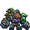

<!-- 本页上半部分由 tools/docs/gen_hero_docs.py 按仓库里现在的数据生成，手改会被覆盖；「开发记录」以下是手写的，生成时原样保留。 -->

# 岩宝 Brock

| 项目 | 内容 |
|---|---|
| id | `tft_brock` |
| 所属的包 | tft 包（金铲铲之战系列，mod_id `tft`） |
| 分路 | 上单 |
| 分类 / 标签 | 近战（Melee） · AD / Melee / Tank / CC / Shield |
| 高清帧 | PPU 1.16 |
| 附加包 | 无 |

其他预览：[skills](../preview/tft_brock_skills.gif)、[逐帧预览](../preview/tft_brock_frames.png)、[特效表](../preview/tft_brock_effects.png)

## 现在的技能

下面是游戏里显示的技能说明（`tft/text/champion.i18n` 的简体中文，去掉了颜色和图标），冷却、距离来自 `tft/champion/tft_brock.data_champion`；1 秒 = 60 tick。

### 普攻 / 被动

*攻击间隔 1.3 秒 · 攻击距离 27000*

双拳砸下，造成100% 攻击力物理伤害，目标周围敌人受25% 攻击力溅射；每第三下击飞目标0.33秒。岩心不动：免疫控制。

### 技能1 · 巨岩投掷

*冷却 10 秒 · 施放距离 50000 · 施放：指定目标 · 敌人（不含防御塔）*

抡起大石头砸向目标，造成30 + 80% 攻击力 + 2%最大生命物理伤害，减速30%（1.5秒）。

### 技能2 · 苔藤缠握

*冷却 13 秒 · 施放距离 40000 · 施放：指定目标 · 敌人（不含防御塔）*

树根从目标脚下钻出，造成20 + 30% 攻击力物理伤害并定身0.83秒；自己获得60 + 50% 攻击力护盾（3秒）。

### 大招 · 震地猛击

*冷却 50 秒 · 施放距离 60000 · 施放：指定目标 · 敌方英雄*

跃起砸向敌方英雄：周围敌人受到90 + 80% 攻击力 + 3%最大生命物理伤害，每远一格-15%（最低40%），本场第一次被砸中的击飞1.25秒；随后落下6块碎石。

### 数值

攻击力 72（每级 +12）、法强 20（每级 +8）、生命 1200（每级 +115）、护甲 38（每级 +8）、魔抗 30（每级 +6）、移速 940（每级 +10）。

## 相关脚本和素材

- [`tools/kit/build_brock.py`](../../tools/kit/build_brock.py)
- [`tools/kit/setup_brock.py`](../../tools/kit/setup_brock.py)
- [`tools/lol/extract_brock.py`](../../tools/lol/extract_brock.py)
- [`tools/art/preview_brock.py`](../../tools/art/preview_brock.py)
- [`tools/art/rig_brock.py`](../../tools/art/rig_brock.py)
- [`assets/source/brock/`](../../assets/source/brock)

## 开发记录

| 部分 | 内容 |
|---|---|
| 定位 | tft 包（`tft_brock`）的英雄，上单（近战，物理伤害，免控，范围击飞）。金铲铲第 16 赛季的五费 `TFT16_Brock`「岩宝」（以绪塔尔，繁中「布洛克」，英文 Brock，射程 1）：深青灰色的大块头岩石魔像，两只巨大的石拳，缠满棕色树根，肩上长着小盆景树，小头缩在两肩之间（灰蓝石兜帽、发光的橙色脸板、两只黄色圆环眼睛），胸口紫色三角水晶纹章。金铲铲原技能「震地猛击」的被动（免疫控制、攻击溅射击飞）做被动和普攻、主动做大招；其余按用户选的方案 A「震地猛击」（2026-11-02，上单）自己设计 |
| 普攻 / 被动 | **岩心不动**（tft.dll）：每条命一开始挂上永久的 `tft_brock_p_stone`，免疫控制（纯数据版从他的第一个动作挂上）。**震地拳**（距离 27000，打塔）：第 20 tick 双拳砸下，100% 攻击力；身前 22000 处半径 18000 以内的敌人（不含塔）再受 25% 攻击力溅射；每第三下把目标击飞 0.33 秒（隐藏计数 `a_n1` / `a_n2`） |
| 技能1 | **巨岩投掷**（冷却 10 秒，距离 50000，打兵和野怪）：第 18 tick 抡起大石头扔向目标（追踪弹，每 tick 3000），30 + 80% 攻击力 + 2% 他的最大生命物理伤害，减速 30% 1.5 秒 |
| 技能2 | **苔藤缠握**（冷却 13 秒，距离 40000，打兵和野怪）：第 16 tick 树根从目标脚下钻出，20 + 30% 攻击力物理伤害、定身 0.83 秒；自己获得 60 + 50% 攻击力的护盾 3 秒（苔石护壳的画面） |
| 大招 | **震地猛击**（金铲铲原技能，冷却 50 秒，距离 60000，打英雄）：蹲下起跳，起跳到落地不可选中、免控；第 22 tick 起看不见，第 47 tick 移到目标身上，第 54 tick 落地：50000 以内的敌人（不含塔）受 90 + 80% 攻击力 + 3% 他的最大生命物理伤害，离落点每格（18000）少 15%、最少 40%；60 秒内第一次被砸中的击飞 1.25 秒（tft.dll `tft_brock:slam`，目标身上的 `tft_brock_r_mark`）；随后 6 块碎石每 8 tick 落在 60000 以内随机的敌人身上，各 25 + 30% 攻击力。纯数据版（塞拉斯偷到的也是）是三圈伤害相加（外圈 40%），每圈都击飞 |
| 数值 | 攻击 72（+12）、法强 20（+8）、生命 1200（+115）、护甲 38（+8）、魔抗 30（+6）、移速 940（+10），攻击间隔 78 tick，距离 27000 |
| 平衡 | 经典引擎模拟（上单，对原版斗士、处刑人、骑士、狂战士、枪骑士、长柄战士，两边三套阵容，纯数据版：免控从第一个动作起、大招三圈都击飞）：初稿（攻击 82，技能1 每 8 秒、技能2 定身 1.25 秒、大招 120 + 110% + 5%）+6.83，伤害 14800，太强（永久免控很值钱）；削弱 +4.92；**v3 +1.60 / +1.09（种子 1–8 / 9–16）**，泰拉同条件 +0.94 / +1.37，五费和泰拉持平 |
| tft.dll | [`addons/tft/src/brock.rs`](../../addons/tft/src/brock.rs)：被动 `tft_brock:stone`（岩心不动：每条命挂免控；倒下时的碎裂声）和大招落地 `tft_brock:slam`（按距离衰减的伤害、本场第一次的击飞）。日志 `data/tft_brock.log`（SPAWN / STONE / SLAM / DEAD） |
| 塞拉斯 / 佛耶戈 / 俄洛伊 / 悠米 | 塞拉斯偷到的「震地猛击」是纯数据版（三圈伤害、都击飞、落石；大招不调 tft.dll），按近战类；佛耶戈的灵魂（近战）、妮蔻、俄洛伊的灵魂、悠米坐在他头上的高度 31 |
| 精灵图（高清帧 PPU 1.16） | 参考是金铲铲客户端 TFTSet16 里他的模型（`TFT16_Brock_16`，57 个关节的人形骨架，借用了极地大乱斗石像的网格）和 8 段动作（待机、弓身跑、双拳过顶砸地、左右勾拳、跳起砸地、坐下、扑倒）。第 0 步 Codex 画了 A（待机 3/4）和 B（双拳举过头顶），它自己缩的 64×50 把脸糊成一团；原图是 14 px 一格，读回 69×51，两只圆环眼画在半格上读糊了，重画成 3×3 的圆环（[`tools/art/design_brock_hd.py`](../../tools/art/design_brock_hd.py)）。用户选 **A-1**、44 游戏像素，按 1:1 定成 **PPU 1.16**。第 2 步的姿势包是他自己动作的骨架投影（[`tools/art/pack_brock_poses.py`](../../tools/art/pack_brock_poses.py)，灰框 = 定稿的头跟着 Head 关节走），Codex 照着画了 20 个姿势 |
| 动作 | [`tools/art/design_brock_poses.py`](../../tools/art/design_brock_poses.py)：Codex 每张大小不一（12–16 px 一格），每张按胸口紫色纹章和整体面积读回到定稿大小，脸贴回定稿的脸（砸地、落地、倒地脸朝下的不贴）。跑步不用 Codex 的 8 帧（腿比定稿长约 40%，一迈步就长高一截，run3、run5 的上半身也偏大），[`tools/art/rig_brock.py`](../../tools/art/rig_brock.py) 用定稿自己迈步：两条腿按定稿的轮廓切出来轮流抬起，落地时身体下沉一格，拳头不动（挪拳头会在腿和拳头之间留下描边线）。普攻 333 + 300 ms、技能1 300 + 233、技能2 267 + 266、大招 1400 ms（蹲、跳起抬 8 / 24 行、空中抬 40 行、看不见的时候移到目标、落下、砸地、站起）；挨打是待机闪白，死亡扑倒、脸板熄灭 |
| 特效 | 用户给的一张 Gemini 图（13 张特效、3 个图标）由 [`tools/art/process_brock_fx.py`](../../tools/art/process_brock_fx.py) 处理：抠掉灰底和字；树根缠腿原是不透明的方块，抠掉深色泥土、压成脚踝一圈的拱形；树根破土底下的整块泥土只留发光的裂缝；苔石护盾原是实心的蛋，掏空成 4 像素的外圈；被震飞和落石两行混在一起，被震飞取 5 个石刺爆发，落石用大石头拼（三段落下、着地、闪光、两堆碎石）；落地大震波只有 2 帧，前后补上放大的震波环；石头砸中的第一帧镜像后中间像一只眼睛，删掉；全部做成左右对称（飞行的大石头上下对称）。[`tools/art/import_brock_fx.py`](../../tools/art/import_brock_fx.py) 拼成两张特效表 |
| 音效 | [`tools/lol/extract_brock.py`](../../tools/lol/extract_brock.py) 的 14 段：他自己的金铲铲第 16 赛季音效（普攻挥拳和打中、暴击、大招起跳加砸地 2.5 秒、砸中）；扔石头和砸中、护盾、被震飞用熔岩巨兽，树根用茂凯和婕拉，倒地碎裂用峡谷的石甲虫。第 16 赛季没有他的语音 |
| 选人卡片 | 44 游戏像素高、60 宽；卡片动图轮流放普攻、扔石头、树根、大招（普攻和大招举起的那一帧出卡片太多，停在前一帧）；图鉴中心按英雄联盟的规则（−17），选人卡片 −6 |
