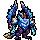

<!-- 本页上半部分由 tools/docs/gen_hero_docs.py 按仓库里现在的数据生成，手改会被覆盖；「开发记录」以下是手写的，生成时原样保留。 -->

# 迭嘉 Daeja



| 项目 | 内容 |
|---|---|
| id | `tft_daeja` |
| 所属的包 | tft 包（金铲铲之战系列，mod_id `tft`） |
| 分路 | ADC |
| 分类 / 标签 | 射手（Range） · AD / AP / Magic / Range |
| 高清帧 | PPU 1.72 |
| 附加包 | 无 |

其他预览：[skills](../preview/tft_daeja_skills.gif)、[逐帧预览](../preview/tft_daeja_frames.png)、[特效表](../preview/tft_daeja_effects.png)

## 现在的技能

下面是游戏里显示的技能说明（`tft/text/champion.i18n` 的简体中文，去掉了颜色和图标），冷却、距离来自 `tft/champion/tft_daeja.data_champion`；1 秒 = 60 tick。

### 普攻 / 被动

*攻击间隔 1.2 秒 · 攻击距离 60000*

推出风弹，造成100% 攻击力物理伤害。三连弹幕：每次普攻再射出3颗小风弹，各造成10 + 15% 法强魔法伤害，魔抗-4（3秒，可叠加）。

### 技能1 · 罡风轰击

*冷却 6 秒 · 施放距离 65000 · 施放：指定目标 · 敌人（不含防御塔）*

双翼前扫，朝敌人最多的直线轰出穿透的风波，造成110 + 70% 法强魔法伤害。

### 技能2 · 振翼退风

*冷却 10 秒 · 施放距离 40000 · 施放：指定目标 · 敌方英雄*

振翅朝身边的敌人扇出一阵风，造成40 + 30% 法强魔法伤害并减速40%（1.5秒），自己借风后跳。

### 大招 · 苍穹罡风

*冷却 45 秒 · 施放距离 75000 · 施放：指定目标 · 敌方英雄*

展翅飞起（减伤30%、免疫控制），朝敌人最多的直线连续轰出3道大冲击波，各造成150 + 70% 法强魔法伤害。

### 数值

攻击力 90（每级 +17）、法强 30（每级 +14）、生命 880（每级 +90）、护甲 20（每级 +7）、魔抗 18（每级 +3）、移速 900（每级 +9）。

## 相关脚本和素材

- [`tools/kit/build_daeja.py`](../../tools/kit/build_daeja.py)
- [`tools/kit/setup_daeja.py`](../../tools/kit/setup_daeja.py)
- [`tools/lol/extract_daeja.py`](../../tools/lol/extract_daeja.py)
- [`tools/art/preview_daeja.py`](../../tools/art/preview_daeja.py)
- [`tools/art/rig_daeja.py`](../../tools/art/rig_daeja.py)
- [`assets/source/daeja/`](../../assets/source/daeja)

## 开发记录

| 部分 | 内容 |
|---|---|
| 定位 | tft 包（`tft_daeja`）的第十九个英雄，下路（ADC，远程）。金铲铲第 7 赛季（巨龙之巢）的四费 `TFT7_DragonBlue`「迭嘉」（幻镜龙 / 龙神，法系主 C，射程 4）：一个直立的蓝色水晶龙人，古铜面甲下一双品红发光的眼睛，浅青蓝的大团鬃毛，深蓝紫的人字形胸甲，两只发光的青色水晶拳，背后两片收起来高高竖起的翅膀（深紫翼骨、青到紫的扇形翼膜），尾巴尖一片古铜尾鳍。技能「罡风轰击」：被动是普攻追加三团弹幕、每团削减魔抗，主动是朝敌人最多的一条直线打一道风。用户选的方案 A「罡风弹幕」：被动和技能1 是罡风轰击的两半，技能2 振翼退风和大招苍穹罡风是我们自己的 |
| 普攻 / 被动 | **风弹**（远程 60000，打塔）：第 8 tick 拳头推出一颗追踪的风弹，100% 攻击力。**三连弹幕**：之后每 4 tick 一颗、共 3 颗小风弹打同一个目标，各 10 + 15% 法强魔法伤害，魔抗 −4（3 秒；每颗一层，同名 buff 叠加，各自计时） |
| 技能1 | **罡风轰击**（冷却 6 秒，距离 65000，打野怪也会放）：双翼往后扬起，第 14 tick 往前一扫：tft.dll 以 90000 以内每个敌人的方向为候选，数每条线（长 90000、半宽 9000 加单位半径）上有几个敌人，取最多的一条（一样多先取穿过施法目标的，再取离施法方向最近的），从他身上朝那边发一道穿透的风波（速度 6000），每个被穿过的敌人 110 + 70% 法强魔法伤害 |
| 技能2 | **振翼退风**（冷却 10 秒，距离 40000，有敌方英雄靠近时）：第 6 tick 振翅：朝目标一条 45000 长的风（40 + 30% 法强魔法伤害，减速 40%，1.5 秒），自己借风往后跳 30000（6 tick） |
| 大招 | **苍穹罡风**（冷却 45 秒，距离 75000，有敌方英雄时）：展翅飞起（1.6 秒，减伤 30%、免疫控制），第 24 tick 起每 24 tick 一道、共 3 道大冲击波（长 110000、半宽 12000，速度 7000），同样由 tft.dll 朝敌人最多的直线打，各 150 + 70% 法强魔法伤害；然后落地 |
| 数值 | 攻击 90（+17）、法强 30（+14）、生命 880（+90）、护甲 20（+7）、魔抗 18（+3）、移速 900（+9），攻击间隔 1.2 秒，射程 60000 |
| 平衡 | 经典引擎模拟（下路，对原版弓箭手、枪手、回旋镖猎人、毒镖猎人，两边三套阵容，纯数据版：风波直接朝施法目标打）：草稿 +1.58 / +0.52（技能2 一局只放 3 次）；技能2 的触发距离 30000 → 40000 后 +1.86 / +1.09（一局 4 次）；罡风轰击 120 + 75% → 110 + 70% 后 **+1.39 / +1.17** = 定稿（诺姆希定稿时 +1.12 / +1.16） |
| tft.dll | 数据数不了一条线上有几个敌人，这部分在 tft 包自己的代码里（[`addons/tft/src/daeja.rs`](../../addons/tft/src/daeja.rs)，和其他 tft 英雄一起编成 `tft.dll`）：效果 `tft_daeja:windblast` / `tft_daeja:skygale`（挑敌人最多的直线、发穿透的风波）和 `tft_daeja:wave_hit` / `tft_daeja:sky_hit`（风波的命中）；被动 `tft_daeja:mirage` 只存参数、死亡时播他的死亡音效。日志写到 `%APPDATA%/TeamSamoyed/TeamfightManager2/data/tft_daeja.log`（SPAWN / WINDBLAST / SKYGALE / WAVE / SKY）。`build_daeja.py` 每次核对代码的默认参数和数据一致 |
| 塞拉斯 / 佛耶戈 / 妮蔻 / 俄洛伊 / 悠米 | 苍穹罡风要调用 tft.dll，塞拉斯的附加包在创意工坊上、tft 包不在，所以塞拉斯偷到的是它的纯数据版（`build_daeja.sylas_ult`：飞起、3 道穿透风波朝他施法的目标），特效表复制进附加包。佛耶戈 / 妮蔻的表（射手）、俄洛伊的幽灵图和悠米骑上去的高度都加上了他 |
| 精灵图（高清帧 PPU 1.72） | 参考是金铲铲客户端里他自己的模型（75 个关节：带手指的人形骨架，翅膀 L/R_Wing 长在 Spine3 上，尾巴 Tail_1–4；一个子网格一张贴图；动作片段按路径找到 idle / run / spell / death / celebration，另有一段没名字的出场；**没有普攻动作**）。Codex 第 0 步画了 A（3/4 站姿）和 B（侧面）；原稿约 10 / 8 px 一格，按它自己的格子读回。用户定 **A-1、40 游戏像素、PPU 1.72**（[`tools/art/design_daeja_model.py`](../../tools/art/design_daeja_model.py)：58×69，一格一个像素，近处的眼睛补一格近白的亮点）。姿势包的骨架是他自己的动作按帧投影出来的（[`tools/art/pack_daeja_poses.py`](../../tools/art/pack_daeja_poses.py)：头放大 2 倍；普攻是待机把近处的手臂转过去做出来的），Codex 画了 13 个姿势和 8 帧跑步。Codex 自己的整理版把每张原稿缩放到填满参考图的框，翅膀张得越开身体越小（定稿的 0.6–1 倍，用户：「怎么模型会一大一小」）；[`tools/art/design_daeja_poses.py`](../../tools/art/design_daeja_poses.py) 改从原稿按它自己的格子读回，逐张除以原稿身体相对定稿的倍数（`BODY`：出拳两张按 Codex 套待机框的比例 944/690、873/690，其余对着定稿看胸甲、肩膀、大腿定的），换成定稿的颜色，每张贴上定稿的脸。大招：起飞、空中轰出 / 平展 / 上扬三轮、落地；空中的几帧按脸对齐（身体悬停、只有翅膀在扇），起飞和落地按脸的水平位置衔接 |
| 走路 | Codex 的 8 帧跑步一直是同一条腿在前、看不出换腿（塞薇卡那次的「换腿不明显」），改成大块头的走法（加里奥 / 布隆：用户的规矩「按照泰坦布隆那种走路方式这种腿就不会变形」）：定稿自己的两条腿按颜色抠出来（腿只用的四种深紫，描边归到最近的颜色，尾巴不跟着走），轮流抬起（去掉顶上几行）往前或往后挪一两格，两脚着地的帧身体下沉一格；挪开后留下的窄缝（两头都有身体）补描边，敞开的（抬起的脚原来的地方）是地面。8 帧 115 毫秒 |
| 特效 | 12 张 + 3 个技能图标，Codex 画（[`tools/art/pack_daeja_fx.py`](../../tools/art/pack_daeja_fx.py) 的提示词，参考是他自己第 7 赛季的粒子贴图 [`tools/lol/fx_ref_daeja.py`](../../tools/lol/fx_ref_daeja.py)）：风弹和命中、小风弹和命中、削魔抗的品红符印、罡风轰击的月牙风波和命中、振翅扇出的风带、减速旋风、大招的双层月牙冲击波和命中、飞行时脚下的旋风。会飞的和画在线上的朝右、上下对称，其余左右对称。[`tools/art/import_daeja_fx.py`](../../tools/art/import_daeja_fx.py) 按 Codex 的 1 倍版切成 `tft_daeja_fx` 和 `tft_daeja_big`，每帧再查一次对称；符印在头顶，风带在那条线的中间、胸口高度 |
| 音效 | 罡风轰击的施法、发射、命中是他自己的金铲铲音效（Riot 客户端 Map22 里还留着的第 7 赛季音效包，按路径哈希读）；风弹、扇出的风和减速、起飞时的蓄风借迦娜，三连弹幕和大冲击波借伊泽瑞尔（他金铲铲的技能图标就是伊泽瑞尔的秘术射击），振翅、吼声、落地、死亡借峡谷的龙（[`tools/lol/extract_daeja.py`](../../tools/lol/extract_daeja.py)，16 段） |
| 选人卡片 | 翅膀尖到脚底 40 游戏像素：`banpick_center` (−1, −10)（按规则 −39 减去最高点 −28.5），不另设缩放。脸 (2, −24)（两眼之间）。待机按 `tools/art/hero_reels.py` 剪进普攻的第一帧，卡片轮播风弹、罡风轰击、振翼退风、苍穹罡风（展翅超出卡片的 3 帧停在前一帧） |

重新生成（素材来自本机的金铲铲客户端，音频和 Riot 的渲染不进仓库）：

```bash
python tools/lol/extract_daeja.py --riot "D:\Riot Games\League of Legends" --vgmstream <vgmstream-cli.exe>
python tools/kit/build_daeja.py                   # 技能数据（风波调用 tft.dll），数字都在脚本的参数表 P 里；--plain 是平衡模拟用的纯数据
python tools/kit/setup_daeja.py                   # 五种语言的文字、音效配置、tft 包共享文件里他的键
python tools/art/design_daeja_hd.py               # Codex 第 0 步的原图读回
python tools/art/design_daeja_model.py            # 定稿 A-1（58×69）
python tools/art/design_daeja_poses.py            # Codex 的姿势：从原稿读回、缩到定稿的身体大小、换成定稿的颜色、贴定稿的脸
python tools/art/import_daeja_fx.py               # 特效 -> tft_daeja_fx / tft_daeja_big，图标
python tools/art/rig_daeja.py                     # 1 倍帧和 1.72 的原帧（走路是定稿自己的腿）
python tools/art/ppu_restyle.py --hero daeja      # 外描边
python tools/art/ppu_hd.py --hero daeja           # hd_ / lo_ 帧（要在 hero_reels 之前）
python tools/art/hero_reels.py --hero tft_daeja   # 待机和选人卡片的小动作
python tools/art/preview_daeja.py                 # 预览和每个技能单独的 GIF
python tools/art/review_daeja_actions.py --out <文件夹> --sheet   # 和金铲铲原版逐个动作对照的 GIF
python addons/league_sylas/make_override.py       # 塞拉斯偷到的苍穹罡风（纯数据版）
cargo test --manifest-path addons/Cargo.toml -p tft   # tft.dll 的单元测试
```
