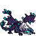

<!-- 本页上半部分由 tools/docs/gen_hero_docs.py 按仓库里现在的数据生成，手改会被覆盖；「开发记录」以下是手写的，生成时原样保留。 -->

# 远古巨龙 Elder Dragon



| 项目 | 内容 |
|---|---|
| id | `tft_elderdragon` |
| 所属的包 | tft 包（金铲铲之战系列，mod_id `tft`） |
| 分路 | 上单 |
| 分类 / 标签 | 近战（Melee） · AD / Melee / Dot / CC / Tank |
| 高清帧 | PPU 2.84 |
| 附加包 | 无 |

其他预览：[skills](../preview/tft_elderdragon_skills.gif)、[逐帧预览](../preview/tft_elderdragon_frames.png)、[特效表](../preview/tft_elderdragon_effects.png)

## 现在的技能

下面是游戏里显示的技能说明（`tft/text/champion.i18n` 的简体中文，去掉了颜色和图标），冷却、距离来自 `tft/champion/tft_elderdragon.data_champion`；1 秒 = 60 tick。

### 普攻 / 被动

*攻击间隔 1.2 秒 · 攻击距离 30000*

撕咬目标，造成100% 攻击力物理伤害，目标身边的敌人受到35% 攻击力溅射。远古巨龙霸符：被它伤害后生命低于15%的敌方英雄直接被处决。

### 技能1 · 烈焰吐息

*冷却 8 秒 · 施放距离 45000 · 施放：指定目标 · 敌人（不含防御塔）*

朝穿过目标、敌人最多的直线喷吐龙焰，造成70 + 130% 攻击力物理伤害，每烧过一人伤害-20%（最低40%），并引燃：3秒内每秒受到2.5%最大生命的物理伤害。

### 技能2 · 龙翼风暴

*冷却 10 秒 · 施放距离 25000 · 施放：指定目标 · 敌人（不含防御塔）*

立起身猛拍双翼，身边的敌人受到30 + 60% 攻击力物理伤害、被击退并减速35%（2秒），自己受到的伤害-25%。

### 大招 · 绝伦火热

*冷却 60 秒 · 施放距离 40000 · 施放：指定目标 · 敌方英雄*

无敌飞上天空，1.5秒后砸落：大范围敌人受到80 + 80% 攻击力物理伤害、晕眩1.25秒并被引燃；获得30%全能吸血（5秒），立刻喷一次烈焰吐息。

### 数值

攻击力 88（每级 +15）、生命 1200（每级 +118）、护甲 38（每级 +8）、魔抗 32（每级 +7）、移速 1000（每级 +10）。

## 相关脚本和素材

- [`tools/kit/build_elderdragon.py`](../../tools/kit/build_elderdragon.py)
- [`tools/kit/setup_elderdragon.py`](../../tools/kit/setup_elderdragon.py)
- [`tools/lol/extract_elderdragon.py`](../../tools/lol/extract_elderdragon.py)
- [`tools/art/preview_elderdragon.py`](../../tools/art/preview_elderdragon.py)
- [`tools/art/rig_elderdragon.py`](../../tools/art/rig_elderdragon.py)
- [`assets/source/elderdragon/`](../../assets/source/elderdragon)

## 开发记录

| 部分 | 内容 |
|---|---|
| 定位 | tft 包（`tft_elderdragon`）的英雄，上单（近战，物理伤害，肉）。金铲铲第 18 赛季的五费 `DA_18_ElderDragon`「远古巨龙」（顶级掠食者 / 峡谷野怪，繁中「遠古巨龍」，英文 Elder Dragon，射程 2）：就是峡谷里的远古巨龙，四条腿压低站着的翼龙，深紫色大蝙蝠翼、青色水晶尖刺、白色晶体鬃毛、深色尖嘴、蓝色弯角、发青光的嘴。金铲铲原技能「绝伦火热」做大招，「烈焰吐息」做技能1，「远古巨龙霸符」做被动，其余按用户选的方案 A「绝伦火热」（2026-11-01，上单）自己设计 |
| 普攻 / 被动 | **龙焰撕咬**（距离 30000，打塔）：第 18 tick 咬下，100% 攻击力物理伤害；目标身边 22000 以内的其他敌人（不含塔）受 35% 攻击力的溅射（tft.dll：数据的范围效果分不出主目标）。**远古巨龙霸符**（tft.dll）：被它伤害后生命不高于最大生命 15% 的敌方英雄直接处决（补一下真实伤害、青色龙眼和龙焰柱的画面）；普攻和技能的伤害由 `on_attack` 记下目标、下一拍检查，tft.dll 自己的伤害（吐息、引燃、溅射）当场检查 |
| 技能1 | **烈焰吐息**（金铲铲原技能，冷却 8 秒，距离 45000，打兵和野怪）：第 16 tick 朝**穿过目标、敌方英雄最多**的直线喷青色龙焰（tft.dll：候选方向只留目标在带子里的，一样多时取正对目标的、再取近的），一发穿透的直线弹道，长 75000、半宽 13000，从它嘴的高度喷出（整条线往北挪 9000）；烧到的每个敌人 70 + 130% 攻击力物理伤害，每烧过一个人后面的少 20%（最低 40%），并被**引燃**：3 秒里每秒挨目标最大生命 2.5% 的物理伤害（一次最多 100，再被引燃只续时间） |
| 技能2 | **龙翼风暴**（冷却 10 秒，距离 25000）：第 16 tick 立起身猛拍双翼，35000 以内的敌人受 30 + 60% 攻击力物理伤害、被击退（2500 × 12）、减速 35% 两秒；自己 2 秒内受到的伤害 −25%（青色水晶鳞片护体） |
| 大招 | **绝伦火热**（金铲铲原技能，冷却 60 秒，距离 40000，有敌方英雄时）：无敌（受到的伤害 −100%、免控）飞上天空 1.5 秒；砸落时 55000 以内的敌人受 80 + 80% 攻击力物理伤害、晕眩 1.25 秒并被引燃，自己获得 30% 全能吸血 5 秒；落地后第 16 tick 再喷一口烈焰吐息 |
| 数值 | 攻击 88（+15）、生命 1200（+118）、护甲 38（+8）、魔抗 32（+7）、移速 1000（+10），攻击间隔 72 tick，距离 30000 |
| 平衡 | 经典引擎模拟（上路，对原版斗士、处刑人、骑士、狂战士、枪兵、长柄战士，两边三套阵容，纯数据版：吐息每人吃满伤害、溅射也打主目标、没有处决）：**+1.79**（±0.40，种子 1–8）；沃利贝尔同条件 +1.47（±0.42）：和包里的上单持平，游戏里另有霸符的处决 |
| tft.dll | [`addons/tft/src/elderdragon.rs`](../../addons/tft/src/elderdragon.rs)：被动 `tft_elderdragon:elder`（处决、参数、死亡的吼声）；原生效果 `tft_elderdragon:bite`（溅射）、`tft_elderdragon:breath`（选直线、放穿透弹道）、`tft_elderdragon:scorch`（一口吐息的命中：递减伤害、引燃、处决）、`tft_elderdragon:ignite` / `ignite_tick`（引燃）。日志 `data/tft_elderdragon.log`（SPAWN / BREATH / SCORCH / IGNITE / SPLASH / EXECUTE） |
| 塞拉斯 / 佛耶戈 / 妮蔻 / 俄洛伊 / 悠米 | 塞拉斯偷到的绝伦火热是一份纯数据版（他的附加包在创意工坊，调不了 tft.dll）：无敌升空、砸落的冲击波、晕眩、引燃（火焰灼烧）、全能吸血，再朝他的目标喷一口吐息（特效表复制进附加包）；佛耶戈 / 妮蔻的表（近战）、俄洛伊的灵魂、悠米坐骑的头顶高度 20 |
| 精灵图（高清帧 PPU 2.84） | 参考是金铲铲客户端 TFTSet18 里它自己的模型（`tft18_elderdragon`，106 个关节 = 峡谷 `sru_dragon_elder` 的骨架，一张贴图），但金铲铲自己的动作只有出场和一段爬行，其余动作用峡谷 `Map11.wad.client` 里远古巨龙的 22 段（待机、咬、张嘴前冲、抬头、立起拍翅、起跳砸落、原地飞、倒地）。第 0 步 Codex 画了 A（3/4）和 B（侧面）各两版：A 初稿 7.5 px 一格（167×125）、A 粗版 14.5 px、B 侧面 9 px、B 初稿 12 px。用户选 **A-1、44 游戏像素、PPU 2.84**（125 行 1:1）；读回后近处那只眼睛只剩一格、嘴里的尖牙没了，在格子上补画（[`tools/art/design_elderdragon_model.py`](../../tools/art/design_elderdragon_model.py)）。第 2 步 Codex 照峡谷的动作画了 18 个姿势（骨架包 [`tools/art/pack_elderdragon_poses.py`](../../tools/art/pack_elderdragon_poses.py)：头放大 1.6 倍；英雄联盟的远古巨龙没有跑步动作，**移动是低空飞行**，8 帧取悬停那段 2.33 秒的完整一圈振翅） |
| 动作 | [`tools/art/design_elderdragon_poses.py`](../../tools/art/design_elderdragon_poses.py)：Codex 每张都画大了、大小也不一样，按闭着嘴时发光的嘴的大小定比例（约 5.8 px 一格，张嘴的几张单独定），每格取原稿那一格最多的定稿颜色；闭嘴的贴定稿的脸，张嘴的（咬、吸气、喷火）保留 Codex 画的张嘴。[`tools/art/rig_elderdragon.py`](../../tools/art/rig_elderdragon.py)：普攻缩颈 + 前探咬；吐息吸气 + 伸颈张嘴；龙翼风暴立起举翼 + 拍下；大招起跳、高空 8 帧完整振翅（最高离地约 46 游戏像素）、砸落、再接吐息；死亡下沉 + 侧翻。空中的帧按脸对齐（头不动、翅膀扇）。**移动用 5 帧浅振翅**（高 → 半 → 平 → 半 → 高，离地约 6 游戏像素，150 ms 一帧）：Codex 的第 4 帧翼尖会穿进地面、第 7、8 帧来回抖，只在大招高空里用 |
| 特效 | 12 张 + 3 个技能图标，Codex 画（[`tools/art/pack_elderdragon_fx.py`](../../tools/art/pack_elderdragon_fx.py) 的提示词，龙焰统一青色、不要橙色；参考是斯莫德的龙焰和墨菲特的冲击 [`tools/lol/fx_ref_elderdragon.py`](../../tools/lol/fx_ref_elderdragon.py)）。[`tools/art/import_elderdragon_fx.py`](../../tools/art/import_elderdragon_fx.py)：按交付的 `pixel_1x` 切格，咬中、溅射、吐息命中、引燃、处决、减速、晕眩在被打的人身上，风暴、鳞片护体、吸血在它身上，砸落的冲击波留在落地处；3 个图标从原稿重新缩到 64 |
| 音效 | 咬、喷火、吼叫、起飞、落地、死亡都是它自己的（峡谷远古巨龙的音效包 `npc_map11_dragons_elder_sfx_`，事件没有名字，按 id 和声音特征认出来；起飞、落地、怒吼、出场吼、死亡来自巨龙共用的 `npc_map11_dragons_sfx_`）；引燃借布兰德的被动，风击中借迦娜，砸落借墨菲特的大招（[`tools/lol/extract_elderdragon.py`](../../tools/lol/extract_elderdragon.py)，15 个） |
| 选人卡片 | 翼尖到爪子 44 游戏像素、60 宽，卡片放不下：`league.dll` 的 `UI_SIZES` 0.85，`banpick_center` (0, −11)，脸 (18, −11)（近处那只眼睛），中心 (0, −22)。待机按 `tools/art/hero_reels.py` 剪进龙翼风暴拍下的那一帧（抬翼的帧会顶出卡片），卡片轮播普攻、烈焰吐息、龙翼风暴（大招升空会飞出卡片，不放） |

重新生成（素材来自本机的英雄联盟 / 金铲铲客户端，音频和 Riot 的渲染不进仓库）：

```bash
python tools/lol/extract_elderdragon.py --riot "D:\Riot Games\League of Legends" --vgmstream <vgmstream-cli.exe>
python tools/kit/build_elderdragon.py                     # 技能数据（被动调用 tft.dll），数字都在脚本的参数表 P 里；--plain 是平衡模拟用的纯数据
python tools/kit/setup_elderdragon.py                     # 五种语言的文字、音效配置、tft 包共享文件里它的键
python tools/art/design_elderdragon_hd.py                 # Codex 第 0 步的原稿读回
python tools/art/design_elderdragon_model.py              # 定稿 A-1（167×125），补眼睛和尖牙
python tools/art/design_elderdragon_poses.py              # Codex 的姿势：按定稿的体型从原稿读回、换成定稿的颜色、贴定稿的脸
python tools/art/rig_elderdragon.py                       # 全部动作帧 -> assets/source/ppu
python tools/art/ppu_restyle.py --hero elderdragon        # 描边、补缝
python tools/art/ppu_hd.py --hero elderdragon             # 高清帧图集
python tools/art/import_elderdragon_fx.py                 # 特效和图标
python tools/art/hero_reels.py --hero tft_elderdragon     # 待机和选人卡片的轮播
python tools/art/preview_elderdragon.py                   # docs/preview 里的预览
```
