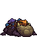

<!-- 本页上半部分由 tools/docs/gen_hero_docs.py 按仓库里现在的数据生成，手改会被覆盖；「开发记录」以下是手写的，生成时原样保留。 -->

# 魔沼蛙 Gromp

| 项目 | 内容 |
|---|---|
| id | `tft_gromp` |
| 所属的包 | tft 包（金铲铲之战系列，mod_id `tft`） |
| 分路 | ADC |
| 分类 / 标签 | 射手（Range） · AD / AP / Magic / Range |
| 高清帧 | PPU 1.69 |
| 附加包 | 无 |

其他预览：[skills](../preview/tft_gromp_skills.gif)、[逐帧预览](../preview/tft_gromp_frames.png)、[特效表](../preview/tft_gromp_effects.png)

## 现在的技能

下面是游戏里显示的技能说明（`tft/text/champion.i18n` 的简体中文，去掉了颜色和图标），冷却、距离来自 `tft/champion/tft_gromp.data_champion`；1 秒 = 60 tick。

### 普攻 / 被动

*攻击间隔 1.2 秒 · 攻击距离 60000*

吐出毒口水，造成100% 攻击力物理伤害和40% 法强魔法伤害。紫霸符：战斗中每4秒法术加成+8，最多8层。

### 技能1 · 打嗝泡泡

*冷却 5 秒 · 施放距离 65000 · 施放：指定目标 · 敌人（不含防御塔）*

打出一个毒泡泡，碰到第一个敌人造成110 + 80% 法强魔法伤害并炸开，周围敌人3秒内受到80 + 60% 法强魔法伤害。

### 技能2 · 黏液沼泽

*冷却 8 秒 · 施放距离 60000 · 施放：地点 · 敌方英雄*

往敌人脚下吐一滩黏液，持续4秒，站在里面的敌人减速55%，每秒受到24 + 16% 法强魔法伤害。

### 大招 · 毒沼大嗝

*冷却 40 秒 · 施放距离 60000 · 施放：地点 · 敌方英雄*

肚子鼓起变大5秒（受到伤害-20%），向前打出大嗝，造成170 + 80% 法强魔法伤害并减速35%，毒雾留在地上4秒，每秒36 + 21% 法强魔法伤害。

### 数值

攻击力 95（每级 +12）、法强 30（每级 +16）、生命 880（每级 +85）、护甲 20（每级 +7）、魔抗 18（每级 +3）、移速 900（每级 +9）。

## 相关脚本和素材

- [`tools/kit/build_gromp.py`](../../tools/kit/build_gromp.py)
- [`tools/kit/setup_gromp.py`](../../tools/kit/setup_gromp.py)
- [`tools/lol/extract_gromp.py`](../../tools/lol/extract_gromp.py)
- [`tools/art/preview_gromp.py`](../../tools/art/preview_gromp.py)
- [`tools/art/rig_gromp.py`](../../tools/art/rig_gromp.py)
- [`assets/source/gromp/`](../../assets/source/gromp)

## 开发记录

| 部分 | 内容 |
|---|---|
| 定位 | tft 包（`tft_gromp`）的英雄，下路（远程，魔法伤害，持续伤害，减速）。金铲铲第 18 赛季的二费 `DA_Gromp18_AP`「魔沼蛙」（峡谷野怪 / 魔战士，繁中「啾吉」，英文 Gromp，射程 4）：又矮又胖的大蛤蟆，前面一个橄榄褐色、带甲片褶皱和深色圆斑的大肚子，橙色扁头压在肚子上，两只发黄绿色光的眼睛、嘴角两根淡黄绿獠牙，深紫色疙瘩皮，背上一丛紫色和蓝色的大蘑菇。金铲铲原技能「打嗝泡泡」做技能1，魔战士物理形态的「大幅减速」做技能2，羁绊的「紫霸符」做被动；其余按用户选的方案 A「打嗝泡泡」（2026-11-01，下路）自己设计 |
| 普攻 / 被动 | **毒涎吐射**（距离 60000，打塔）：第 8 tick 吐出追踪的毒口水，100% 攻击力物理伤害 + 40% 法强魔法伤害。**紫霸符**（tft.dll）：90000 以内有敌方英雄（在打架）时每 4 秒叠一层 +8 法强，最多 8 层，每层 10 秒、叠下一层时刷新；叠满时有声音，背上方飘一个紫色符文 |
| 技能1 | **打嗝泡泡**（金铲铲原技能，冷却 5 秒，距离 65000，打兵和野怪）：第 14 tick 朝目标吐出不穿透的毒泡泡（飞 80000），碰到的第一个敌人受 110 + 80% 法强魔法伤害；泡泡在那里炸开，25000 以内的敌人 3 秒内受 80 + 60% 法强魔法伤害（中毒，冒毒泡）。没碰到人就不炸（命中时给自己挂个 2 tick 的标记，停下时看标记） |
| 技能2 | **黏液沼泽**（冷却 8 秒，距离 60000，打英雄的位置）：第 8 tick 往目标脚下吐一团黏液（抛物线 14 tick），落地摊成 26000 宽的沼泽，持续 4 秒；每 15 tick 里面的敌人受 6 + 4% 法强魔法伤害（每秒 24 + 16%）并减速 55% |
| 大招 | **毒沼大嗝**（冷却 40 秒，距离 60000，打英雄的位置）：仰头鼓肚子，5 秒内身体变大 15%（league.dll 的 hd::FORMS 按旗子 `tft_gromp_r_big`，0.5 秒长大和缩回）、受到的伤害降低 20%；第 18 tick 往前打出大嗝：55000 长、两边各 53° 的扇形里的敌人受 170 + 80% 法强魔法伤害并减速 35% 1.5 秒；毒雾留在瞄准的地方 4 秒，32000 宽，每 20 tick 12 + 7% 法强魔法伤害（每秒 36 + 21%） |
| 数值 | 攻击 95（+12）、法强 30（+16）、生命 880（+85）、护甲 20（+7）、魔抗 18（+3）、移速 900（+9），攻击间隔 72 tick，距离 60000 |
| 平衡 | 经典引擎模拟（下路，对原版弓箭手、火枪手、回旋镖猎手、毒镖猎手，两边三套阵容，纯数据版：紫霸符换成固定 3 层法强）：初稿 −1.85（伤害太低）；普攻、泡泡、毒、黏液、大招都加强 −1.10；加生命、泡泡冷却 5 秒 +0.15；再加普攻、大招冷却 40 秒、黏液冷却 8 秒和减速 55% **+1.51 / +0.50（种子 1–8 / 9–16）**；迭嘉同条件 +1.39 / +1.17，二费比四费的迭嘉低一点 |
| tft.dll | [`addons/tft/src/gromp.rs`](../../addons/tft/src/gromp.rs)：被动 `tft_gromp:purple`（紫霸符：每拍看附近有没有敌方英雄，计时叠法强、封顶，叠满时的声音；倒地的叫声）。日志 `data/tft_gromp.log` |
| 塞拉斯 / 佛耶戈 / 俄洛伊 / 悠米 | 塞拉斯偷到的「毒沼大嗝」就是数据版（大招本来就不调 tft.dll；特效表复制进附加包），按远程类；佛耶戈的灵魂（远程）、妮蔻、俄洛伊的灵魂、悠米坐在它背上的高度 20 |
| 精灵图（高清帧 PPU 1.69） | 参考是金铲铲客户端 TFTSet18 里它的模型（`tft18_gromp`，82 个关节，隐藏出场网格和小魔沼蛙）和动作（7 段：待机、两种甩舌头、蛙跳、鼓肚子、死亡沉进地里），加英雄联盟 Map11 魔沼蛙的 21 段（仰头张大嘴、张嘴吐）。第 0 步 Codex 画了 A（3/4）和 B（侧面），它自己缩的 56×32 糊了脸；用户选第一版 A 按 12 px 读回的 **A-1、32 游戏像素、PPU 1.69**（105×54，54 行 1:1，[`tools/art/design_gromp_model.py`](../../tools/art/design_gromp_model.py)）。第 2 步 Codex 照它的动作画了 18 个姿势（骨架包 [`tools/art/pack_gromp_poses.py`](../../tools/art/pack_gromp_poses.py)：蛙跳取 0.53 秒一整跳 8 帧，死亡两张是待机往后翻 45° / 160°，舌头一律不伸） |
| 动作 | [`tools/art/design_gromp_poses.py`](../../tools/art/design_gromp_poses.py)：Codex 每张格子都不一样（8–10 px 一格，要的是 7），每张按头、蘑菇、肚子三个大小的中位数读回到定稿的身体大小（用户「怎么模型容易一大一小」：大招两张原来按肚子读，头只剩 0.78 倍），鼓肚子的三张保留 Codex 画的大肚子；对得上的贴定稿的脸；按肚子的中心对位（蛙跳伸直的后腿不会把身子往后拽）。[`tools/art/rig_gromp.py`](../../tools/art/rig_gromp.py)：普攻 133 + 267 ms、泡泡 233 + 267、黏液 133 + 267、大嗝 300 + 300（出手的那帧在放出的 tick 上），蛙跳用 Codex 的 8 帧、腾空三帧离地 6 / 8 / 3 像素，挨打是待机闪白，死亡翻倒再仰躺（眼睛熄灭） |
| 特效 | Codex 画了 15 张和 3 个图标（[`tools/art/import_gromp_fx.py`](../../tools/art/import_gromp_fx.py)）：飞行的口水、泡泡、黏液上下对称朝右，其余左右对称；大嗝冲击波按提示词的「身体位置留空」被 Codex 挖成一块块，从原稿重读到 84×50 整条弧；中毒的泡泡投成单个像素，按它放的位置盖成带高光的 3×3 泡泡；图标从高清原稿缩到 64；紫霸符的符文降 8 像素贴着蘑菇 |
| 音效 | [`tools/lol/extract_gromp.py`](../../tools/lol/extract_gromp.py) 的 15 段：峡谷魔沼蛙自己的吐口水、溅射、蛙叫（技能1 / 技能2 / 大招）、肚子的闷响和死亡叫声，大嘴的吐泡泡、黏液，图奇毒罐炸开，卡西奥佩娅的毒雾，辛吉德的黏胶减速 |
| 选人卡片 | 肚子伸到站立点前面 34 游戏像素，卡片宽 59.5，UI 大小 0.82；卡片动图轮流放普攻、泡泡、黏液、大嗝 |
