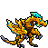

<!-- 本页上半部分由 tools/docs/gen_hero_docs.py 按仓库里现在的数据生成，手改会被覆盖；「开发记录」以下是手写的，生成时原样保留。 -->

# 艾达丝 Idas



| 项目 | 内容 |
|---|---|
| id | `tft_idas` |
| 所属的包 | tft 包（金铲铲之战系列，mod_id `tft`） |
| 分路 | 辅助 |
| 分类 / 标签 | 功能型（Util） · AP / Magic / Melee / Tank / Heal / Shield |
| 高清帧 | PPU 2.45 |
| 附加包 | 无 |

## 现在的技能

下面是游戏里显示的技能说明（`tft/text/champion.i18n` 的简体中文，去掉了颜色和图标），冷却、距离来自 `tft/champion/tft_idas.data_champion`；1 秒 = 60 tick。

### 普攻 / 被动

*攻击间隔 1.4 秒 · 攻击距离 25000*

挥爪造成100% 攻击力物理伤害。护卫之誓：生命值低于50%时，她和最近的一名友军各获得她最大生命值18%的护盾（5秒），每30秒一次。

### 技能1 · 黄金龙息

*冷却 5 秒 · 施放距离 35000 · 施放：指定目标 · 敌人（不含防御塔）*

向前喷出扇形金色龙息，造成110 + 70% 法强魔法伤害，护甲降低35%（4秒）。

### 技能2 · 龙威振翅

*冷却 9 秒 · 施放距离 55000 · 施放：无目标 · 敌方英雄*

振翅一吼：附近的敌人眩晕0.75秒并减速50%（2秒）；她和附近友军获得50 + 30% 法强护盾（3秒）。

### 大招 · 黄金龙鳞

*冷却 25 秒 · 施放距离 70000 · 施放：无目标 · 敌方英雄*

双翼裹身2秒，受到的伤害降低60%；然后回复200 + 60% 法强生命值，附近友军获得150 + 50% 法强护盾（5秒），护盾在时攻速+30%。

### 数值

攻击力 72（每级 +6）、法强 35（每级 +16）、生命 1250（每级 +120）、护甲 42（每级 +8）、魔抗 36（每级 +5）、移速 960（每级 +10）。

## 相关脚本和素材

- [`tools/kit/build_idas.py`](../../tools/kit/build_idas.py)
- [`tools/kit/setup_idas.py`](../../tools/kit/setup_idas.py)
- [`tools/lol/extract_idas.py`](../../tools/lol/extract_idas.py)
- [`tools/art/rig_idas.py`](../../tools/art/rig_idas.py)
- [`assets/source/idas/`](../../assets/source/idas)

## 开发记录

| 部分 | 内容 |
|---|---|
| 定位 | tft 包（`tft_idas`）的第十八个英雄，辅助（Util，近战坦克辅助）。金铲铲第 7 赛季（巨龙之巢）的四费 `TFT7_DragonGold`「艾达丝」（金鳞龙 / 龙神 / 护卫，法系坦克，射程 1）：一条两条反关节腿直立的金色巨龙，有棱角的金鳞甲、深棕的胸腹、青蓝宝石，头上青蓝的鬃冠、往后的细角、脸颊往下绕的月牙角，发光的青蓝眼睛；手臂就是翅膀（前臂上金色的羽刃翼，手腕上深灰三指爪），长尾巴尖上一片刀刃。技能「黄金龙鳞」：减伤一会儿，然后回血、给附近友军护盾，护盾在时攻速提高。用户选的方案 A「黄金守护」：大招沿用黄金龙鳞，被动取护卫羁绊的半血护盾，技能1 黄金龙息和技能2 龙威振翅是我们自己的 |
| 普攻 / 被动 | **龙爪**（近战 25000，打塔）：第 14 tick 一爪，100% 攻击力。**护卫之誓**：生命值低于 50% 时，她和 60000 以内最近的一名友方英雄各得她最大生命值 18% 的护盾（5 秒），之后 30 秒内不再触发（每条命一开始就是好的）；数据读不到生命、也找不到最近的队友，由 tft.dll 每拍看她的生命，护盾在时两人身上亮 `p_shield` |
| 技能1 | **黄金龙息**（冷却 5 秒，距离 35000，打野怪也会放）：仰头吸气，第 14 tick 往前喷出扇形的熔金龙息（半径 50000），110 + 70% 法强魔法伤害，护甲 −35%（4 秒） |
| 技能2 | **龙威振翅**（冷却 9 秒，距离 55000，有敌方英雄时）：双翼一展、仰头一吼，第 12 tick：42000 以内的敌人眩晕 0.75 秒、减速 50%（2 秒）；她和 60000 以内的友军得到 50 + 30% 法强的护盾（3 秒） |
| 大招 | **黄金龙鳞**（冷却 25 秒，距离 70000，有敌方英雄时）：蹲下用双翼裹住自己，2 秒内受到的伤害 −60%；然后双翼展开一吼：回复 200 + 60% 法强生命，60000 以内的其他友方英雄得到 150 + 50% 法强的护盾（5 秒），护盾在时攻速 +30%（`WithShield` 的 buff，护盾破了攻速就没了，和金铲铲一样） |
| 数值 | 攻击 72（+6）、法强 35（+16）、生命 1250（+120）、护甲 42（+8）、魔抗 36（+5）、移速 960（+10），攻击间隔 1.4 秒，近战 25000 |
| 平衡 | 经典引擎模拟（辅助，对原版牧师、武僧、吟游诗人、附魔师、道士，两边三套阵容，纯数据版：护卫之誓换成振翅时给自己和一名随机队友一层固定的护盾，30 秒一次）：草稿 −2.93（同一批 tft_loris 纯数据版 +1.40，换一批种子 +0.86）；攻击间隔、Q / E / R 的冷却、伤害、护盾、减伤怎么调都在 −0.6 到 −0.9 之间——缺的是控制；龙威振翅加上 0.75 秒眩晕后 **+1.18 / +1.40** = 定稿（眩晕不在用户选的方案里，跟用户说过） |
| tft.dll | 数据做不到的部分在 tft 包自己的代码里（[`addons/tft/src/idas.rs`](../../addons/tft/src/idas.rs)，和其他 tft 英雄一起编成 `tft.dll`）：被动 `tft_idas:guardian`（半血时给自己和最近的友军护盾，30 秒冷却；死亡时播她的死亡音效）。日志写到 `%APPDATA%/TeamSamoyed/TeamfightManager2/data/tft_idas.log`（SPAWN / VOW）。`build_idas.py` 每次核对代码的默认参数和数据一致 |
| 塞拉斯 / 佛耶戈 / 妮蔻 / 俄洛伊 / 悠米 | 黄金龙鳞本身没有 tft.dll 的部分，塞拉斯照常偷到。佛耶戈 / 妮蔻的表（功能型）、俄洛伊的幽灵图和悠米骑上去的高度都加上了她（悠米的高度量的是她站立点正上方：她的头在前面，悠米骑在她背上） |
| 精灵图（高清帧 PPU 2.45） | 参考是金铲铲客户端里她自己的模型（56 个关节，希瓦娜龙形那套骨架：翅膀长在手上；一个子网格一张贴图；动作片段按路径找到 idle / run / attack1 / attack2 / death / celebration，另有两段没名字的蹲下 / 蹲着循环）。Codex 第 0 步画了 A（3/4 站姿）和 B（侧面）；原稿约 9 / 7 px 一格，按它自己的格子读回。用户定 **B-1、40 游戏像素、PPU 2.45**（[`tools/art/design_idas_model.py`](../../tools/art/design_idas_model.py)：127×98，一格一个像素，近处的眼睛中间补一格近白的亮点）。姿势包的骨架是她自己的动作按帧投影出来的（[`tools/art/pack_idas_poses.py`](../../tools/art/pack_idas_poses.py)：头放大 1.6 倍，扑击和倒地两帧尾巴缩到 0.7），Codex 画了 11 个姿势（格子 5–8 px 不等、人物比参考大约 1.22 倍）；[`tools/art/design_idas_poses.py`](../../tools/art/design_idas_poses.py) 按每张自己的格子读回、换成定稿的颜色、缩到定稿的密度（Codex 第二次交的「整理版」把定稿的头剪下来硬转角度贴上，接缝明显，没用）。大招：蹲下裹翼、裹着（一格的呼吸）、展开 |
| 走路 | 用户要「明显的腿部交换」，又要「像金铲铲里面那样的姿势」：金铲铲原版的跑是低身往前扑（翼爪在头前面点地、尾巴伸直、两条腿在身体下面轮流蹬，0.67 秒一整个循环，两次换腿）。第一次用她自己的模型做的直立走路，Codex 交回来的是用定稿零件剪下来弯折拼的，用户说「非常的奇怪」；改回金铲铲的跑步片段 8 帧（[`tools/art/pack_idas_run.py`](../../tools/art/pack_idas_run.py)：两次换腿、两次分得最开都在里面，近侧腿亮、远侧腿暗一档），要 Codex 每帧整张画。（待 Codex 交回） |
| 特效 | 12 张 + 3 个技能图标，Codex 画（[`tools/art/pack_idas_fx.py`](../../tools/art/pack_idas_fx.py) 的提示词，参考是她自己第 7 赛季的粒子贴图和洛的护盾 [`tools/lol/fx_ref_idas.py`](../../tools/lol/fx_ref_idas.py)）：金色龙爪、熔金龙息、护甲熔化、振翅冲击波、减速、三种金鳞护盾、裹翼外壳和它炸开、回血。会飞的龙息朝右、上下对称，其余左右对称。（待 Codex 交回） |
| 音效 | 黄金龙息的喷吐和熔甲、黄金龙鳞的施放 / 持续 / 爆开、第 7 赛季喷火的命中是她自己的金铲铲音效（Riot 客户端 Map22 里还留着的第 7 赛季音效包，按路径哈希读）；普攻和回血借希瓦娜龙形，两声吼、振翅、死亡借峡谷的龙，三种护盾借拉克丝、迦娜、洛（[`tools/lol/extract_idas.py`](../../tools/lol/extract_idas.py)，16 段） |
| 选人卡片 | 鬃冠到脚底 40 游戏像素：`banpick_center` (3, 1)（按规则 −39 减去最高点 −40），不另设缩放。脸 (18, −31)（近处的眼睛）。待机按 `tools/art/hero_reels.py` 剪进振翅展开的那一帧，卡片轮播龙爪、黄金龙息、龙威振翅、黄金龙鳞 |

重新生成（素材来自本机的金铲铲客户端，音频和 Riot 的渲染不进仓库）：

```bash
python tools/lol/extract_idas.py --riot "D:\Riot Games\League of Legends" --vgmstream <vgmstream-cli.exe>
python tools/kit/build_idas.py                   # 技能数据（被动调用 tft.dll），数字都在脚本的参数表 P 里；--plain 是平衡模拟用的纯数据
python tools/kit/setup_idas.py                   # 五种语言的文字、音效配置、tft 包共享文件里她的键
python tools/art/design_idas_hd.py               # Codex 第 0 步的原图读回
python tools/art/design_idas_model.py            # 定稿 B-1（127×98）
python tools/art/design_idas_poses.py            # Codex 的姿势：读回、换成定稿的颜色
python tools/art/rig_idas.py                     # 1 倍帧和 2.45 的原帧
python tools/art/ppu_restyle.py --hero idas      # 外描边
python tools/art/ppu_hd.py --hero idas           # hd_ / lo_ 帧（要在 hero_reels 之前）
python tools/art/hero_reels.py --hero tft_idas   # 待机和选人卡片的小动作
cargo test --manifest-path addons/Cargo.toml -p tft   # tft.dll 的单元测试
```
