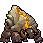

<!-- 本页上半部分由 tools/docs/gen_hero_docs.py 按仓库里现在的数据生成，手改会被覆盖；「开发记录」以下是手写的，生成时原样保留。 -->

# 远古石甲虫 Krug



| 项目 | 内容 |
|---|---|
| id | `tft_krug` |
| 所属的包 | tft 包（金铲铲之战系列，mod_id `tft`） |
| 分路 | 打野 |
| 分类 / 标签 | 近战（Melee） · AD / Melee / Tank / CC / Shield |
| 高清帧 | PPU 2 |
| 附加包 | 无 |

其他预览：[skills](../preview/tft_krug_skills.gif)、[逐帧预览](../preview/tft_krug_frames.png)、[特效表](../preview/tft_krug_effects.png)

## 现在的技能

下面是游戏里显示的技能说明（`tft/text/champion.i18n` 的简体中文，去掉了颜色和图标），冷却、距离来自 `tft/champion/tft_krug.data_champion`；1 秒 = 60 tick。

### 普攻 / 被动

*攻击间隔 1.2 秒 · 攻击距离 25000*

岩拳砸地，造成100% 攻击力物理伤害。碎岩重生：每条命第一次受到致命伤害时碎成石堆0.75秒，再以小石甲虫站起：生命35%、攻速+30%，嘲讽周围敌人1秒（至少隔60秒）。

### 技能1 · 岩之摇滚

*冷却 8 秒 · 施放距离 45000 · 施放：指定目标 · 敌人（不含防御塔）*

获得80 + 60% 法强的护盾（4秒），缩成石球滚向目标，造成40 + 140% 攻击力 + 6%最大生命物理伤害并击退。

### 技能2 · 坚岩外壳

*冷却 10 秒 · 施放距离 30000 · 施放：指定目标 · 敌人（不含防御塔）*

缩进巨石2.5秒：护甲+40、魔抗+30；周围的敌人被嘲讽0.75秒。

### 大招 · 远古崩落

*冷却 50 秒 · 施放距离 50000 · 施放：指定目标 · 敌方英雄*

一跃而起（不可选中、免疫控制），砸进敌方英雄身边：周围敌人受到70 + 100% 攻击力 + 6%最大生命物理伤害并被击飞0.8秒；随后落石再造成40 + 4%最大生命物理伤害。

### 数值

攻击力 80（每级 +14）、法强 20（每级 +10）、生命 1200（每级 +118）、护甲 38（每级 +8）、魔抗 28（每级 +4）、移速 960（每级 +10）。

## 相关脚本和素材

- [`tools/kit/build_krug.py`](../../tools/kit/build_krug.py)
- [`tools/kit/setup_krug.py`](../../tools/kit/setup_krug.py)
- [`tools/lol/extract_krug.py`](../../tools/lol/extract_krug.py)
- [`tools/art/preview_krug.py`](../../tools/art/preview_krug.py)
- [`tools/art/rig_krug.py`](../../tools/art/rig_krug.py)
- [`assets/source/krug/`](../../assets/source/krug)

## 开发记录

| 部分 | 内容 |
|---|---|
| 定位 | tft 包（`tft_krug`）的第十个英雄，打野（Melee，近战肉坦）。峡谷石甲虫营地的老大：驼着一块砂岩巨石背、四肢着地的岩石巨兽，背上的石缝里亮着橙金色的光，小小的硬壳脸和两只弯钳子长在身子最前面。金铲铲第 18 赛季的三费（`DA_Krug18`「远古石甲虫」，峡谷野怪 / 斗士，射程 1，生命 1100，法力 80/135），技能「岩之摇滚」：阵亡时分裂成两只会嘲讽的小石甲虫；主动获得最大生命，然后滚向目标，按攻击和生命造成伤害。用户选了**打野**和方案 A「岩之摇滚」：技能1 照金铲铲，被动按金铲铲改成重生（召唤物在数据里不能走路），技能2 坚岩外壳、大招远古崩落是我们加的。旧的 PVE 野怪石甲虫（以石补石）没有用。模型在 Riot 客户端的 `TFTSet18.wad.client`（`tft18_krug.skn`，46 根骨骼：四肢、钳子、背上五块石头；七段动作在 `da_krug18` 的动画表里，只有路径哈希，按内容命名） |
| 普攻 / 被动 | 岩拳砸地（近战，100% 攻击，打塔）。**碎岩重生**：每条命第一次受到致命伤害时不死，碎成一堆石头 0.75 秒（播 `shatter`，期间不受伤害），再以小石甲虫站起来（播 `reform`）：生命 35%，这条命剩下的时间攻速 +30%，身边 40000 以内的敌人（英雄、小兵、野怪）被嘲讽 1 秒；两次重生至少隔 60 秒。tft.dll 的被动做（数据读不到生命）：能重生时一直挂着「不死」（艾尼维亚冰蛋的做法），碎裂和站起用动作控制播自己的两段动作，碎裂、重聚和小石甲虫的光圈都挂成 buff 的画面（tft.dll 直接播的画面游戏里看不到，巴德的门的教训）。身形没有变小 |
| 技能1 | **岩之摇滚**（冷却 8 秒，距离 45000，小兵野怪也放）：获得 80 + 60% 法强的护盾（4 秒），缩成石球滚向目标（MoveToTarget），撞上时 40 + 140% 攻击 + 6% 最大生命的物理伤害并击退 |
| 技能2 | **坚岩外壳**（冷却 10 秒，距离 30000）：缩进巨石 2.5 秒，护甲 +40、魔抗 +30；28000 以内的敌人被嘲讽 0.75 秒 |
| 大招 | **远古崩落**（冷却 50 秒，敌方英雄在 50000 以内时放）：蹲下跃起（看不见、不可选中、免疫控制），落在目标身边：36000 以内的敌人受到 70 + 100% 攻击 + 6% 最大生命并被击飞 0.8 秒；半秒后天上落石，40000 以内的敌人再受到 40 + 4% 最大生命 |
| 数值 | 攻击 80（+14）、生命 1200（+118）、护甲 38（+8）、魔抗 28（+4）、移速 960（+10），攻击间隔 1.2 秒（以拉莫斯、范德尔为参照：更重、更慢的大块头） |
| 平衡 | 经典引擎模拟（打野，对忍者、恶魔、猎人、狼人、吸血鬼，两边三套阵容，纯数据版：重生换成从第一次出手起受到伤害 -15%）：草稿 −0.82（伤害只有对面打野的一半，同一批 league_rammus +2.62）；攻击 74 → 80、攻击间隔 1.33 → 1.2 秒、岩之摇滚 100% + 4% → 140% + 6%、大招 80% + 5% → 100% + 6% 后 +0.92；再把生命 1120 → 1200、岩之摇滚冷却 10 → 8 秒、坚岩外壳 12 → 10 秒，**定稿** +2.06 / +1.89（种子 1–8 / 9–16，league_rammus +2.62 / +2.14，league_vi +2.08 / +1.99）。tft.dll 里真正的重生没有进模拟 |
| tft.dll | 数据做不到的部分在 tft 包自己的代码里（[`addons/tft/src/krug.rs`](../../addons/tft/src/krug.rs)，和蔚奥莱、范德尔、可酷伯、洛里斯、麦迪、希尔科、拉露恩、诺拉一起编成 `tft.dll`）：被动 `tft_krug:split`。`build_krug.py` 每次核对代码的默认参数和数据一致 |
| 塞拉斯 / 佛耶戈 / 妮蔻 / 俄洛伊 / 悠米 | 他的大招是纯数据，塞拉斯直接偷到（特效表复制进附加包；`sylas_steal_check.py` 模拟里落点、起跳、击飞、落石的特效出现 77 次）。佛耶戈 / 妮蔻的表（近战类）、俄洛伊的幽灵图和悠米骑上去的高度都加上了他 |
| 精灵图（高清帧 PPU 2.0） | Codex 第 0 步画了 A（金铲铲的伏地待机）和 B（人立而起）两张，实际格子约 9.5 px（要求的是 11 px），按它自己的格子读回；用户定 **A-1、高 38、PPU 2.0**（[`tools/art/design_krug_model.py`](../../tools/art/design_krug_model.py)：86×76）。姿势包的骨架是他自己的动作按帧投影出来的（[`tools/art/pack_krug_poses.py`](../../tools/art/pack_krug_poses.py)：四足、钳子），Codex 画了 15 个姿势，格子 8–12 px 不等、整体画大了约 12%，[`tools/art/design_krug_poses.py`](../../tools/art/design_krug_poses.py) 全部按同一个比例（收势那帧 = 定稿的 76 行）缩到定稿密度、换成定稿的颜色；[`tools/art/rig_krug.py`](../../tools/art/rig_krug.py) 按轴心列对齐、着地的帧都落地，拼成跑步（四帧沉重地奔跑）、普攻（人立 → 双拳砸地 → 收势）、技能1（石球一次转 90° 滚过去 → 张开 → 冲撞）、技能2（下蹲 → 缩进巨石）、大招（下蹲 → 石球跳起 → 看不见 → 砸地 → 收势）、受击、阵亡（下沉 → 碎裂 → 碎成一堆），以及重生用的碎裂和重聚 |
| 特效 | 15 张 + 3 个技能图标，用户用 Gemini 画的（[`tools/art/pack_krug_fx.py`](../../tools/art/pack_krug_fx.py) 的提示词，参考是峡谷石甲虫和墨菲特的粒子贴图 [`tools/lol/fx_ref_krug.py`](../../tools/lol/fx_ref_krug.py)：第 18 赛季没有他自己的特效贴图）。[`tools/art/clean_krug_fx.py`](../../tools/art/clean_krug_fx.py) 清理：每帧按自己边上的颜色去掉黑底、棋盘格、灰底、白底，缩到游戏格子，颜色对到石头 / 砂岩 / 橙金裂缝 / 尘土四组，逐格左右对称；落石被帧边切掉一半的石块去掉，碎裂第 5 帧（尘土被分隔线切成方的）不用，一张把他整个身体画进石壳的图不用，坚岩外壳改用石甲护盾的石圈；图标从原图直接缩到 64 px。[`tools/art/import_krug_fx.py`](../../tools/art/import_krug_fx.py) 切成 `tft_krug_fx` / `tft_krug_big` |
| 音效 | 峡谷石甲虫自己的声音（Riot 客户端 Map11 `NPC_Map11_Krug_SFX`：石拳、碎裂、出生的吼声），岩之摇滚、坚岩外壳、嘲讽和击飞借拉莫斯（滚球、缩壳、嘲讽），石层护盾、跃起、落地和落石借墨菲特（花岗岩护盾、不可阻挡、地震碎片）（[`tools/lol/extract_krug.py`](../../tools/lol/extract_krug.py)，13 段；客户端没有第 18 赛季的音效包） |
| 选人卡片 | 巨石顶到脚底 38 游戏像素：`banpick_center` −8，不另设缩放。脸 (7, −15)（小脸在身子前下方，头像框住脸和巨石）。待机按 `tools/art/hero_reels.py` 剪进缩壳和冲撞的帧，卡片轮播技能1、技能2、大招、普攻 |

重新生成（素材来自本机的金铲铲客户端，音频和 Riot 的渲染不进仓库）：

```bash
python tools/lol/extract_krug.py --riot "D:\Riot Games\League of Legends" --vgmstream <vgmstream-cli.exe>
python tools/kit/build_krug.py                  # 技能数据（被动调用 tft.dll），数字都在脚本的参数表 P 里；--plain 是平衡模拟用的纯数据
python tools/kit/setup_krug.py                  # 五种语言的文字、音效配置、tft 包共享文件里他的键
python tools/art/design_krug_hd.py              # Codex 第 0 步的原图读回
python tools/art/design_krug_model.py           # 定稿 A-1 缩到 76 行
python tools/art/design_krug_poses.py           # Codex 的姿势（同一个比例缩到定稿密度，定稿的颜色）
python tools/art/clean_krug_fx.py               # Gemini 的特效清理成游戏格子
python tools/art/import_krug_fx.py              # 特效 -> tft_krug_fx / tft_krug_big，图标
python tools/art/rig_krug.py                    # 1 倍帧和 2.0 的原帧
python tools/art/ppu_restyle.py --hero krug     # 外描边
python tools/art/ppu_hd.py --hero krug          # hd_ / lo_ 帧（要在 hero_reels 之前）
python tools/art/hero_reels.py --hero krug      # 待机和选人卡片的小动作
python tools/art/preview_krug.py                # 预览和每个技能单独的 GIF
python tools/art/review_krug_actions.py --out <文件夹> --sheet   # 和金铲铲原版逐个动作对照的 GIF
python addons/league_sylas/make_override.py     # 塞拉斯偷到的远古崩落
cargo test --manifest-path addons/Cargo.toml -p tft   # tft.dll 的单元测试
```
