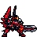

<!-- 本页上半部分由 tools/docs/gen_hero_docs.py 按仓库里现在的数据生成，手改会被覆盖；「开发记录」以下是手写的，生成时原样保留。 -->

# 超级机甲 The Mighty Mech

| 项目 | 内容 |
|---|---|
| id | `tft_mightymech` |
| 所属的包 | tft 包（金铲铲之战系列，mod_id `tft`） |
| 分路 | 辅助 |
| 分类 / 标签 | 功能型（Util） · AD / Melee / Tank / CC / Shield / Heal |
| 高清帧 | PPU 2 |
| 附加包 | 无 |

其他预览：[skills](../preview/tft_mightymech_skills.gif)

## 现在的技能

下面是游戏里显示的技能说明（`tft/text/champion.i18n` 的简体中文，去掉了颜色和图标），冷却、距离来自 `tft/champion/tft_mightymech.data_champion`；1 秒 = 60 tick。

### 普攻 / 被动

*攻击间隔 1.42 秒 · 攻击距离 25000*

每第三下活塞重斩额外造成30 + 60% 攻击力物理伤害并减速30%。旅人护航：每次开战为生命最低的队友提供80+最大生命6%的护盾（10秒），自己双倍。

### 技能1 · 引力矩阵

*冷却 12.33 秒 · 施放距离 40000 · 施放：无目标 · 敌方英雄*

张开刃翼4秒：受到伤害-22%，嘲讽附近敌人两次，每0.5秒回复20 + 15% 法强；结束时冲击波造成60 + 双抗60%物理伤害。

### 技能2 · 机甲飞跃

*冷却 12 秒 · 施放距离 70000 · 施放：指定目标 · 敌方英雄*

跃向正在冲击我方后排的敌人，落地造成60 + 80% 攻击力物理伤害，击飞0.75秒。

### 大招 · 究极变形·超级战刃

*冷却 50 秒 · 施放距离 60000 · 施放：指定目标 · 敌方英雄*

究极变形：获得150 + 80% 法强护盾，双抗+30%（6秒）；剑核爆燃，向前劈出剑气，造成125 + 115% 攻击力物理伤害并击飞1.25秒。

### 数值

攻击力 66（每级 +7）、法强 28（每级 +14）、生命 1250（每级 +120）、护甲 46（每级 +8）、魔抗 42（每级 +7）、移速 930（每级 +10）。

## 相关脚本和素材

- [`tools/kit/build_mightymech.py`](../../tools/kit/build_mightymech.py)
- [`tools/kit/setup_mightymech.py`](../../tools/kit/setup_mightymech.py)
- [`tools/lol/extract_mightymech.py`](../../tools/lol/extract_mightymech.py)
- [`tools/art/preview_mightymech.py`](../../tools/art/preview_mightymech.py)
- [`tools/art/rig_mightymech.py`](../../tools/art/rig_mightymech.py)
- [`assets/source/mightymech/`](../../assets/source/mightymech)

## 开发记录

| 部分 | 内容 |
|---|---|
| 定位 | tft 包（`tft_mightymech`）的英雄，辅助（近战机甲，护盾、嘲讽、击飞，伤害按攻击力和双抗）。金铲铲第 17 赛季的四费 `TFT17_Galio`「超级机甲」（霸天机甲 / 旅人，繁中「超能機甲」，英文 The Mighty Mech，射程 1，原技能「引力矩阵」）；第 15 赛季超级战队召唤的那台（`TFT15_Galio`）是同一副骨架的另一套涂装，没有做。红银黑三色的超级机器人：小红头盔、银色 V 形角、黄色眼罩，银色星形护肩，背后扇形红色刃翼，双手握着一把带橙色发光剑核的巨剑。技能是我们按原技能和霸天机甲（变形成究极形态）、旅人（开战护盾）羁绊自己设计的，用户 2026-11-03 定为辅助（「方案A 辅助」） |
| 普攻 / 被动 | **活塞重斩**（距离 25000，打塔）：第 15 tick 巨剑砍下 100% 攻击力；每第三下（隐藏计数 a_n1、a_n2）活塞推着剑重砸，多 30 + 60% 攻击力，减速 30% 1 秒。**旅人护航**（tft.dll）：每条命第一次有敌方英雄进到 70000 以内（开打）时，之后每 30 秒再一次：60000 以内生命比例最低的 1 个队友得 80 + 它自己最大生命 6% 的护盾 10 秒，它自己得双倍（纯数据版没有：数据里没有「开打」这个时机，也读不到生命） |
| 技能1 | **引力矩阵**（金铲铲原技能，冷却约 12.3 秒，只在打架时放）：第 10 tick 张开刃翼 4 秒，受到的伤害少 22%；开始和中途各嘲讽 40000 以内的敌方英雄 0.67 秒（代替原技能的「吸引投射物」：数据里没有能拦截投射物的效果）；每 0.5 秒回 20 + 15% 法强；结束时冲击波打 45000 以内的敌人：60 + 它（护甲 + 魔抗）的 60%（tft.dll `tft_mightymech:shockwave`；纯数据版 60 + 3% 最大生命） |
| 技能2 | **机甲飞跃**（冷却 12 秒，距离 70000，打英雄）：第 8 tick 起跳，24 tick 跳到正在冲我方后排的敌人身上——70000 以内的队友（不算自己）里，身边 35000 以内有敌方英雄、生命比例最低的那个，跳到离他最近的敌人（tft.dll `tft_mightymech:leap` + `hop`；没人被冲就跳向数据给的目标）；落地 30000 以内的敌人受 60 + 80% 攻击力，敌方英雄击飞 0.75 秒 |
| 大招 | **究极变形·超级战刃**（冷却 50 秒，距离 60000，打英雄）：变形，护盾 150 + 80% 法强 5 秒，护甲和魔抗 +30% 6 秒；第 30 tick 剑核爆燃、剑刃变长，第 50 tick 往前劈出一道剑气（75000 长、20000 宽）：线上每个敌人 125 + 115% 攻击力、击飞 1.25 秒。全是数据，塞拉斯偷到的就是这一招 |
| 数值 | 攻击 66（+7）、法强 28（+14）、生命 1250（+120）、护甲 46（+8）、魔抗 42（+7）、移速 930（+10），攻击间隔 85 tick，距离 25000 |
| 平衡 | 经典引擎模拟（辅助，纯数据版：没有护航护盾，冲击波按最大生命，飞跃跳向目标）：初稿 +4.34（引力矩阵每 10 秒一次、减伤 35%、嘲讽 1 秒、回血 25，太强）；v2 -0.50；v4 +2.25；v5 +0.85 / +0.55；v6 = 定稿 +1.31 / +1.27（种子 1–8 / 9–16）；回血从 20 降到 18 就掉到 +0.78 / +0.54。对照小木灵（纯数据版）+1.00 |
| tft.dll | [`addons/tft/src/mightymech.rs`](../../addons/tft/src/mightymech.rs)：被动 `tft_mightymech:escort`（开战护盾、护盾标记、倒下的音效）；效果 `tft_mightymech:shockwave`（按护甲 + 魔抗的冲击波）、`tft_mightymech:leap` / `hop`（挑目标、逐 tick 移动、落地伤害和击飞）。日志 `data/tft_mightymech.log`（SPAWN / ESCORT / SHOCKWAVE / LEAP / LAND） |
| 塞拉斯 / 佛耶戈 / 俄洛伊 / 悠米 | 塞拉斯偷到「究极变形·超级战刃」（纯数据，原样），按辅助类；佛耶戈的灵魂（辅助）、妮蔻、俄洛伊的灵魂、悠米坐在它头上的高度 28 |
| 精灵图（高清帧 PPU 2.0） | 参考是金铲铲客户端 TFTSet17 里它的模型（`tft17_galio_17`，85 个关节，皮肤先藏起 `Sword` 子网格；刃翼是挂在 Spine3 上的 16 根骨）和它自己的动作（站立、握剑待机、握剑行走、举剑劈砍、展翼防御、跃起落地、变形、召剑、碎裂）。第 0 步 Codex 画了 A（普通形态站立）和 B（究极形态双手握剑），原稿按它自己 7 px 的格子读回（A 83×116，B 136×115），用户选 B-1 40 像素高、PPU 2.0（缩到 94×80）：它从此一直握着巨剑，所以普攻改成用剑砍，大招改成剑核爆燃（不再从天上掉剑） |
| 动作 | [`tools/art/design_mightymech_poses.py`](../../tools/art/design_mightymech_poses.py)：Codex 的 18 个姿势（格子 6–10 px，身体比定稿大约 1.3 倍，刃翼张开时面积虚高）统一按跑步帧的平均尺度读回，剑在每一帧一样长；能对上的帧贴回定稿的头盔和黄眼罩（转头的几帧保留 Codex 的头）；举剑那帧 Codex 画成朝左，翻转朝右；剑尖落在最低处的几帧按躯干中线定站立点；跑步 8 帧上身各不相同，统一用第 1 帧的上半身、各帧自己的腿和尾巴（不然每步都抖）。[`rig_mightymech.py`](../../tools/art/rig_mightymech.py)：普攻举剑 → 劈下；引力矩阵待机 → 展翼立剑；飞跃下蹲 → 空中（抬高 14 格）→ 落地砸剑；大招展翼变形 → 举剑 → 横扫；跑步用金铲铲握剑行走的一整圈 8 帧 |
| 特效 | 用户给的一张 Gemini 图（15 张特效、3 个图标）由 [`tools/art/process_mightymech_fx.py`](../../tools/art/process_mightymech_fx.py) 处理：抠掉深灰底，按游戏大小缩小、减色、补成对称。引力罩原图是一块平躺的实心六边形地盘，改成铺在它脚下的引力场；变形光芒和剑核光柱原图画在身体中间，改到它身后；剑气三帧方向不一，统一朝右、上下对称；第三下重斩的实心红柱削成一道细刀光，不再挡住被打的人 |
| 音效 | [`tools/lol/extract_mightymech.py`](../../tools/lol/extract_mightymech.py) 的 13 段，全是它自己的：金铲铲第 15 赛季机甲的剑击、护盾、飞跃和落地、剑砸，第 17 赛季的引力矩阵、冲击波和变形，超级战队羁绊的巨剑仪式、召唤和砸地（当倒下） |
| 选人卡片 | 40 游戏像素高；卡片动图轮流放普攻、引力矩阵、飞跃、大招；图鉴中心按英雄联盟的规则（−11），选人卡片 −10（举剑时剑尖比头高，会被卡片框裁掉一点，按规则保留） |
