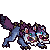

<!-- 本页上半部分由 tools/docs/gen_hero_docs.py 按仓库里现在的数据生成，手改会被覆盖；「开发记录」以下是手写的，生成时原样保留。 -->

# 暗影狼 Murkwolf



| 项目 | 内容 |
|---|---|
| id | `tft_murkwolf` |
| 所属的包 | tft 包（金铲铲之战系列，mod_id `tft`） |
| 分路 | 打野 |
| 分类 / 标签 | 刺客（Assassin） · AD / Melee |
| 高清帧 | PPU 1.67 |
| 附加包 | 无 |

其他预览：[skills](../preview/tft_murkwolf_skills.gif)、[逐帧预览](../preview/tft_murkwolf_frames.png)、[特效表](../preview/tft_murkwolf_effects.png)

## 现在的技能

下面是游戏里显示的技能说明（`tft/text/champion.i18n` 的简体中文，去掉了颜色和图标），冷却、距离来自 `tft/champion/tft_murkwolf.data_champion`；1 秒 = 60 tick。

### 普攻 / 被动

*攻击间隔 0.93 秒 · 攻击距离 23000*

两个头一起撕咬，造成100% 攻击力物理伤害。灰霸符：暴击率25%，随已损失生命值最多再+30%，技能也能暴击。

### 技能1 · 撕裂之爪

*冷却 7 秒 · 施放距离 45000 · 施放：指定目标 · 敌人（不含防御塔）*

跃向附近生命值最低的敌人，造成40 + 110% 攻击力物理伤害。接下来3次攻击攻速+60%，额外造成10 + 30% 攻击力物理伤害。

### 技能2 · 狂战士之嚎

*冷却 10 秒 · 施放距离 30000 · 施放：指定目标 · 敌人（不含防御塔）*

仰头长嚎，5秒内吸血20%，伤害提高15%，对生命低于50%的敌人翻倍。

### 大招 · 狼群攻击

*冷却 45 秒 · 施放距离 50000 · 施放：指定目标 · 敌方英雄*

叫来2只小暗影狼扑向目标，造成40 + 60% 攻击力物理伤害。6秒内它每次攻击，小狼咬2口，每口12 + 25% 攻击力物理伤害。

### 数值

攻击力 86（每级 +15）、生命 920（每级 +88）、护甲 28（每级 +8）、魔抗 24（每级 +4）、移速 1100（每级 +12）、暴击 25（每级 +0）。

## 相关脚本和素材

- [`tools/kit/build_murkwolf.py`](../../tools/kit/build_murkwolf.py)
- [`tools/kit/setup_murkwolf.py`](../../tools/kit/setup_murkwolf.py)
- [`tools/lol/extract_murkwolf.py`](../../tools/lol/extract_murkwolf.py)
- [`tools/art/preview_murkwolf.py`](../../tools/art/preview_murkwolf.py)
- [`tools/art/rig_murkwolf.py`](../../tools/art/rig_murkwolf.py)
- [`assets/source/murkwolf/`](../../assets/source/murkwolf)

## 开发记录

| 部分 | 内容 |
|---|---|
| 定位 | tft 包（`tft_murkwolf`）的英雄，打野（近战刺客，物理伤害，暴击）。金铲铲第 18 赛季的二费 `DA_Murkwolf18`「暗影狼」（峡谷野怪 / 狂战士，繁中「魔狼」，英文 Murkwolf，射程 1）：就是峡谷里的暗影狼，**双头狼**，灰蓝色的毛，背上紫色鬃毛和一排墨绿尖刺，白色腮毛，发青光的眼睛，两张粉色大嘴。金铲铲原技能「撕裂之爪」做技能1，「灰霸符」做被动，其余按用户选的方案 A「撕裂之爪」（2026-11-01，打野）自己设计 |
| 普攻 / 被动 | **双头撕咬**（距离 23000）：第 10 tick 咬下，100% 攻击力物理伤害。**灰霸符**（tft.dll）：基础暴击率 25%，每 15 拍按已损失生命值再加最多 30%（`p_gray` 层）；技能的每一下由 tft.dll 按它的暴击率掷骰（确定性种子），暴击 200%，亮银星 `p_hit` |
| 技能1 | **撕裂之爪**（金铲铲原技能，冷却 7 秒，距离 45000，打兵和野怪）：先英雄、再小兵野怪，跃向范围内**生命值最低**的敌人（tft.dll 把它放到目标身前 20000），撕一下 40 + 110% 攻击力物理伤害（能暴击）；之后 3 次攻击攻速 +60%、每次多 10 + 30% 攻击力物理伤害（`q_n1` 记号计数，用完摘掉） |
| 技能2 | **狂战士之嚎**（冷却 10 秒）：仰头长嚎，5 秒里吸血 20%、它的每一下（普攻、技能、小狼）伤害 +15%，对生命低于 50% 的敌人翻倍（tft.dll `on_attack`） |
| 大招 | **狼群攻击**（冷却 45 秒，距离 50000，有敌方英雄时）：叫来两只小暗影狼，第 12 tick 扑向目标 40 + 60% 攻击力物理伤害；6 秒内它每次攻击，小狼咬同一个敌人 2 口（间隔 4 拍），每口 12 + 25% 攻击力物理伤害。两只小狼**面向敌人**（用户：「召唤出来的小狼应该面向敌人 参考沙皇怎么做的」「左右都可以面向敌人」）：特效图不会跟着单位翻转，所以像沙皇的士兵一样画了朝右、朝左两张（`r_pack_r` / `r_pack_l`，一只在尾巴后、一只在头前），tft.dll 每 6 拍看最近的敌人在哪边挂上那一张（左右差不到 2000 不转），它每次攻击和小狼扑上去时朝被咬的人重新挂，动画从缩身扑咬开始 |
| 数值 | 攻击 86（+15）、生命 920（+88）、护甲 28（+8）、魔抗 24（+4）、移速 1100（+12），攻击间隔 56 tick，距离 23000 |
| 平衡 | 经典引擎模拟（打野，纯数据版：暴击按期望折进技能、小狼的咬写成数据）：**+1.32 / +1.09**（种子 1–8 / 9–16）；同位置的史密奇 +1.24 / +1.25：持平 |
| tft.dll | [`addons/tft/src/murkwolf.rs`](../../addons/tft/src/murkwolf.rs)：被动 `tft_murkwolf:gray`（灰霸符、狂战士之嚎的增伤、死亡的叫声）；原生效果 `tft_murkwolf:rend`（选血最少的目标、落地、撕扯）、`tft_murkwolf:bite`（强化攻击计数、小狼跟咬）、`tft_murkwolf:pounce`（小狼扑击）、`tft_murkwolf:pup`（小狼一口）。日志 `data/tft_murkwolf.log` |
| 塞拉斯 / 佛耶戈 / 妮蔻 / 俄洛伊 / 悠米 | 塞拉斯偷到的狼群攻击是一份纯数据版（他的附加包在创意工坊，调不了 tft.dll，小狼也跟不了他的普攻）：小狼扑上去，之后每隔 50 拍再咬 4 轮、每轮 2 口（特效表复制进附加包）；佛耶戈 / 妮蔻的表（刺客）、俄洛伊的灵魂、悠米坐骑的头顶高度 |
| 精灵图（高清帧 PPU 1.67） | 参考是金铲铲客户端 TFTSet18 里它自己的模型（`tft18_murkwolf`，61 个关节，L / R / C 三套脖子和头，C 头不显示：画面上是两个头）和它自己的 6 段动作（待机、扑咬、立起、死亡、跑、伏低）。第 0 步 Codex 画了 A（3/4）和 B（侧面）：A 按 9 px 一格读回 83×60、按 11 px 75×51，A 初稿 99×66，B 110×68 / 100×59。用户选 **A-1、36 游戏像素、PPU 1.67**（60 行 1:1，脸不用重画）。第 2 步 Codex 照它自己的动作画了 19 个姿势（骨架包 [`tools/art/pack_murkwolf_poses.py`](../../tools/art/pack_murkwolf_poses.py)：两个头放大 1.3 倍；它没有嚎叫动作，嚎叫和号令的姿势把两条脖子绕根部抬起或压低） |
| 动作 | [`tools/art/design_murkwolf_poses.py`](../../tools/art/design_murkwolf_poses.py)：Codex 每张都画大了约两成、身子还长了一成，按面积定比例从原稿读回，每格取原稿那一格最多的定稿颜色；两个头各自能对上的贴定稿的脸，原稿里的每只眼睛按定稿的眼睛形状补回（读小后眼睛只剩一格或没了），按重心对齐。[`tools/art/rig_murkwolf.py`](../../tools/art/rig_murkwolf.py)：普攻后缩 + 扑咬；撕裂之爪蹲下、立起扑出、落地撕扯；嚎叫低头吸气 + 仰头长嚎；大招伏低龇牙 + 站高号令；死亡被掀翻 + 侧躺。**移动是待机图上的小跑**：Codex 的 8 帧跑步每帧身体都不一样（尾巴、身长、两个头的间距都在变），所以身体、头、尾巴每帧都用定稿，三条看得见的腿绕髋部摆动（爪子整块移动），前后交替，0.8 秒一圈 |
| 特效 | 9 张 + 3 个技能图标，Codex 画（[`tools/art/pack_murkwolf_fx.py`](../../tools/art/pack_murkwolf_fx.py) 的提示词：爪痕、咬痕、奶黄尖牙、粉红伤口、青色闪光、紫黑暗影烟；参考是纳亚菲利的尖牙和猎犬、莎弥拉和沃利贝尔的爪痕、沃里克的火星 [`tools/lol/fx_ref_murkwolf.py`](../../tools/lol/fx_ref_murkwolf.py)）。[`tools/art/import_murkwolf_fx.py`](../../tools/art/import_murkwolf_fx.py)：咬中、暴击银星、小狼咬一口从原稿按更大的格子重新裁（原来的小格子把星芒和尖牙糊成了色块），两只小狼从原稿重读成 16×19（原来被压扁成 14×13），落地的暗影尘土提亮一档，3 个图标从原稿重新缩到 64。侧身小狼是第二轮 Codex 画的（[`tools/art/pack_murkwolf_pups.py`](../../tools/art/pack_murkwolf_pups.py)：峡谷小暗影狼 `sru_murkwolfmini` 自己的模型和动作，6 个姿势：站、喘气、缩身、扑咬、回收、站回），每只按 16.5 px 一格读回（站着 28×17），用它自己的颜色，眼睛补回一格青色；正面小狼留给塞拉斯偷的大招 |
| 音效 | 咬、低吼、长嚎、死亡是峡谷暗影狼自己的（`npc_map11_murkwolf_sfx_`，大多数事件没有名字，按 id 和声音特征认出来），小狼出场和离场是峡谷小狼的（`npc_map11_murkwolfmini_sfx_`）；咬中、嚎叫借沃里克，扑跃和暴击借雷恩加尔，小狼扑咬借纳亚菲利的猎犬（[`tools/lol/extract_murkwolf.py`](../../tools/lol/extract_murkwolf.py)，16 个） |
| 选人卡片 | 尾巴尖到爪子 36 游戏像素，两个头伸到站位点前 28 像素：卡片以站位点为中心，远处那个头的鼻子会超出右边，`league.dll` 的 `UI_SIZES` 0.9；`banpick_center` (0, −14)，脸 (9, −16)（近处那只眼睛），中心 (3, −16)。待机按 `tools/art/hero_reels.py` 剪进低头吸气和扑咬起手，卡片轮播普攻、撕扯、嚎叫、大招（起跳立起的那帧会顶出卡片，不放） |

重新生成（素材来自本机的英雄联盟 / 金铲铲客户端，音频和 Riot 的渲染不进仓库）：

```bash
python tools/lol/extract_murkwolf.py --riot "D:\Riot Games\League of Legends" --vgmstream <vgmstream-cli.exe>
python tools/kit/build_murkwolf.py                        # 技能数据（被动调用 tft.dll），数字都在脚本的参数表 P 里；--plain 是平衡模拟用的纯数据
python tools/kit/setup_murkwolf.py                        # 五种语言的文字、音效配置、tft 包共享文件里它的键
python tools/art/design_murkwolf_hd.py                    # Codex 第 0 步的原稿读回
python tools/art/design_murkwolf_model.py                 # 定稿 A-1（83×60）
python tools/art/design_murkwolf_poses.py                 # Codex 的姿势：按定稿的体型从原稿读回、换成定稿的颜色、贴脸补眼睛
python tools/art/rig_murkwolf.py                          # 全部动作帧 -> assets/source/ppu
python tools/art/ppu_restyle.py --hero murkwolf           # 描边、补缝
python tools/art/ppu_hd.py --hero murkwolf                # 高清帧图集
python tools/art/import_murkwolf_fx.py                    # 特效和图标
python tools/art/hero_reels.py --hero tft_murkwolf        # 待机和选人卡片的轮播
python tools/art/preview_murkwolf.py                      # docs/preview 里的预览
```
