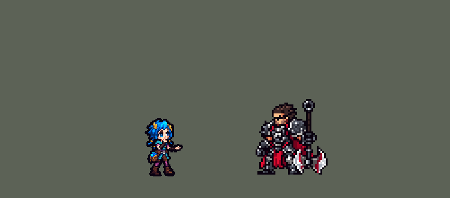

<!-- 本页上半部分由 tools/docs/gen_hero_docs.py 按仓库里现在的数据生成，手改会被覆盖；「开发记录」以下是手写的，生成时原样保留。 -->

# 爆爆 Powder


| 项目 | 内容 |
|---|---|
| id | `tft_powder` |
| 所属的包 | tft 包（金铲铲之战系列，mod_id `tft`） |
| 分路 | 中单 |
| 分类 / 标签 | 法师（Magician） · AP / Magic / Range |
| 高清帧 | PPU 1.75（画成 90%） |
| 附加包 | 无 |



其他预览：[逐帧预览](../preview/tft_powder_frames.png)、[特效表](../preview/tft_powder_effects.png)

## 现在的技能

下面是游戏里显示的技能说明（`tft/text/champion.i18n` 的简体中文，去掉了颜色和图标），冷却、距离来自 `tft/champion/tft_powder.data_champion`；1 秒 = 60 tick。

### 普攻 / 被动

*攻击间隔 1.5 秒 · 攻击距离 55000*

扔出自制小鞭炮，造成100% 攻击力物理伤害。伏击者：技能炸弹可以暴击（25%几率，伤害翻倍）。

### 技能1 · 猴子炸弹

*冷却 5.5 秒 · 施放距离 70000 · 施放：指定目标 · 敌人（不含防御塔）*

把上了发条的猴子炸弹丢到目标脚下，范围内敌人受到36 + 28% 法强魔法伤害，中心再受一次；被炸到的敌人灼烧3秒，并重伤4秒（受到治疗-40%）。

### 技能2 · 快跑，爆爆！

*冷却 10 秒 · 施放距离 24000 · 施放：指定目标 · 敌方英雄*

敌方英雄靠近时摔下闪光烟雾弹：周围敌人受到45 + 30% 法强魔法伤害并致盲1秒（无法普攻），自己向后跳开。

### 大招 · 海克斯水晶炸弹

*冷却 50 秒 · 施放距离 75000 · 施放：指定目标 · 敌方英雄*

把装着海克斯水晶的包丢向敌方英雄，引线烧完0.9秒后蓝光大爆炸：范围内敌人受到170 + 65% 法强魔法伤害并击飞0.75秒。

### 数值

攻击力 76（每级 +6）、法强 40（每级 +20）、生命 860（每级 +95）、护甲 18（每级 +7）、魔抗 20（每级 +4）、移速 930（每级 +9）。

## 相关脚本和素材

- [`tools/kit/build_powder.py`](../../tools/kit/build_powder.py)
- [`tools/kit/setup_powder.py`](../../tools/kit/setup_powder.py)
- [`tools/art/preview_powder.py`](../../tools/art/preview_powder.py)
- [`tools/art/rig_powder.py`](../../tools/art/rig_powder.py)
- [`assets/source/powder/`](../../assets/source/powder)

## 开发记录

> 下面是原来 README 里「英雄：爆爆（金铲铲之战 · tft 包）」一节，原样搬过来（只改了相对链接）。

| 部分 | 内容 |
|---|---|
| 定位 | tft 包（`tft_powder`）的第一个英雄，中单（Magician，标签 AP / Magic / Range）。《双城之战》里小时候的金克丝，金铲铲之战第 13 赛季「双城之战」的棋子（家人 / 废铁 / 伏击者）。金铲铲里她只有一个技能（把猴子炸弹扔向敌人最密的地方，离中心越远伤害越低，附带重伤和灼烧），所以三个技能和被动都是自己设计的；用户从三套方案里选了 A「猴子炸弹」 |
| 普攻 / 被动 | 扔出自制小鞭炮（射程 55000，100% 攻击）。**伏击者**：技能炸弹可以暴击（25%，暴击 2 倍）——只在技能命中的那一 tick 给自己挂一层 25% 暴击的 buff，所以普攻不暴击（金铲铲的伏击者只让技能暴击）；buff 每打中一个人先摘再挂，不然一次爆炸打中五个人叠成 125%，次次暴击（模拟 +7.5） |
| 技能1 | **猴子炸弹**（对小兵、野怪也放，射程 70000）：把发条猴子炸弹丢到目标脚下（0.5 秒落地）。数据没有「敌人最密的地方」，就丢目标；衰减做成两圈：半径 32000 内 36 + 28% 法强 魔法伤害，中心 16000 内再来一次（中心全额、外圈减半）；被炸到的灼烧 3 秒（每 0.5 秒 5 + 5% 法强）、重伤 4 秒（受到治疗 −40%）。冷却 5.5 秒 |
| 技能2 | **快跑，爆爆！**（敌方英雄进到 24000 内才放）：脚下摔一颗闪光烟雾弹，周围 28000 内的敌人受到 45 + 30% 法强 魔法伤害并致盲 1 秒（不能普攻），自己向后跳开（MoveBack）。冷却 10 秒 |
| 大招 | **海克斯水晶炸弹**（《双城之战》第三集那颗真炸了的炸弹，射程 75000）：把装着海克斯水晶的包丢向敌方英雄（0.6 秒落地，落点一直有警示圈），引线烧 0.9 秒后蓝光大爆炸：半径 42000 内 170 + 65% 法强 魔法伤害并击飞 0.75 秒。冷却 50 秒 |
| 数值 | 攻击 76（+6）、法强 40（+20）、生命 860（+95）、护甲 18（+7）、魔抗 20（+4）、移速 930（+9）、射程 55000 |
| 平衡 | 10 分钟经典引擎模拟，中路对五个原版法师，三套阵容、两边各打，两批种子（1–8、9–16）：初稿（Q 55 + 45%、E 60 + 40%、R 230 + 90%）+5.31（去掉暴击 +1.71：25% 暴击就是她伤害的 +25%）；Q 38 + 30%、E 45 + 30%、R 170 + 65%、灼烧 5 + 5% +1.34 / +1.38（同批吉格斯 +1.70）；按动作条的出手时间（普攻第 11 tick、Q 第 12、E 第 5、R 第 18）+1.77 / +2.29；Q 35 + 27% +0.65 / +0.57；定稿 Q 36 + 28% +1.55 / +0.72（约 +1.1，佐伊约 +1.3） |
| 精灵图（高清帧 PPU 1.75，画成 90%） | 参考：英雄联盟客户端里也带着金铲铲的棋子——`Game/DATA/FINAL/TFTSet13.wad.client` 里爆爆是 `TFT13_Blue`（小蔚是 `TFT13_Red`），模型、动作（Idle、Run、attack_1、attack_2、Spell、Death）、猴子炸弹都在，`tools/lol/pose_ref.py --champ TFT13_Blue --wad-file TFTSet13.wad.client` 渲染（皮肤里的 Bomb、Monkey 两个道具要藏掉）。Codex 第 0 步画了待机 A（金铲铲的待机：一只手托下巴、另一只手摊开）和站直 B（[`tools/art/pack_powder_picture.py`](../../tools/art/pack_powder_picture.py)），[`tools/art/design_powder_hd.py`](../../tools/art/design_powder_hd.py) 从原始图按 10 px 一格读回（Codex 自己压成 60 行的那份是最近邻取样，丢细节），用户：「A」「35」「PPU 1.5」（53 行）。第 1 步 Codex 在游戏格子上画了 A、S 各两稿（[`tools/art/pack_powder_model.py`](../../tools/art/pack_powder_model.py)，每格 22 px），用户选了待机 A-2（33 × 53）和侧面 S-2；侧面在 53 行里只有 24 格宽、近侧手臂两格粗和身体分不开，待机的下巴又被托下巴的手挡着，造型自己的格子摆不出动作，所以 Codex 又画了一个部件包（[`tools/art/pack_powder_poses.py`](../../tools/art/pack_powder_poses.py)）：去掉手的干净头、七个姿势（抡臂、扔出、蹲低、上抛、摔、后跳、挨打）和跑步 8 帧，每帧照一具红 / 蓝骨架画、每段长度按待机量的。[`tools/art/design_powder_poses.py`](../../tools/art/design_powder_poses.py) 按 Codex 自己的格子读回、按颜色多数缩到待机的下巴到脚底 32 行（同一张图一个比例），Codex 的头换成那颗干净的头（每一帧同一张脸）。[`tools/art/rig_powder.py`](../../tools/art/rig_powder.py) 排成动作（整张平移、四分之一转、闪白，不重画）：待机（上身坐下一行）、跑（头固定在一列）、普攻（抡臂、扔出）、技能1（蹲低、下手上抛）、技能2（摔烟雾弹、原地跳起——往后退交给游戏的 MoveBack）、大招（抡臂更久、扔出）、挨打（闪白）、阵亡 8 帧（往后转倒、回弹一下）；审查只发一张合成 GIF，左边金铲铲模型的同名动作，用户：「动作可以」。用户：「人物模型太大 缩小一点」——`league.dll` 画成 90%（hd.rs SIZES），帧整体下移 2 格让脚踩在地上。之后用户：「PPU像素好低啊 能调一下吗」，看了 1.5 / 1.75 / 2.0 / 2.2 的对照，选了不重画的 1.75（61 行）：待机换成第 0 步原画 A（84 行）缩到 61 行，姿势和跑步用 Codex 部件包自己的格子（姿势 7 px、跑步 6 px，每张一个比例缩到下巴到脚底 37 行），动作里的头统一换成 Codex 画在「扔出」那一帧上的头（53 行那颗干净的头对 61 行太粗）；`design_powder_poses.py` 写到 `assets/source/powder/hd/ppu175/`，动作不变 |
| 特效 | 第 3 步的 14 张特效和 3 个技能图标（[`tools/art/pack_powder_fx.py`](../../tools/art/pack_powder_fx.py)，参考是金铲铲皮肤里她自己的贴图：猴子炸弹、碎猴子零件、炸弹桶）用户交给 Gemini 画回来，17 张 JPG（没有透明背景，底色有黑、白、灰和画出来的棋盘格），[`tools/art/process_powder_fx.py`](../../tools/art/process_powder_fx.py) 处理：按底色抠背景（白底、灰底从边上漫填，光芯里的白留着；黑底只去纯黑，实物的描边留着；格子框、分隔条去掉），按帧数等分，每个特效所有帧共用一个框（闪光在爆炸里的位置不变），归到 24 种颜色，按格子取多数颜色缩到清单里的游戏尺寸（细线四分之一有颜色就画，太小的亮光点单独补一格），警示圈横竖分开缩成地上的扁椭圆，除了三个翻滚的弹道全部从更满的一半镜像成左右对称；[`tools/art/import_powder_fx.py`](../../tools/art/import_powder_fx.py) 写成 `tft/effects/tft_powder_fx` 和 `tft_powder_big`：小鞭炮（翻滚）和它炸开的火星，猴子炸弹（翻滚的发条猴）、它的爆炸（火球、粉蓝烟、碎钹和螺丝）、灼烧的火和绿色溅射、重伤的裂开红十字，脚下的闪光烟雾弹、致盲的烟带，举包时手上的蓝光、水晶包（翻滚）、落点的警示圈、地上冒火花的包、蓝色海克斯大爆炸、击飞的电火花 |
| 音效 | 自己找：mod 里没有一个音频文件。每个音效事件是她自己的 `.sound_info`，按名字播放游戏本体自带的音频片段（`asset/base/sound/sfx/<片段>`，本体的事件也是这么播的），几段叠起来、调音量和延迟混出她自己的声音，所以没有版权和许可的问题：小鞭炮出手 = 炼金术士的投掷（0.35），打中 = 炸弹人的命中（0.35）；猴子炸弹出手 = 小丑技能 + 炼金术士投掷，爆炸 = 赌徒的爆炸 + 炸弹人的命中，灼烧 = 炼金术士技能 2 的命中；烟雾弹 = 忍者普攻（出手）、忍者技能 2 + 炸弹人技能 2（炸开）、幻术师普攻（致盲）；水晶炸弹出手 = 大力士扔人 + 魔剑士技能 2，引线 = 炸弹人的陷阱 + 炼金术士的持续声，爆炸 = 鬼怪大招爆炸 + 驱魔人大招爆炸 + 召唤师大招爆炸，击飞 = 占星师技能 1 的冲击。没有配音（[`tools/kit/setup_powder.py`](../../tools/kit/setup_powder.py) 的 SOUNDS；`lint_mod.py` 认得按名字播放的本体片段） |
| 图标 | 同一批 Gemini 画的三个 64 × 64 像素图标：发条猴子炸弹、摔出去的烟雾弹（带往回跑的速度线）、透出青蓝光的水晶炸弹包（`tft/icons/tft_powder_skill` / `_skill2` / `_ult`，缩到 64 × 64、归到各自的 32 种颜色）。金铲铲只有一个技能图标，所以三个都是自己画的 |

重新生成：

```bash
python tools/kit/build_powder.py                       # 技能数据，数字都在脚本的参数表 P 里
python tools/kit/setup_powder.py                       # 五种语言的文字、音效配置、tft 包的共享文件
python tools/art/design_powder_model.py                # Codex 第 1 步的造型读回（A-2 / S-2）
python tools/art/design_powder_poses.py                # 部件包读回：干净的头、姿势、跑步
python tools/art/rig_powder.py                         # 1 倍帧和 1.5 的原帧
python tools/art/ppu_restyle.py --hero powder          # 外描边、下移 2 格
python tools/art/ppu_hd.py --hero powder               # hd_ / lo_ 帧
python tools/art/process_powder_fx.py --src <放 Gemini 原图 00.jpg–16.jpg 的文件夹>   # 特效、图标处理
python tools/art/import_powder_fx.py                 # 特效表、图标
python tools/art/preview_powder.py                   # 预览和演示 GIF
python tools/package_mod.py --src tft --hero powder --install
```


逐帧预览：[`docs/preview/tft_powder_frames.png`](../preview/tft_powder_frames.png?v=1019a)，特效：[`docs/preview/tft_powder_effects.png`](../preview/tft_powder_effects.png?v=1019a)。
