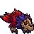

<!-- 本页上半部分由 tools/docs/gen_hero_docs.py 按仓库里现在的数据生成，手改会被覆盖；「开发记录」以下是手写的，生成时原样保留。 -->

# 深红锋喙鸟 Mama Beak



| 项目 | 内容 |
|---|---|
| id | `tft_raptor` |
| 所属的包 | tft 包（金铲铲之战系列，mod_id `tft`） |
| 分路 | ADC |
| 分类 / 标签 | 射手（Range） · AD / Range |
| 高清帧 | PPU 1.56 |
| 附加包 | 无 |

其他预览：[skills](../preview/tft_raptor_skills.gif)、[逐帧预览](../preview/tft_raptor_frames.png)、[特效表](../preview/tft_raptor_effects.png)

## 现在的技能

下面是游戏里显示的技能说明（`tft/text/champion.i18n` 的简体中文，去掉了颜色和图标），冷却、距离来自 `tft/champion/tft_raptor.data_champion`；1 秒 = 60 tick。

### 普攻 / 被动

*攻击间隔 1.17 秒 · 攻击距离 60000*

甩出一根锋羽，造成100% 攻击力物理伤害。橙霸符：它的物理伤害使目标护甲-6（3秒，最多5层）。

### 技能1 · 羽刃扇射

*冷却 6 秒 · 施放距离 60000 · 施放：指定目标 · 敌人（不含防御塔）*

张开翅膀，扇形甩出5根羽刃，每根命中第一个敌人，造成35 + 55% 攻击力物理伤害。

### 技能2 · 惊飞跃退

*冷却 9 秒 · 施放距离 35000 · 施放：指定目标 · 敌方英雄*

受惊尖叫，往后一跳，之后3秒攻速+70%。

### 大招 · 鸟群之家

*冷却 45 秒 · 施放距离 65000 · 施放：指定目标 · 敌方英雄*

召唤4只不可选中的小锋喙鸟（7秒）：它每次普攻，小鸟们一起啄同一目标，各造成18 + 30% 攻击力物理伤害。

### 数值

攻击力 98（每级 +18）、生命 860（每级 +88）、护甲 22（每级 +7）、魔抗 18（每级 +3）、移速 920（每级 +9）。

## 相关脚本和素材

- [`tools/kit/build_raptor.py`](../../tools/kit/build_raptor.py)
- [`tools/kit/setup_raptor.py`](../../tools/kit/setup_raptor.py)
- [`tools/lol/extract_raptor.py`](../../tools/lol/extract_raptor.py)
- [`tools/art/preview_raptor.py`](../../tools/art/preview_raptor.py)
- [`tools/art/rig_raptor.py`](../../tools/art/rig_raptor.py)
- [`assets/source/raptor/`](../../assets/source/raptor)

## 开发记录

| 部分 | 内容 |
|---|---|
| 定位 | tft 包（`tft_raptor`）的英雄，下路（ADC，远程，物理伤害）。金铲铲第 18 赛季的三费 `DA_CrimsonRaptor18`「深红锋喙鸟」（用户叫它锋啄鸟；峡谷野怪 / 召唤师 / 迅捷射手，繁中「巨喙鳥媽媽」，英文 Mama Beak，射程 4）：峡谷锋喙鸟里的鸟妈妈，圆滚滚、压低身子蹲着的鸟，红色背羽尾羽、紫色尖刺鬃毛、棕色骨质钩喙鸟头、两只发光的橙色眼睛，嘴里透橙光。金铲铲原技能「鸟群之家」做大招，原版的「橙霸符」做被动，其余按用户选的方案 A「鸟群之家」（2026-10-31）自己设计 |
| 普攻 / 被动 | **锋羽射击**（射程 60000，打塔）：第 8 tick 甩出一根追踪的红色羽毛，100% 攻击力物理伤害。**橙霸符**（tft.dll）：它的每次物理命中（普攻、羽刃、小锋喙鸟的啄击）让目标护甲 -6，持续 3 秒，最多 5 层，再中一下刷新时长（引擎的叠层 buff，数据里的同名 buff 只会无限叠），叠满那一下有一声 |
| 技能1 | **羽刃扇射**（冷却 6 秒，距离 60000，打兵和野怪）：第 12 tick 张开翅膀和羽冠，朝目标扇形甩出 5 根羽刃，相邻两根差 12 度（tft.dll：数据里的投射物不能带角度），每根直飞 70000、碰到第一个敌人就停，35 + 55% 攻击力物理伤害，挂一层橙霸符；贴脸时一个敌人能吃到好几根 |
| 技能2 | **惊飞跃退**（冷却 9 秒，距离 35000，身边有敌方英雄时）：第 4 tick 尖叫一声，直线往后跳 30000（`MoveBack` 5000 × 6），落地后 3 秒攻速 +70%（迅捷射手） |
| 大招 | **鸟群之家**（金铲铲原技能，冷却 45 秒，距离 65000，有敌方英雄时）：第 12 tick 仰头大叫，4 只不可选中的小锋喙鸟围在身边 7 秒（旗子 `tft_raptor_r_flock`，画面是身边的四只小鸟）；期间它每次普攻，羽毛之后每隔 3 tick 追加一只小鸟的扑啄，共 4 下，每下 18 + 30% 攻击力物理伤害，也挂橙霸符 |
| 数值 | 攻击 98（+18）、生命 860（+88）、护甲 22（+7）、魔抗 18（+3）、移速 920（+9），攻击间隔 70 tick，射程 60000 |
| 平衡 | 经典引擎模拟（下路，对原版弓箭手、枪手、回旋镖猎人、毒镖猎人，两边三套阵容，纯数据版：扇射换成同样宽的锥形、每个敌人吃 2 根的伤害，橙霸符不封顶）：草稿（攻击 92、羽刃 30 + 45%、小鸟 12 + 22%、大招 6 秒、E +60%、减甲 5）+0.08 / −0.02（种子 1–8 / 9–16）；攻击 98、羽刃 35 + 55% +0.45；再加小鸟 18 + 30%、大招 7 秒 +0.37；再加 E +80%、减甲 7 +2.31 / +1.01；取中间（E +70%、减甲 6）**+0.69 / +1.47**。迭嘉（四费射手）纯数据同种子 +1.39 / +1.17：三费的它略低一点 |
| tft.dll | [`addons/tft/src/raptor.rs`](../../addons/tft/src/raptor.rs)：原生效果 `tft_raptor:fan`（扇形发 5 根不穿透的直线羽刃）、`tft_raptor:fan_hit`（一根羽刃的命中：物理伤害、命中特效和声音、橙霸符）、`tft_raptor:shred`（橙霸符：`entity_stack_buff` 最多 5 层、刷新时长）；被动 `tft_raptor:flock`（参数、死亡时的叫声）。日志 `data/tft_raptor.log`（SPAWN / FAN / FEATHER / SHRED） |
| 塞拉斯 / 佛耶戈 / 妮蔻 / 俄洛伊 / 悠米 | 塞拉斯偷到的鸟群之家是一份纯数据版（原版只强化它自己的普攻，在他手里没用）：仰头一叫，四只小鸟围着他，分 3 轮各 4 下扑啄他的目标（特效表复制进附加包）；佛耶戈 / 妮蔻的表（远程）、俄洛伊的灵魂、悠米坐骑的头顶高度 24 |
| 精灵图（高清帧 PPU 1.56） | 参考是金铲铲客户端 TFTSet18 里它自己的模型（`tft18_raptor`，48 个关节，一张贴图；皮肤借的是峡谷的 SRU_Razorbeak；动作片段按路径哈希连着：待机、跑、三种啄、死亡、仰头叫、落地出场）。第 0 步 Codex 画了 A（3/4）和 B（侧面），它自己按 11 px 整理的版本是从原稿缩下来的、糊了，只读原稿：A 11 px 一格（75×56）、A 初稿 9 px（110×82）、B 9 px（100×54）/ 11 px（93×51）。用户选 **A-1、36 游戏像素、PPU 1.56**（56 行 1:1，脸不用修）。第 2 步 Codex 照它自己的动作片段画了 18 个姿势（骨架包 [`tools/art/pack_raptor_poses.py`](../../tools/art/pack_raptor_poses.py)：头放大 1.3 倍，骨架不从 `Spine1_null` 连（它在出场和死亡里会飘出身体）；8 帧跑取金铲铲 1.2 秒的完整一圈） |
| 动作 | [`tools/art/design_raptor_poses.py`](../../tools/art/design_raptor_poses.py)：Codex 每张的身体大小都不一样（定稿一格对应原稿 10–14 px），按「贴定稿的脸吻合度最高」逐张找比例读回，每格取原稿那一格最多的定稿颜色；头摆正的贴定稿的上半张脸（眉骨、两只橙眼、上喙，张嘴的下喙保留），歪头的保留 Codex 的；站位按脸，没有脸的按爪子。[`tools/art/rig_raptor.py`](../../tools/art/rig_raptor.py)：普攻竖冠蓄力 + 前探射羽；羽刃扇射后仰 + 翅膀羽冠全开；惊飞跃退腾空（离地 6 格）+ 落地尖叫；鸟群之家挺身 + 仰头大叫；死亡后仰踉跄 + 侧翻倒地。**跑不用 Codex 的 8 帧**（每帧的身体都是另一张画）：在定稿待机上走（加里奥 / 布隆的做法），后腿和爪子从羽毛下切出来，每帧抬起一条往前迈，身体完全是定稿，随步子起伏 1–2 行，8 帧 × 150 ms |
| 特效 | 10 张 + 3 个技能图标，Codex 画（[`tools/art/pack_raptor_fx.py`](../../tools/art/pack_raptor_fx.py) 的提示词，参考是霞的羽毛、羽刃和命中，奎因的风和烟，嘉文四世的粒子贴图 [`tools/lol/fx_ref_raptor.py`](../../tools/lol/fx_ref_raptor.py)）。[`tools/art/import_raptor_fx.py`](../../tools/art/import_raptor_fx.py)：飞出的羽毛、羽刃、小鸟扑啄当初给的格子太小，Codex 缩成了一团，从原稿重新切进更大的格子（18×7、26×10、16×8，每帧按自己的范围居中，上下对称），羽毛命中也重切（16×16）；鸟群按原稿 9.5 px 一格重读（每只小鸟约 11 格高），左右各往外挪 4 格不压脸；3 个图标从原稿重新缩到 64 |
| 音效 | 甩羽、命中、尖叫和死亡是它自己的（峡谷锋喙鸟的音效包 `npc_map11_razorbeak_sfx_`，没名字的事件按 id 听出来）；大招的小鸟用小锋喙鸟自己的（`npc_map11_razorbeakmini_sfx_`：出场、啄、啄中、飞走）；羽刃借霞，后跳借薇恩的翻滚，攻速借奎因的 W，破甲借嘉文四世的 Q（[`tools/lol/extract_raptor.py`](../../tools/lol/extract_raptor.py)，15 个） |
| 选人卡片 | 羽冠到爪子 36 游戏像素：`banpick_center` (0, −14)，脸 (8, −17)（近处那只眼睛），中心 (0, −18)。待机按 `tools/art/hero_reels.py` 剪进普攻的第一帧，卡片轮播普攻、羽刃扇射、惊飞跃退、鸟群之家 |

重新生成（素材来自本机的英雄联盟 / 金铲铲客户端，音频和 Riot 的渲染不进仓库）：

```bash
python tools/lol/extract_raptor.py --riot "D:\Riot Games\League of Legends" --vgmstream <vgmstream-cli.exe>
python tools/kit/build_raptor.py                          # 技能数据（被动调用 tft.dll），数字都在脚本的参数表 P 里；--plain 是平衡模拟用的纯数据
python tools/kit/setup_raptor.py                          # 五种语言的文字、音效配置、tft 包共享文件里它的键
python tools/art/design_raptor_hd.py                      # Codex 第 0 步的原稿读回
python tools/art/design_raptor_model.py                   # 定稿 A-1（75×56）
python tools/art/design_raptor_poses.py                   # Codex 的姿势：按定稿的体型从原稿读回、换成定稿的颜色、贴定稿的脸
python tools/art/import_raptor_fx.py                      # 特效 -> tft_raptor_fx / tft_raptor_big，图标
python tools/art/rig_raptor.py                            # 1 倍帧和 1.56 的原帧（跑在定稿待机上走）
python tools/art/ppu_restyle.py --hero raptor             # 外描边
python tools/art/ppu_hd.py --hero raptor                  # hd_ / lo_ 帧（要在 hero_reels 之前）
python tools/art/hero_reels.py --hero tft_raptor          # 待机和选人卡片的小动作（之后再跑佛耶戈的 make_override）
python tools/art/preview_raptor.py                        # 预览和每个技能单独的 GIF
python tools/art/review_raptor_actions.py --out <文件夹> --sheet   # 和金铲铲原版逐个动作对照的 GIF
cargo test --manifest-path addons/Cargo.toml -p tft       # tft.dll 的单元测试
```
