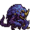

<!-- 本页上半部分由 tools/docs/gen_hero_docs.py 按仓库里现在的数据生成，手改会被覆盖；「开发记录」以下是手写的，生成时原样保留。 -->

# 峡谷先锋 Rift Herald

| 项目 | 内容 |
|---|---|
| id | `tft_riftherald` |
| 所属的包 | tft 包（金铲铲之战系列，mod_id `tft`） |
| 分路 | 上单 |
| 分类 / 标签 | 近战（Melee） · AP / Melee / Tank / CC |
| 高清帧 | PPU 2 |
| 附加包 | 无 |

其他预览：[skills](../preview/tft_riftherald_skills.gif)、[逐帧预览](../preview/tft_riftherald_frames.png)、[特效表](../preview/tft_riftherald_effects.png)

## 现在的技能

下面是游戏里显示的技能说明（`tft/text/champion.i18n` 的简体中文，去掉了颜色和图标），冷却、距离来自 `tft/champion/tft_riftherald.data_champion`；1 秒 = 60 tick。

### 普攻 / 被动

*攻击间隔 1.33 秒 · 攻击距离 25000*

钳爪砸下，造成100% 攻击力物理伤害。虚空甲壳：身边每有一名敌方英雄，受到伤害-4%（最多5名）。

### 技能1 · 回旋横扫

*冷却 8 秒 · 施放距离 30000 · 施放：指定目标 · 敌人（不含防御塔）*

原地转一圈，周围敌人受到40 + 90% 攻击力 + 3%最大生命物理伤害并减速30%（1秒）。

### 技能2 · 虚空冲锋

*冷却 15 秒 · 施放距离 70000 · 施放：指定目标 · 敌方英雄*

直立蓄力后翻身冲向敌方英雄：沿途敌人受到40 + 4%最大生命魔法伤害并被撞开，撞到的英雄再受一次并晕眩1秒。

### 大招 · 扭曲护甲

*冷却 50 秒 · 施放距离 30000 · 施放：指定目标 · 敌方英雄*

长啸变大，最大生命+300；猛击前方，敌人受到100 + 120% 法强 + 6%最大生命魔法伤害；4秒内受到伤害-15%，虚空甲壳每名敌人再-3%。

### 数值

攻击力 72（每级 +11）、法强 20（每级 +8）、生命 1250（每级 +120）、护甲 40（每级 +8）、魔抗 32（每级 +6）、移速 930（每级 +10）。

## 相关脚本和素材

- [`tools/kit/build_riftherald.py`](../../tools/kit/build_riftherald.py)
- [`tools/kit/setup_riftherald.py`](../../tools/kit/setup_riftherald.py)
- [`tools/lol/extract_riftherald.py`](../../tools/lol/extract_riftherald.py)
- [`tools/art/preview_riftherald.py`](../../tools/art/preview_riftherald.py)
- [`tools/art/rig_riftherald.py`](../../tools/art/rig_riftherald.py)
- [`assets/source/riftherald/`](../../assets/source/riftherald)

## 开发记录

| 部分 | 内容 |
|---|---|
| 定位 | tft 包（`tft_riftherald`）的英雄，上单（近战，坦克斗士，魔法伤害，身边敌人越多越硬）。金铲铲第 16 赛季的四费 `TFT16_RiftHerald`「峡谷先锋」（虚空 / 斗士，繁中「預示者」，英文 Rift Herald，射程 1，原技能「扭曲护甲」）：弓着背缩在蓝紫晶体圆顶甲壳下的虚空巨兽，甲片上一排排洋红小眼睛，两只大蟹钳，两根金獠牙，背后一只粉红竖眼。技能是我们按金铲铲第 16 赛季、第 9 赛季（召唤物「虚空冲锋」）和英雄联盟里的峡谷先锋自己设计的，用户 2026-11-02 定为上单（「按方案做，上单」） |
| 普攻 / 被动 | **虚空甲壳**（tft.dll）：每 15 tick 数一次 45000 以内的敌方英雄，每个让它受到的伤害少 4%，最多算 5 个；大招护甲期间每个再多 3%（纯数据版：从第一个动作起固定 10%）。**裂钳**（距离 25000，打塔）：第 22 tick 钳爪砸下，100% 攻击力 |
| 技能1 | **回旋横扫**（冷却 8 秒，距离 30000，打兵和野怪）：第 20 tick 原地转一圈，45000 以内的敌人受 40 + 90% 攻击力 + 3% 它的最大生命物理伤害，减速 30% 1 秒。范围原先是 38000，做预览时发现够不到它正在普攻的敌人（攻击距离下两个中心隔 55000），改成 45000 |
| 技能2 | **虚空冲锋**（冷却 15 秒，距离 70000，打英雄）：直立蓄力 24 tick（免控），然后翻身用甲壳冲向目标（每 tick 5000，动作 `charge`）：路上一条 70000 长、14000 宽的线里的敌人受 40 + 4% 它的最大生命魔法伤害并被撞开（击飞 18 tick）；落点 26000 以内的英雄再受一次并晕眩 1 秒 |
| 大招 | **扭曲护甲**（金铲铲原技能，冷却 50 秒，距离 30000，打英雄）：长啸、体型变大（league.dll 的 `hd::FORMS`：`tft_riftherald_r_big` 期间画大 25%，0.5 秒长到），最大生命 +300 并回满这 300，持续 8 秒；第 48 tick 猛击身前 18000 处半径 40000 的地面：100 + 120% 法强 + 6% 它的最大生命魔法伤害；之后 4 秒受到伤害 -15%，虚空甲壳每个敌人再多 3%。纯数据，塞拉斯偷到的就是这一招 |
| 数值 | 攻击 72（+11）、法强 20（+8）、生命 1250（+120）、护甲 40（+8）、魔抗 32（+6）、移速 930（+10），攻击间隔 80 tick，距离 25000 |
| 平衡 | 经典引擎模拟（上单，对原版斗士、处刑人、骑士、狂战士、枪骑士、长柄战士，两边三套阵容，纯数据版）：初稿（攻击 66，技能1 30 + 70% + 2%，技能2 30 + 3%，大招 80 + 100% + 5%，甲壳 8%）-0.17；v2 +1.25 / +1.48（种子 1–8 / 9–16）；v3 +3.57 太强；定 v2，范围改 45000 后 +1.36（种子 1–16）。对照岩宝 +1.60、泰拉 +0.94 |
| tft.dll | [`addons/tft/src/riftherald.rs`](../../addons/tft/src/riftherald.rs)：被动 `tft_riftherald:shell`（数身边的敌方英雄，挂 `tft_riftherald_p_shell` 伤害减免，两个检查周期长、每次刷新；倒下时的声音）。日志 `data/tft_riftherald.log`（SPAWN / SHELL / DEAD） |
| 塞拉斯 / 佛耶戈 / 俄洛伊 / 悠米 | 塞拉斯偷到的「扭曲护甲」是原样的数据（大招不调 tft.dll），按近战类；佛耶戈的灵魂（近战）、妮蔻、俄洛伊的灵魂、悠米坐在它头上的高度 32 |
| 精灵图（高清帧 PPU 2.0） | 参考是金铲铲客户端 TFTSet16 里它的模型（`TFT16_RiftHerald_16`，76 个关节：甲壳 L/R_Shell1–5、前后两对手臂、尾巴 5 节）和 10 段动作（待机、小跑、两种爪击、转圈、直立长啸砸地、翻身冲锋、横扫、翻倒）。第 0 步 Codex 画了 A（待机）和 B（直立），用户选 A-1（Codex 第一稿按它自己 8 px 的格子读回）44 像素高、PPU 2.0（88 行）；缩小后眼睛只剩一格，在 [`design_riftherald_model.py`](../../tools/art/design_riftherald_model.py) 里重画成 3×2 和 2×2 的洋红色 |
| 动作 | [`tools/art/design_riftherald_poses.py`](../../tools/art/design_riftherald_poses.py)：Codex 的 18 个姿势每张大小不一，按甲壳面积读回到定稿大小（甲壳是硬的，每张都一样大；直立那张甲壳侧着、面积小，手动定 8.7），脸能对上的贴回定稿的脸。小跑不用 Codex 的 6 帧（大小、画风每帧不同），[`rig_riftherald.py`](../../tools/art/rig_riftherald.py) 用定稿本身让两条后腿轮流抬起、身体一起一伏，钳爪不动（动了会留一道缝）。技能2 另有一个 `charge` 动作（翻身 + 甲壳冲撞），由技能数据的 `CasterAnimation` 在冲锋时播放 |
| 特效 | 用户给的一张 Gemini 图（10 张特效、3 个图标）由 [`tools/art/process_riftherald_fx.py`](../../tools/art/process_riftherald_fx.py) 处理：抠掉深蓝底和黑框；多数特效只画了一两张，缺的帧从它们放大、淡出、把亮光和尘土裂缝拆开来补；长啸只用圆的那张（宽的那张被画框截成了方的）；全部做成左右对称。图上有两个「技能1图标」，用了横扫弧光 + 蟹钳的那张 |
| 音效 | [`tools/lol/extract_riftherald.py`](../../tools/lol/extract_riftherald.py) 的 13 段，全是它自己的：召唤师峡谷峡谷先锋的爪击和打中、转圈打中、冲锋前的吼叫、音爆、撞到英雄、怒吼、虚空出现、倒下；金铲铲第 16 赛季的转圈、转圈吼叫、大招蓄力和砸地 |
| 选人卡片 | 44 游戏像素高；卡片动图轮流放普攻、转圈、冲锋、大招；待机时偶尔缩身一下（大招第一帧）；图鉴中心按英雄联盟的规则（−17），选人卡片 −6 |
