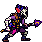

<!-- 本页上半部分由 tools/docs/gen_hero_docs.py 按仓库里现在的数据生成，手改会被覆盖；「开发记录」以下是手写的，生成时原样保留。 -->

# 刀疤 Scar



| 项目 | 内容 |
|---|---|
| id | `tft_scar` |
| 所属的包 | tft 包（金铲铲之战系列，mod_id `tft`） |
| 分路 | 上单 |
| 分类 / 标签 | 近战（Melee） · AP / Melee / Tank / CC / Heal |
| 高清帧 | PPU 2 |
| 附加包 | 无 |

其他预览：[skills](../preview/tft_scar_skills.gif)、[逐帧预览](../preview/tft_scar_frames.png)、[特效表](../preview/tft_scar_effects.png)

## 现在的技能

下面是游戏里显示的技能说明（`tft/text/champion.i18n` 的简体中文，去掉了颜色和图标），冷却、距离来自 `tft/champion/tft_scar.data_champion`；1 秒 = 60 tick。

### 普攻 / 被动

*攻击间隔 1.2 秒 · 攻击距离 25000*

长矛刺击造成100% 攻击力物理伤害。野火冲刺：每6秒下一击踩滑板冲刺，造成40 + 110% 攻击力+30% 法强伤害，回复上次冲刺以来所受伤害的25%。监察：生命不低于50%时减伤20%，否则10%。

### 技能1 · 水坑狙击惊喜

*冷却 10 秒 · 施放距离 45000 · 施放：指定目标 · 敌人（不含防御塔）*

向最近的3名敌人各扔一颗炸弹，造成70 + 80% 法强魔法伤害并晕眩1秒；自己回复60 + 60% 法强生命。

### 技能2 · 长矛横扫

*冷却 9 秒 · 施放距离 30000 · 施放：指定目标 · 敌人（不含防御塔）*

长矛横扫前方，造成50 + 80% 攻击力+2% 最大生命物理伤害并击退敌人。

### 大招 · 野火突袭

*冷却 50 秒 · 施放距离 50000 · 施放：指定目标 · 敌方英雄*

踩滑板冲向敌人，途中丢下两颗燃烧弹（各40 + 40% 法强魔法伤害）；落地爆炸，周围敌人受到120 + 100% 法强魔法伤害并被击飞0.5秒，之后4秒内减伤40%。

### 数值

攻击力 80（每级 +11）、法强 40（每级 +12）、生命 1120（每级 +110）、护甲 36（每级 +8）、魔抗 32（每级 +5）、移速 1000（每级 +10）。

## 相关脚本和素材

- [`tools/kit/build_scar.py`](../../tools/kit/build_scar.py)
- [`tools/kit/setup_scar.py`](../../tools/kit/setup_scar.py)
- [`tools/lol/extract_scar.py`](../../tools/lol/extract_scar.py)
- [`tools/art/preview_scar.py`](../../tools/art/preview_scar.py)
- [`tools/art/rig_scar.py`](../../tools/art/rig_scar.py)
- [`assets/source/scar/`](../../assets/source/scar)

## 开发记录

| 部分 | 内容 |
|---|---|
| 定位 | tft 包（`tft_scar`）的第十二个英雄，上单（Melee，近战法术坦克）。《双城之战》里的刀疤：祖安「野火帮」（Firelight）的二当家，戴白色骷髅面具、蓝色莫西干头、一只红色鳍耳，紫色皮肤，右手前臂缠着绷带，拿一根长矛，踩野火帮的悬浮滑板。金铲铲第 13 赛季的三费（`TFT13_FlyGuy`「刀疤」，野火帮 / 监察，法术坦克，射程 1，生命 800，法力 80/170），技能「水坑狙击惊喜」：向最近的 3 名敌人各扔一颗炸弹，魔法伤害并晕眩，自己回血；野火帮羁绊每 6 秒踩滑板冲一次，按上次冲刺以来受到的伤害回血；监察羁绊给减伤。用户选了**上路**和方案 A「野火坦克」：被动按野火帮和监察改成他自己的，技能1 照金铲铲，技能2 长矛横扫、大招野火突袭是我们加的。模型在 Riot 客户端的 `TFTSet13.wad.client`（`tft13_flyguy.skn`，84 根骨骼；动作只有路径哈希，按内容命名） |
| 普攻 / 被动 | 长矛刺击（近战，100% 攻击，打塔）。**野火冲刺**：每 6 秒下一次普攻变成踩滑板冲到目标面前（MoveToTarget，播自己的 `surf` 动作）再捅一矛：40 + 110% 攻击 + 30% 法强，并回复上次冲刺以来受到伤害的 25%。**监察**：生命不低于一半时减伤 20%，低于一半时 10%。受到的伤害和生命比例数据读不到，由 tft.dll 的被动来做 |
| 技能1 | **水坑狙击惊喜**（冷却 10 秒，距离 45000，小兵野怪也放）：向最近的 3 名敌人（英雄优先）各扔一颗炸弹：70 + 80% 法强的魔法伤害，晕眩 1 秒；自己回复 60 + 60% 法强生命。炸弹在第 18 tick 出手（扔出那一帧），挑最近的三个不同目标由 tft.dll 做 |
| 技能2 | **长矛横扫**（冷却 9 秒，距离 30000）：长矛扫过身前的扇形（半径 40000）：50 + 80% 攻击 + 2% 最大生命的物理伤害，并把敌人短短打退一下（1500 × 6） |
| 大招 | **野火突袭**（冷却 50 秒，敌方英雄在 50000 以内时放）：跳上滑板冲向目标（MoveToTarget，播 `ride`），途中第 8、16 tick 各在脚下丢一颗燃烧弹（22000 以内 40 + 40% 法强魔法伤害）；到达时落地爆炸（播 `land`）：32000 以内的敌人受到 120 + 100% 法强的魔法伤害并被击飞 0.5 秒，之后 4 秒减伤 40% |
| 数值 | 攻击 80（+11）、法强 40（+12）、生命 1120（+110）、护甲 36（+8）、魔抗 32（+5）、移速 1000（+10），攻击间隔 1.2 秒，射程 25000 |
| 平衡 | 经典引擎模拟（上路，两边三套阵容，纯数据版：冲刺按 40 + 40% 法强回固定的血，技能1 的三颗炸弹改成目标一颗加随机两颗）：草稿 −0.06（同一批 tft_kobuko 纯数据版 +1.99、league_sett +2.07）；调了三轮生命、炸弹和横扫的数字，**定稿** +2.86 / +1.97（种子 1–8 / 9–16；tft_kobuko +1.99 / +2.90）。tft.dll 里按真实受到伤害回的血和监察减伤没有进模拟 |
| tft.dll | 数据做不到的部分在 tft 包自己的代码里（[`addons/tft/src/scar.rs`](../../addons/tft/src/scar.rs)，和敖兴、石甲虫、蔚奥莱、范德尔、可酷伯、洛里斯、麦迪、希尔科、拉露恩、诺拉一起编成 `tft.dll`）：被动 `tft_scar:firelight`（累计这条命受到的伤害，冲刺打中时按比例回血、播回血画面和音效；按生命比例换监察的减伤 buff），技能1 的 `tft_scar:bombs` / `tft_scar:bomb`（挑最近的三个目标扔炸弹，落点结算伤害、晕眩），日志写到 `%APPDATA%/TeamSamoyed/TeamfightManager2/data/tft_scar.log`。`build_scar.py` 每次核对代码的默认参数和数据一致 |
| 塞拉斯 / 佛耶戈 / 妮蔻 / 俄洛伊 / 悠米 | 他的大招是纯数据，塞拉斯直接偷到（特效表复制进附加包；`sylas_steal_check.py` 模拟里燃烧弹、落地爆炸和击飞的特效出现 79 次）。佛耶戈 / 妮蔻的表（近战类）、俄洛伊的幽灵图和悠米骑上去的高度都加上了他 |
| 精灵图（高清帧 PPU 2.0） | Codex 第 0 步画了 A（金铲铲的弓背待机、矛尖朝下）和 B（矛尖朝前的持矛架势），格子 A 约 6 px、B 约 5 px，按它自己的格子读回；A 太窄（16–19 游戏像素宽，邻居 35–42），用户定 **B-1、高 38、PPU 2.0**（[`tools/art/design_scar_model.py`](../../tools/art/design_scar_model.py)：84×76）。用户问过「刀疤的武器拿的对吗」，定稿的握法保留（裸手在前靠近矛头，缠绷带的手在后）。姿势包的骨架是他自己的动作按帧投影出来的（[`tools/art/pack_scar_poses.py`](../../tools/art/pack_scar_poses.py)：头放大 1.7 倍，长矛按武器骨骼的点拟合出主轴；金铲铲里他矛尖朝后拿，每个姿势写明矛尖在哪头），Codex 画了 22 个姿势，守住了 12 px 格子和定稿的颜色，贴好了定稿的头，[`tools/art/design_scar_poses.py`](../../tools/art/design_scar_poses.py) 读回。**走路**改了三次：Codex 为了让头停在同一列、脚底不动把身体按行拉伸过，腰到头的距离每帧 36–40 行乱跳（用户：「走路的时候身体和头不协调 导致身体看起来变形」），改成从它的原稿按同一个比例重读（下巴到脚底 53 格，起伏按金铲铲走路时脖子的高度），定稿的头贴在每帧原稿的头上；原稿里长矛每帧歪 −11° 到 +8°（用户：「走路时武器别歪啊」），每帧把原来的矛擦掉，用第 2 帧的矛转正后竖直放回手里，矛尾在下巴上 24 行，绷带手压在矛杆上；定稿的头图下巴以下带着设计稿自己的肩甲和衣领，盖住了走路帧的肩膀（用户：「这一部分连接处又看起来变形了」），走路帧只贴头本身。**阵亡**的两帧原稿是按真人比例画的，躺着比站着长一半（用户：「死亡时候身体这么长？」），也从原稿重读：倒下那帧 16 px 一格（腿长和走路一样），躺地那帧横向 18.6、竖向 12.5（下巴到脚底 53 格，厚度不变），飞出去的长矛单独按走路时的 76 格读。[`tools/art/rig_scar.py`](../../tools/art/rig_scar.py) 按 Codex 画的位置拼成走路（8 帧交叉步，每帧 133 毫秒）、普攻（收矛 → 刺出 → 收势）、野火冲刺（蹲在滑板上 → 从滑板上刺出）、技能1（后仰 → 扔炸弹 → 举拳）、技能2（抡矛 → 横扫）、大招（跳上滑板 → 滑行；落地）、受击、阵亡（被打飞、长矛脱手 → 仰面躺倒） |
| 特效 | 11 张 + 3 个技能图标，Codex 画的（[`tools/art/pack_scar_fx.py`](../../tools/art/pack_scar_fx.py) 的提示词，参考是金铲铲里他自己的粒子贴图和野火帮的青绿火光、紫粉涂鸦颜料 [`tools/lol/fx_ref_scar.py`](../../tools/lol/fx_ref_scar.py)）。七张直接用；回血的光点、炸弹、晕眩星和护体光弧被 Codex 自己缩小时弄坏了（光点没了、炸弹成了暗方块、晕眩星成了横条、光弧淡得看不见），[`tools/art/import_scar_fx.py`](../../tools/art/import_scar_fx.py) 从原稿按块重新读回、颜色对回色阶，炸弹转 90° 让引线火星拖在飞行方向后面，切成 `tft_scar_fx` / `tft_scar_big`；图标从原稿缩到 64×64 |
| 音效 | 他自己的金铲铲音效（Riot 客户端 Map22 第 13 赛季：普攻、击中、暴击、技能1 的扔出和爆炸、回血、技能2），技能1 配英文语音，野火冲刺、大招的起跳和护体借野火帮皮肤的艾克（E、被动加速、W 护盾），燃烧弹和落地爆炸借吉格斯（Q 爆炸、W 引爆）（[`tools/lol/extract_scar.py`](../../tools/lol/extract_scar.py)，14 段） |
| 选人卡片 | 头发到脚底 38 游戏像素：`banpick_center` −6，不另设缩放。脸 (9, −30)（面具两只眼窝之间）。待机按 `tools/art/hero_reels.py` 剪进扔炸弹和普攻的帧，卡片轮播技能1、技能2、大招落地、普攻 |

重新生成（素材来自本机的金铲铲客户端，音频和 Riot 的渲染不进仓库）：

```bash
python tools/lol/extract_scar.py --riot "D:\Riot Games\League of Legends" --lol "D:\WeGameApps\lol" --vgmstream <vgmstream-cli.exe>
python tools/kit/build_scar.py                    # 技能数据（被动和技能1 调用 tft.dll），数字都在脚本的参数表 P 里；--plain 是平衡模拟用的纯数据
python tools/kit/setup_scar.py                    # 五种语言的文字、音效配置、tft 包共享文件里他的键
python tools/art/design_scar_hd.py                # Codex 第 0 步的原图读回
python tools/art/design_scar_model.py             # 定稿 B-1 缩到 76 行
python tools/art/design_scar_poses.py             # Codex 的姿势；走路和阵亡从原稿重读（长矛竖直，只贴头本身）
python tools/art/import_scar_fx.py                # 特效 -> tft_scar_fx / tft_scar_big，图标（四张从原稿重读）
python tools/art/rig_scar.py                      # 1 倍帧和 2.0 的原帧
python tools/art/ppu_restyle.py --hero scar       # 外描边
python tools/art/ppu_hd.py --hero scar            # hd_ / lo_ 帧（要在 hero_reels 之前）
python tools/art/hero_reels.py --hero tft_scar    # 待机和选人卡片的小动作
python tools/art/preview_scar.py                  # 预览和每个技能单独的 GIF
python tools/art/review_scar_actions.py --out <文件夹> --sheet   # 和金铲铲原版逐个动作对照的 GIF
python addons/league_sylas/make_override.py       # 塞拉斯偷到的野火突袭
cargo test --manifest-path addons/Cargo.toml -p tft   # tft.dll 的单元测试
```
