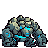

<!-- 本页上半部分由 tools/docs/gen_hero_docs.py 按仓库里现在的数据生成，手改会被覆盖；「开发记录」以下是手写的，生成时原样保留。 -->

# 苍蓝雕纹魔像 Sentinel



| 项目 | 内容 |
|---|---|
| id | `tft_sentinel` |
| 所属的包 | tft 包（金铲铲之战系列，mod_id `tft`） |
| 分路 | 打野 |
| 分类 / 标签 | 近战（Melee） · AP / Melee / Tank / CC / Shield |
| 高清帧 | PPU 1.7 |
| 附加包 | 无 |

其他预览：[skills](../preview/tft_sentinel_skills.gif)、[逐帧预览](../preview/tft_sentinel_frames.png)、[特效表](../preview/tft_sentinel_effects.png)

## 现在的技能

下面是游戏里显示的技能说明（`tft/text/champion.i18n` 的简体中文，去掉了颜色和图标），冷却、距离来自 `tft/champion/tft_sentinel.data_champion`；1 秒 = 60 tick。

### 普攻 / 被动

*攻击间隔 1.27 秒 · 攻击距离 26000*

巨拳砸下，造成100% 攻击力物理伤害。蓝霸符：每放一个技能，身边友军的技能剩余冷却立刻降到最多67%。

### 技能1 · 双拳重砸

*冷却 6.5 秒 · 施放距离 30000 · 施放：指定目标 · 敌人（不含防御塔）*

双拳砸地，对周围敌人造成85 + 105% 法强 + 4% 最大生命魔法伤害并减速30%（2秒）。

### 技能2 · 雕纹石肤

*冷却 10 秒 · 施放距离 30000 · 施放：指定目标 · 敌人（不含防御塔）*

符文亮起，获得120 + 120% 法强护盾（4秒），嘲讽周围敌人1.2秒。

### 大招 · 蔚蓝冲击波

*冷却 50 秒 · 施放距离 60000 · 施放：指定目标 · 敌方英雄*

获得150 + 120% 法强护盾，猛砸地面，朝敌方英雄最多的方向裂开裂隙：击飞、170 + 170% 法强 + 4% 最大生命魔法伤害，破法（下一个技能晚2秒）。

### 数值

攻击力 77（每级 +11）、法强 40（每级 +14）、生命 1250（每级 +120）、护甲 40（每级 +8）、魔抗 36（每级 +6）、移速 950（每级 +10）。

## 相关脚本和素材

- [`tools/kit/build_sentinel.py`](../../tools/kit/build_sentinel.py)
- [`tools/kit/setup_sentinel.py`](../../tools/kit/setup_sentinel.py)
- [`tools/lol/extract_sentinel.py`](../../tools/lol/extract_sentinel.py)
- [`tools/art/preview_sentinel.py`](../../tools/art/preview_sentinel.py)
- [`tools/art/rig_sentinel.py`](../../tools/art/rig_sentinel.py)
- [`assets/source/sentinel/`](../../assets/source/sentinel)

## 开发记录

| 部分 | 内容 |
|---|---|
| 定位 | tft 包（`tft_sentinel`）的英雄，打野（坦克，魔法伤害）。金铲铲第 18 赛季的四费 `DA_Sentinel18`「苍蓝雕纹魔像」（峡谷野怪 / 重装战士 / 神谕，繁中「守望者」）：峡谷蓝 Buff 的石头魔像，深青灰的驼背石身，一对比头还大、快有身子大的巨拳，肩上背上是淡绿灰的大石块，米白八角形的小石头脑袋半埋在两肩之间、只有一只青色的眼睛，腰带、膝盖和脚踝上发青光，身上刻着螺旋符文。金铲铲原技能「蔚蓝冲击波」做大招，原版的「蓝霸符」（每次施法给友军回蓝）改成技能冷却做被动，其余按用户选的方案 A「蔚蓝冲击波」（2026-10-31）自己设计 |
| 普攻 / 被动 | **岩拳猛击**（射程 26000，打塔）：单拳举过头顶，第 18 tick 砸下，100% 攻击力。**蓝霸符**（纯数据）：它每放一个技能（Q、E、大招），50000 以内的其他友方英雄身上的技能剩余冷却立刻降到最多各自冷却的 67%（引擎的 `skill_cooldown_mult` 50，挂 3 tick 就是一次性的退还），脚下亮 1 秒青光 |
| 技能1 | **双拳重砸**（冷却 6.5 秒，距离 30000，打兵和野怪）：第 16 tick 双拳砸地：34000 以内的敌人受 85 + 105% 法强 + 4% 最大生命的魔法伤害，减速 30%（2 秒），身上挂石块 |
| 技能2 | **雕纹石肤**（冷却 10 秒，距离 30000）：第 10 tick 符文亮起：自己获得 120 + 120% 法强的刻纹石板护盾（4 秒），30000 以内的敌人被嘲讽 1.2 秒（72 tick） |
| 大招 | **蔚蓝冲击波**（金铲铲原技能，冷却 50 秒，距离 60000，有敌方英雄时）：先获得 150 + 120% 法强的护盾（4 秒），到砸地前免疫控制；第 24 tick 双拳过顶猛砸，朝**敌方英雄最多的方向**裂开一道 100000 长、两边各 16000 宽的裂隙（tft.dll 数每个方向这条带子里站着几个敌方英雄，一样多就选 AI 的目标、再选近的），每 tick 跑 5000：碰到的敌人受 170 + 170% 法强 + 4% 最大生命的魔法伤害、被石刺击飞 50 tick；被打到的英雄**破法**：15 秒内它下一个转好的技能（Q / E / 大招）被封 2 秒（金铲铲是下次施法多耗蓝；引擎只能缩短冷却、不能加长，所以改成「转好的那一刻封住」，头顶亮碎掉的符文） |
| 数值 | 攻击 77（+11）、法强 40（+14）、生命 1250（+120）、护甲 40（+8）、魔抗 36（+6）、移速 950（+10），攻击间隔 76 tick（1.27 秒），射程 26000 |
| 平衡 | 经典引擎模拟（打野，对原版忍者、恶魔、猎人、狼人、吸血鬼，两边三套阵容，纯数据版：裂隙朝 AI 的目标、破法换成立刻沉默 2 秒）：草稿（攻击 70，Q 60 + 80% + 3%，大招 120 + 140% + 4%）+0.93（克鲁格纯数据同种子 +2.06：打出 4800 伤害、克鲁格 6200）；攻击 76、Q 80 + 100% + 4%、大招 160 + 160% +1.66；攻击 78、Q 90 + 110% + 5% 每 6 秒、大招 180 + 180%、嘲讽 1.25 秒 +3.31；取中间（攻击 77、Q 85 + 105% + 4% 每 6.5 秒、大招 170 + 170%、嘲讽 70 tick，后来为了说明写 1.2 秒改 72）：**+2.20 / +3.00**（种子 1–8 / 9–16；克鲁格纯数据同种子 +2.06 / +1.89），四费比三费的打野坦克略强 |
| tft.dll | [`addons/tft/src/sentinel.rs`](../../addons/tft/src/sentinel.rs)：原生效果 `tft_sentinel:fissure`（选方向、发穿透的直线弹道 `tft_sentinel_r_crack`）、`tft_sentinel:crack`（每道裂隙每个单位只打一次：魔法伤害、击飞、命中的石刺、英雄挂破法印记）；被动 `tft_sentinel:golem`（带破法印记的敌方英雄技能转好的那一刻 `BlockSkill` 2 秒 + 封印图标，死亡时播碎裂声）。日志 `data/tft_sentinel.log`（SPAWN / FISSURE / CRACK / SEAL） |
| 塞拉斯 / 佛耶戈 / 妮蔻 / 俄洛伊 / 悠米 | 塞拉斯偷到的蔚蓝冲击波是纯数据版（`build_sentinel.sylas_ult`：护盾、砸地、朝目标的一道裂隙，同样的伤害和击飞，破法换成立刻沉默；裂隙的图另用一个只显示的直线弹道画出来），特效表复制进附加包；佛耶戈 / 妮蔻的表（近战）、俄洛伊的灵魂、悠米坐骑的头顶高度 28 |
| 精灵图（高清帧 PPU 1.7） | 参考是金铲铲客户端 TFTSet18 里它自己的模型（`tft18_sentinel`，64 个关节，一张贴图；动作片段按路径哈希连着：单拳过顶砸、抡拳砸、双拳过顶砸、跑、待机、死亡倒地碎裂、出场从地里升起、庆祝）。第 0 步 Codex 画了 A（3/4）和 B（侧面），用户选 **A-1、40 游戏像素、PPU 1.7**（A 修改稿按 8 px 一格读回 101×68，1:1，脸不用改）。第 2 步 Codex 照它自己的动作片段画了 18 个姿势（骨架包 [`tools/art/pack_sentinel_poses.py`](../../tools/art/pack_sentinel_poses.py)：头放大 1.4 倍到定稿的比例；8 帧跑是金铲铲 1.3 秒的完整一步） |
| 动作 | [`tools/art/design_sentinel_poses.py`](../../tools/art/design_sentinel_poses.py)：每张按定稿的体型读回（每格取原稿那一格最多的定稿颜色），贴定稿的脸——只贴在眼睛下面正好是发光青色的地方（不然会贴到拳头或胸口上，变成两个头），倒地那张不贴、眼睛熄灭。[`tools/art/rig_sentinel.py`](../../tools/art/rig_sentinel.py)：普攻单拳举起 + 砸下；双拳重砸举起 + 砸地；雕纹石肤蹲身 + 挺身吼；蔚蓝冲击波双拳过顶 + 猛砸；死亡跪倒 + 扑倒 |
| 移动 | Codex 的 8 帧跑只抬了画面右边那只脚，所以后半步（step1–3）用 run4 把左小腿和脚抬起 2、4、2 格做出来，前后两步交替 |
| 特效 | 12 张 + 3 个技能图标，Codex 画（[`tools/art/pack_sentinel_fx.py`](../../tools/art/pack_sentinel_fx.py) 的提示词，参考是熔岩巨兽和奥恩的粒子贴图 [`tools/lol/fx_ref_sentinel.py`](../../tools/lol/fx_ref_sentinel.py)：青蓝发光的符文和石块）。[`tools/art/import_sentinel_fx.py`](../../tools/art/import_sentinel_fx.py)：普攻命中 Codex 只画了 5 px，从 2×2 的原稿重新切；砸地的特效放在拳头落下的地方（站立点前 14 游戏像素）；裂隙是从上往下画的飞行条；3 个图标从 1254 像素的原稿重新缩到 64 |
| 音效 | 普攻挥拳、命中、大招起手、吼声和死亡碎裂是它自己的（峡谷蓝 Buff 野怪的音效包 `npc_map11_blue_sfx_`）；蓝霸符借娑娜 E，双拳重砸借墨菲特的 E（Landslide），雕纹石肤借墨菲特的花岗岩护盾，嘲讽借拉莫斯，大招护盾借墨菲特的 Obduracy，裂隙借奥恩的 Q、击飞借奥恩的 E，破法借瑞兹的 W（[`tools/lol/extract_sentinel.py`](../../tools/lol/extract_sentinel.py)，14 个） |
| 选人卡片 | 背上石块到脚底 40 游戏像素：`banpick_center` (0, −10)，脸 (7, −27)（眼睛），中心 (0, −20)。待机按 `tools/art/hero_reels.py` 剪进雕纹石肤的第一帧，卡片轮播普攻、双拳重砸、雕纹石肤、蔚蓝冲击波 |

重新生成（素材来自本机的英雄联盟 / 金铲铲客户端，音频和 Riot 的渲染不进仓库）：

```bash
python tools/lol/extract_sentinel.py --riot "D:\Riot Games\League of Legends" --vgmstream <vgmstream-cli.exe>
python tools/kit/build_sentinel.py                     # 技能数据（大招调用 tft.dll），数字都在脚本的参数表 P 里；--plain 是平衡模拟用的纯数据
python tools/kit/setup_sentinel.py                     # 五种语言的文字、音效配置、tft 包共享文件里它的键
python tools/art/design_sentinel_hd.py                 # Codex 第 0 步的原图读回
python tools/art/design_sentinel_model.py              # 定稿 A-1（101×68）
python tools/art/design_sentinel_poses.py              # Codex 的姿势：按定稿的体型从原稿读回、换成定稿的颜色、贴定稿的脸
python tools/art/import_sentinel_fx.py                 # 特效 -> tft_sentinel_fx / tft_sentinel_big，图标
python tools/art/rig_sentinel.py                       # 1 倍帧和 1.7 的原帧
python tools/art/ppu_restyle.py --hero sentinel        # 外描边
python tools/art/ppu_hd.py --hero sentinel             # hd_ / lo_ 帧（要在 hero_reels 之前）
python tools/art/hero_reels.py --hero tft_sentinel     # 待机和选人卡片的小动作
python tools/art/preview_sentinel.py                   # 预览和每个技能单独的 GIF
python tools/art/review_sentinel_actions.py --out <文件夹> --sheet   # 和金铲铲原版逐个动作对照的 GIF
cargo test --manifest-path addons/Cargo.toml -p tft    # tft.dll 的单元测试
```
