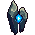

<!-- 本页上半部分由 tools/docs/gen_hero_docs.py 按仓库里现在的数据生成，手改会被覆盖；「开发记录」以下是手写的，生成时原样保留。 -->

# 苍蓝哨戒 Pebbles

| 项目 | 内容 |
|---|---|
| id | `tft_sentry` |
| 所属的包 | tft 包（金铲铲之战系列，mod_id `tft`） |
| 分路 | ADC |
| 分类 / 标签 | 射手（Range） · AP / Magic / Range |
| 高清帧 | PPU 1.29 |
| 附加包 | 无 |

其他预览：[skills](../preview/tft_sentry_skills.gif)、[逐帧预览](../preview/tft_sentry_frames.png)、[特效表](../preview/tft_sentry_effects.png)

## 现在的技能

下面是游戏里显示的技能说明（`tft/text/champion.i18n` 的简体中文，去掉了颜色和图标），冷却、距离来自 `tft/champion/tft_sentry.data_champion`；1 秒 = 60 tick。

### 普攻 / 被动

*攻击间隔 1.2 秒 · 攻击距离 60000*

蓝核射出碎光弹，造成100% 攻击力物理伤害和45% 法强魔法伤害。青霸符：蔚蓝激光每引导1秒，大招冷却-1秒。

### 技能1 · 蔚蓝激光

*冷却 6 秒 · 施放距离 65000 · 施放：指定目标 · 敌人（不含防御塔）*

对目标引导激光2.5秒（可以边飘边照），共造成460 + 250% 法强魔法伤害，每0.25秒魔抗-4（可叠加，持续2秒）。目标离开射程或自己被控时中断。

### 技能2 · 裂石跃迁

*冷却 10 秒 · 施放距离 45000 · 施放：指定目标 · 敌方英雄*

两块石头猛地分开再合拢，周围敌人受到80 + 45% 法强魔法伤害并减速40%（1.5秒），自己向后闪开。

### 大招 · 棱镜扫射

*冷却 35 秒 · 施放距离 70000 · 施放：地点 · 敌方英雄*

两块石头张开，蓝核射出光柱扫过前方扇形，造成320 + 160% 法强魔法伤害，魔抗-25（3秒）。

### 数值

攻击力 95（每级 +11）、法强 30（每级 +16）、生命 1000（每级 +80）、护甲 26（每级 +7）、魔抗 22（每级 +3）、移速 900（每级 +9）。

## 相关脚本和素材

- [`tools/kit/build_sentry.py`](../../tools/kit/build_sentry.py)
- [`tools/kit/setup_sentry.py`](../../tools/kit/setup_sentry.py)
- [`tools/lol/extract_sentry.py`](../../tools/lol/extract_sentry.py)
- [`tools/art/preview_sentry.py`](../../tools/art/preview_sentry.py)
- [`tools/art/rig_sentry.py`](../../tools/art/rig_sentry.py)
- [`assets/source/sentry/`](../../assets/source/sentry)

## 开发记录

| 部分 | 内容 |
|---|---|
| 定位 | tft 包（`tft_sentry`）的英雄，下路（远程，魔法伤害，持续引导，削魔抗）。金铲铲第 18 赛季的一费 `DA_18_Sentry`「苍蓝哨戒」（峡谷野怪 / 神谕，繁中「小石子」，英文 Pebbles，射程 4）：两块漂浮的高瘦水晶石（上半截浅灰绿、下半截深海军蓝，底下收成尖），中间的圆孔里一颗发光的蔚蓝能量核，没有手脚和脸。金铲铲原技能「蔚蓝激光」做技能1，羁绊的「青霸符」做被动；其余按用户选的方案 A「蔚蓝激光」（2026-11-02，下路）自己设计 |
| 普攻 / 被动 | **碎光弹**（距离 60000，打塔）：第 8 tick 从蓝核射出追踪的蓝光弹，100% 攻击力物理伤害 + 45% 法强魔法伤害。**青霸符**（tft.dll）：蔚蓝激光每引导满 1 秒，大招剩余冷却 −1 秒（2 tick 的 `ult_cooldown_mult` 压到那个值；用户原选「其他技能 −0.5 秒」，但引擎的技能冷却加速是 Q、E 共用一个，引导时 Q 自己也在冷却，只有大招能精确地减，改成这样），每次有声音 |
| 技能1 | **蔚蓝激光**（金铲铲原技能，冷却 6 秒，距离 65000，打兵和野怪）：从第 10 tick 起对目标引导 2.5 秒，每 15 tick 一下（快速追踪弹）共 460 + 250% 法强魔法伤害，每下魔抗 −4、2 秒、同名叠加；引导时可以移动（模拟里站桩版太弱）。被控（每 5 tick 查一次）或死了就停；目标离开 85000 或死了由 tft.dll 停（目标身上的 `tft_sentry_q_lock`）。激光的画面是爬得很慢的追踪弹（维克兹大招的做法），每 tick 一帧钉在蓝核上 |
| 技能2 | **裂石跃迁**（冷却 10 秒，距离 45000，打英雄）：两块石头裂开，24000 以内的敌人受 80 + 45% 法强魔法伤害并减速 40% 1.5 秒，原地留一圈碎水晶；第 4 tick 向后闪开（MoveBack 6000 × 6 tick） |
| 大招 | **棱镜扫射**（冷却 35 秒，距离 70000，打英雄的位置）：两块石头张成 V 字、蓝核蓄力，第 18 tick 光柱扫过前方 85000 长、两边各 60° 的扇形：320 + 160% 法强魔法伤害，魔抗 −25 3 秒；扫射的画面是只有画面的直线弹，同样钉在蓝核上 |
| 数值 | 攻击 95（+11）、法强 30（+16）、生命 1000（+80）、护甲 26（+7）、魔抗 22（+3）、移速 900（+9），攻击间隔 72 tick，距离 60000 |
| 平衡 | 经典引擎模拟（下路，对原版弓箭手、火枪手、回旋镖猎手、毒镖猎手，两边三套阵容，纯数据版：没有青霸符）：初稿 −4.45（引导时站桩，少打很多普攻又容易被打死；技能2 距离 30000 一局只放 2 次）；激光、大招加强、技能2 距离 45000 −2.00；引导时可以移动、加生命和双抗 −0.57 / −2.24；大招和技能2 再加 +0.27 / −0.61；激光 460 + 250%、生命 1000 **+0.24 / +0.47（种子 1–8 / 9–16）**；魔沼蛙同条件 +1.51 / +0.50，一费比二费低一点 |
| tft.dll | [`addons/tft/src/sentry.rs`](../../addons/tft/src/sentry.rs)：被动 `tft_sentry:blue`（青霸符：引导中按秒减大招冷却；被照的敌人离开射程或死了就收起激光；倒下时的碎裂声）。日志 `data/tft_sentry.log`（SPAWN / BLUE / BREAK） |
| 塞拉斯 / 佛耶戈 / 俄洛伊 / 悠米 | 塞拉斯偷到的「棱镜扫射」就是数据版（大招不调 tft.dll；特效表复制进附加包），按远程类；佛耶戈的灵魂（远程）、妮蔻、俄洛伊的灵魂、悠米坐在它头上的高度 25 |
| 精灵图（高清帧 PPU 1.29） | 参考是金铲铲客户端 TFTSet18 里它的模型（`tft18_sentry`，19 个关节：左右两块石头和顶尖，贴图按哈希找到）和 6 段动作（待机浮动、开火时往上一抬、死亡两块分开倒下；只有死亡会把两块分开）。第 0 步 Codex 画了 A（稍微 3/4）和 B（更侧），它自己按 11 px 缩的 22×34 糊了蓝核；原图其实是 9 px 一格。用户选 **A-3**（原图按 12 px 读回 28×44）、34 游戏像素，按 1:1 定成 **PPU 1.29**（[`tools/art/design_sentry_model.py`](../../tools/art/design_sentry_model.py)）。第 2 步的姿势包把定稿拆成左石、右石、蓝核三块，按每个姿势挪动、转动、加光圈做成布局图（[`tools/art/pack_sentry_poses.py`](../../tools/art/pack_sentry_poses.py)），Codex 照着画了 15 个姿势 |
| 动作 | [`tools/art/design_sentry_poses.py`](../../tools/art/design_sentry_poses.py)：Codex 每张格子都不一样（11.6–14.4 px），石头是刚体，每张按石头（蓝核以外）的面积读回到定稿大小（相差 ±3%）；去掉蓝核外的零散光点和石头边上的白色亮点；按布局图的蓝核位置和离地高度摆（Codex 自己的位置漂了）。[`tools/art/rig_sentry.py`](../../tools/art/rig_sentry.py)：整只离地 3 行飘着；飘移不用 Codex 的 4 帧（每帧石头大小不同，会忽大忽小），用定稿前倾加上下浮动、蓝核保持正的；普攻 133 + 267 ms、激光起手 100 + 100 后循环两帧、裂石 150 + 150、扫射 300 + 367；挨打是待机闪白，死亡两块倒开、蓝核熄灭。PPU 管线不补缝（两块石头之间的缝是造型） |
| 特效 | Codex 画了 13 张和 3 个图标（[`tools/art/import_sentry_fx.py`](../../tools/art/import_sentry_fx.py)）：碎光弹、激光小光点、激光上下对称朝右，扫射不对称（向左时游戏转半圈），其余左右对称；原地的一圈碎水晶、两个裂盾标记、脚下碎石 Codex 缩成了噪点，从原稿按面积重缩；激光剪到 66 像素（技能射程），不再穿过目标 25 像素；图标从高清原稿缩到 64 |
| 音效 | [`tools/lol/extract_sentry.py`](../../tools/lol/extract_sentry.py) 的 16 段：峡谷蓝 buff 营地的小石像在英雄联盟里没有声音（音效库是空的），所以普攻和激光用维克兹（普攻、大招射线、研究层数、射线结束），扫射用维克托的死亡射线，后跳用伊泽瑞尔的奥术跃迁，石头分开、碎石、死亡碎裂用塔莉垭，青霸符用维克托 Q 的充能 |
| 选人卡片 | 34 游戏像素高、22 宽，卡片里放得下；卡片动图轮流放普攻、激光、裂石、扫射；图鉴中心按英雄联盟的规则（−6） |
