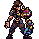

<!-- 本页上半部分由 tools/docs/gen_hero_docs.py 按仓库里现在的数据生成，手改会被覆盖；「开发记录」以下是手写的，生成时原样保留。 -->

# 塞薇卡 Sevika



| 项目 | 内容 |
|---|---|
| id | `tft_sevika` |
| 所属的包 | tft 包（金铲铲之战系列，mod_id `tft`） |
| 分路 | 上单 |
| 分类 / 标签 | 近战（Melee） · AD / Melee / CC / Shield / Dot |
| 高清帧 | PPU 1.8 |
| 附加包 | 无 |

其他预览：[skills](../preview/tft_sevika_skills.gif)、[逐帧预览](../preview/tft_sevika_frames.png)、[特效表](../preview/tft_sevika_effects.png)

## 现在的技能

下面是游戏里显示的技能说明（`tft/text/champion.i18n` 的简体中文，去掉了颜色和图标），冷却、距离来自 `tft/champion/tft_sevika.data_champion`；1 秒 = 60 tick。

### 普攻 / 被动

*攻击间隔 1.1 秒 · 攻击距离 25000*

铁拳造成100% 攻击力物理伤害，每第3下钳击造成25 + 150% 攻击力。百变铁手：每次施放技能随机一个改件：火箭、护盾、35%攻速，12%中头奖强化本次技能。

### 技能1 · 喷火器

*冷却 8 秒 · 施放距离 32000 · 施放：指定目标 · 敌人（不含防御塔）*

喷火1.2秒，对前方扇形造成5次12 + 32% 攻击力物理伤害，期间减伤30%。

### 技能2 · 伸缩拳

*冷却 10 秒 · 施放距离 55000 · 施放：指定目标 · 敌人（不含防御塔）*

射出铁拳，造成40 + 120% 攻击力物理伤害并击退；撞到身后的敌人则两人眩晕1.2秒。

### 大招 · 嚼一嚼

*冷却 45 秒 · 施放距离 40000 · 施放：指定目标 · 敌方英雄*

冲向目标连咬2口，每口60 + 135% 攻击力物理伤害，眩晕1.1秒并流血；目标生命低于15%时直接咬死，再冲向下一个英雄。

### 数值

攻击力 82（每级 +11）、生命 1200（每级 +118）、护甲 36（每级 +7）、魔抗 30（每级 +5）、移速 1000（每级 +10）。

## 相关脚本和素材

- [`tools/kit/build_sevika.py`](../../tools/kit/build_sevika.py)
- [`tools/kit/setup_sevika.py`](../../tools/kit/setup_sevika.py)
- [`tools/lol/extract_sevika.py`](../../tools/lol/extract_sevika.py)
- [`tools/art/preview_sevika.py`](../../tools/art/preview_sevika.py)
- [`tools/art/rig_sevika.py`](../../tools/art/rig_sevika.py)
- [`assets/source/sevika/`](../../assets/source/sevika)

## 开发记录

| 部分 | 内容 |
|---|---|
| 定位 | tft 包（`tft_sevika`）的第十五个英雄，上路（Melee，近战物理斗士）。《双城之战》里祖安的打手、后来的炼金男爵塞薇卡：肩宽结实的女人，深棕头发往后梳，左臂是一条被金克丝涂成洋红 / 青绿的巨大黄铜机械臂，肩上装着一台小老虎机，手是一副亮青色的大爪钳。金铲铲第 13 赛季的五费（`TFT13_Lieutenant`「塞薇卡」，百变铁手 / 炼金男爵 / 搏击手，近战物理斗士）：技能「扭转局势」随机放喷火器、伸缩拳、嚼一嚼之一，有机会中头奖。用户选的方案 A「百变铁手」把这三招拆成三个技能，老虎机做成被动 |
| 普攻 / 被动 | **机械铁拳**（近战，打塔）：铁拳重击，100% 攻击力；每第三下爪钳一夹（`attack2` 帧），25 + 150% 攻击力。**百变铁手**：每次放技能（Q / E / R）肩上的老虎机转一圈（头顶播转轮），由 tft.dll 用效果的确定性种子摇：12% 中头奖（这次技能强化），否则三个改件机会均等——火箭（4 枚追踪小火箭，每 6 tick 一枚，打 60000 内随机的敌人，先英雄，各 15 + 30% 攻击力）、护盾（60 + 100% 攻击力，3 秒）、微光（攻速 +35%，3 秒） |
| 技能1 | **喷火器**（冷却 8 秒，距离 32000，打野怪也会放）：1.2 秒内对前方扇形喷 5 段火（每 12 tick 一段），每段 12 + 32% 攻击力物理伤害并灼烧，喷火时自己减伤 30%；中头奖每段伤害 ×1.6。火焰是一条只显示图的线（长 108000，图的中点在线的中点），从她的爪钳喷出去 |
| 技能2 | **伸缩拳**（冷却 10 秒，距离 55000）：第 14 tick 由 tft.dll 沿她到目标的直线射出铁拳，打中的第一个敌人受 40 + 120% 攻击力物理伤害并被击退；落点 30000 内另有敌人，那人受这一拳的 50%，两人都眩晕 1.2 秒。中头奖：目标不撞人也眩晕，伤害 +50% |
| 大招 | **嚼一嚼**（冷却 45 秒，距离 40000，打英雄）：冲到目标面前（不受控制），爪钳咬 2 口（中头奖 4 口），第 8 tick 起每 18 tick 一口，每口 60 + 135% 攻击力物理伤害，第一口眩晕 1.1 秒，每口挂 5 秒流血（共 60% 攻击力，被动每 10 tick 结算）；最后一口后目标生命低于 15%（中头奖 25%）直接咬死，目标死了就冲向 30000 内最近的敌方英雄再咬一轮（每次施法最多 2 次，每次伤害 ×80%） |
| 数值 | 攻击 82（+11）、生命 1200（+118）、护甲 36（+7）、魔抗 30（+5）、移速 1000（+10），攻击间隔 1.1 秒，射程 25000 |
| 平衡 | 经典引擎模拟（上路，对原版六个上路，两边三套阵容，纯数据版：每次施法给三分之一的火箭 / 护盾 / 微光、没有头奖、伸缩拳的眩晕减半、大招没有斩杀和连冲）：草稿（攻击 80、生命 1180、Q 30%、R 130%）+1.49；攻击 84、生命 1220、Q 35%、R 140% +2.52（太强）；**定稿**取两者之间：+1.62（同一批 tft_renni 纯数据版 +2.03）。游戏里还有斩杀、连冲、撞人眩晕和头奖，所以纯数据版留低一点 |
| tft.dll | 数据做不到的部分在 tft 包自己的代码里（[`addons/tft/src/sevika.rs`](../../addons/tft/src/sevika.rs)，和史密奇、荏妮、刀疤、敖兴、石甲虫、蔚奥莱、范德尔、可酷伯、洛里斯、麦迪、希尔科、拉露恩、诺拉一起编成 `tft.dll`）：被动 `tft_sevika:roll` 记下参数、结算流血；效果 `roll`（老虎机，splitmix64 掷种子）、`rocket` / `rocket_hit`、`punch` / `fist`（击退、撞人眩晕）、`chomp` / `bite1-6`（咬、斩杀、连冲）。每次施法的状态都挂在她身上（`p_triple` / `e_tri` / `r_tri` / `r_hop`），不存静态表，预演和观战两个模拟同时跑也互不干扰。日志写到 `%APPDATA%/TeamSamoyed/TeamfightManager2/data/tft_sevika.log`。`build_sevika.py` 每次核对代码的默认参数和数据一致 |
| 塞拉斯 / 佛耶戈 / 妮蔻 / 俄洛伊 / 悠米 | 塞拉斯偷到的是大招的纯数据版（`build_sevika.sylas_ult`：没有老虎机，咬和流血按延迟伤害算，特效表复制进附加包；`sylas_steal_check.py` 模拟里咬的特效出现 30 次）。佛耶戈 / 妮蔻的表（近战类）、俄洛伊的幽灵图和悠米骑上去的高度都加上了她 |
| 精灵图（高清帧 PPU 1.8） | 参考是金铲铲客户端里她自己的模型（机械臂有自己的贴图，伸缩拳的拳头子网格默认隐藏）。Codex 第 0 步画了 A（站姿戒备，机械臂垂在身前）和 B（深蹲，机械臂抬起），原稿约 17.5 / 14 px 一格，按它自己的格子读回（Codex 自己缩的版本把脸和老虎机弄糊了，没用）。用户定 **A-1、38 游戏像素、PPU 1.8**（[`tools/art/design_sevika_model.py`](../../tools/art/design_sevika_model.py)：53×70，一格一个像素，远侧眼睛重画成和近侧一样的白 + 灰瞳孔）。姿势包的骨架是她自己的动作按帧投影出来的（[`tools/art/pack_sevika_poses.py`](../../tools/art/pack_sevika_poses.py)：机械臂画到爪尖，肩上一圈标老虎机），Codex 画了 23 个姿势；[`tools/art/design_sevika_poses.py`](../../tools/art/design_sevika_poses.py) 贴定稿的头，钳击、伸缩拳蓄力和收回三帧画大了一号，按头缩回；[`tools/art/rig_sevika.py`](../../tools/art/rig_sevika.py) 按靴子把每帧的站位对回待机。跑步：第一版只取了金铲铲跑步动画的前半个循环（她的跑步一个循环 1.87 秒），两条腿又是同一个颜色，用户说「走路感觉换腿不明显」；重画包（[`tools/art/pack_sevika_run.py`](../../tools/art/pack_sevika_run.py)）取完整循环的 8 个时刻（含换腿和交叉两帧），近侧腿用定稿的颜色画在上面、远侧腿暗一档，每帧写明两只靴尖的格子。Codex 的腿轮流在前画对了，但每帧上半身大小不一样，[`tools/art/design_sevika_run.py`](../../tools/art/design_sevika_run.py) 8 帧都用 run5 的上半身（贴一次定稿的头），每帧用它自己的腿，远侧腿换成暗一档的颜色，腰的高度只往下压（不拉长腿），起伏 3 格；按片段间隔分 936 毫秒一个循环 |
| 特效 | 17 张 + 3 个技能图标，Codex 画的（[`tools/art/pack_sevika_fx.py`](../../tools/art/pack_sevika_fx.py) 的提示词，参考是金铲铲里她自己的粒子贴图 [`tools/lol/fx_ref_sevika.py`](../../tools/lol/fx_ref_sevika.py)：火焰、金克丝的洋红 / 青色油漆、黄铜、青绿金属、老虎机的金币、微光紫粉）。原地播的全部左右对称；会飞的三张（火焰、火箭、铁拳）朝右画、上下对称（游戏按方向转）。[`tools/art/import_sevika_fx.py`](../../tools/art/import_sevika_fx.py) 按 Codex 的 1 倍版切成 `tft_sevika_fx` 和 `tft_sevika_big`（火焰、头奖、咬死），图标用 Codex 的 64×64 |
| 音效 | 几乎都是她自己的金铲铲音效（Riot 客户端第 13 赛季：两种铁拳和击中、老虎机转动、金克丝的火箭、头奖、喷火器的起手 / 喷射 / 持续、伸缩拳的出手 / 射出 / 打中、冲刺、咬、爆炸），大招配英文语音；护盾借拉克丝（W），微光借金克丝（被动）（[`tools/lol/extract_sevika.py`](../../tools/lol/extract_sevika.py)，23 段） |
| 选人卡片 | 发顶到脚底 38.9 游戏像素：`banpick_center` (1, −11)（按规则 −39 减去最高点 −27.9），不另设缩放。脸 (1, −32)（两眼之间）。待机按 `tools/art/hero_reels.py` 剪进普攻的出拳帧，卡片轮播普攻、喷火、伸缩拳、嚼一嚼 |

重新生成（素材来自本机的金铲铲客户端，音频和 Riot 的渲染不进仓库）：

```bash
python tools/lol/extract_sevika.py --riot "D:\Riot Games\League of Legends" --lol "D:\WeGameApps\lol" --vgmstream <vgmstream-cli.exe>
python tools/kit/build_sevika.py                  # 技能数据（被动和技能调用 tft.dll），数字都在脚本的参数表 P 里；--plain 是平衡模拟用的纯数据
python tools/kit/setup_sevika.py                  # 五种语言的文字、音效配置、tft 包共享文件里她的键
python tools/art/design_sevika_hd.py              # Codex 第 0 步的原图读回
python tools/art/design_sevika_model.py           # 定稿 A-1（53×70）
python tools/art/design_sevika_poses.py           # Codex 的姿势：贴定稿的头（跑步帧不写）
python tools/art/design_sevika_run.py             # 跑步 8 帧：run5 的上半身 + 每帧自己的腿，远侧腿暗一档
python tools/art/import_sevika_fx.py              # 特效 -> tft_sevika_fx / tft_sevika_big，图标
python tools/art/rig_sevika.py                    # 1 倍帧和 1.8 的原帧
python tools/art/ppu_restyle.py --hero sevika     # 外描边
python tools/art/ppu_hd.py --hero sevika          # hd_ / lo_ 帧（要在 hero_reels 之前）
python tools/art/hero_reels.py --hero tft_sevika  # 待机和选人卡片的小动作
python tools/art/preview_sevika.py                # 预览和每个技能单独的 GIF
python tools/art/review_sevika_actions.py --out <文件夹> --sheet   # 和金铲铲原版逐个动作对照的 GIF
python addons/league_sylas/make_override.py       # 塞拉斯偷到的嚼一嚼
cargo test --manifest-path addons/Cargo.toml -p tft   # tft.dll 的单元测试
```
