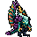

<!-- 本页上半部分由 tools/docs/gen_hero_docs.py 按仓库里现在的数据生成，手改会被覆盖；「开发记录」以下是手写的，生成时原样保留。 -->

# 石傲玉 Shi Oh Yu



| 项目 | 内容 |
|---|---|
| id | `tft_shiohyu` |
| 所属的包 | tft 包（金铲铲之战系列，mod_id `tft`） |
| 分路 | 上单 |
| 分类 / 标签 | 近战（Melee） · AD / Melee / CC / Tank |
| 高清帧 | PPU 2.46 |
| 附加包 | 无 |

其他预览：[skills](../preview/tft_shiohyu_skills.gif)、[逐帧预览](../preview/tft_shiohyu_frames.png)、[特效表](../preview/tft_shiohyu_effects.png)

## 现在的技能

下面是游戏里显示的技能说明（`tft/text/champion.i18n` 的简体中文，去掉了颜色和图标），冷却、距离来自 `tft/champion/tft_shiohyu.data_champion`；1 秒 = 60 tick。

### 普攻 / 被动

*攻击间隔 1.1 秒 · 攻击距离 25000*

左右爪交替挥击，第3下造成20 + 130% 攻击力物理伤害。玉石之肤：生命低于50%时化作玉石，减伤40%（3秒，冷却30秒）。

### 技能1 · 玉拳连打

*冷却 7 秒 · 施放距离 45000 · 施放：指定目标 · 敌人（不含防御塔）*

冲向目标连打4拳，每拳造成15 + 45% 攻击力物理伤害。

### 技能2 · 震地

*冷却 9 秒 · 施放距离 30000 · 施放：指定目标 · 敌人（不含防御塔）*

一拳砸地，周围敌人受到50 + 110% 攻击力物理伤害，被击飞0.75秒并减速35%。

### 大招 · 玉龙形态

*冷却 25 秒 · 施放距离 60000 · 施放：无目标 · 敌方英雄*

减伤35%、免疫控制，接下来3次普攻各造成40 + 175% 攻击力伤害：第1下晕眩1秒；第2下为真实伤害；第3下打出直线冲击波，晕眩沿线敌人。

### 数值

攻击力 84（每级 +10）、生命 1260（每级 +118）、护甲 48（每级 +8）、魔抗 38（每级 +6）、移速 1000（每级 +10）。

## 相关脚本和素材

- [`tools/kit/build_shiohyu.py`](../../tools/kit/build_shiohyu.py)
- [`tools/kit/setup_shiohyu.py`](../../tools/kit/setup_shiohyu.py)
- [`tools/lol/extract_shiohyu.py`](../../tools/lol/extract_shiohyu.py)
- [`tools/art/preview_shiohyu.py`](../../tools/art/preview_shiohyu.py)
- [`tools/art/rig_shiohyu.py`](../../tools/art/rig_shiohyu.py)
- [`assets/source/shiohyu/`](../../assets/source/shiohyu)

## 开发记录

| 部分 | 内容 |
|---|---|
| 定位 | tft 包（`tft_shiohyu`）的第二十个英雄，上路（上单，近战）。金铲铲第 7 赛季（巨龙之巢）的四费 `TFT7_DragonGreen`「石傲玉」（玉龙 / 秘术师 / 龙神，AD 战士，射程 1）：一个直立的玉石龙人武者，翡翠青绿的皮肤，下巴下垂着一大把浅玉色的胡子，金边的深青人字胸甲，深紫水晶肩甲，青绿眉盔下一双橙黄发光的眼睛，两根金角和一根紫色额角，珊瑚橙的爪子，背后两片收起来高高竖起的翅膀（深紫翼骨、金到玫瑰色的翼膜、青蓝翼刺），深紫尾巴尖一片带刺的叶形尾鳍。技能「玉龙形态」：减伤、免控，之后三次普攻依次是晕眩、真实伤害、直线冲击波晕眩。用户选的方案 A「玉龙三连」：大招是金铲铲原技能，被动玉石之肤、普攻龙爪三连、技能1 玉拳连打、技能2 震地是我们自己的 |
| 普攻 / 被动 | **龙爪三连**（近战 25000，打塔）：第 12 tick 爪子落下，三下一轮（两下之间不超过 240 tick，否则重来），前两下 100% 攻击力，第三下 20 + 130% 攻击力，各用金铲铲的 attack1 / attack2 / attack3 三段动作。**玉石之肤**：生命掉到 50% 以下时全身化作玉石，3 秒内受到的伤害减少 40%，之后 30 秒内不再触发（每条命一开始就好），由 tft.dll 看生命 |
| 技能1 | **玉拳连打**（冷却 7 秒，距离 45000，打野怪也会放）：冲向目标（速度 3500），到了以后第 6 tick 起每 8 tick 一拳、共 4 拳，每拳 15 + 45% 攻击力 |
| 技能2 | **震地**（冷却 9 秒，距离 30000）：第 14 tick 一拳砸地，45000 以内的敌人受 50 + 110% 攻击力物理伤害，击飞 0.75 秒，减速 35%（1.5 秒） |
| 大招 | **玉龙形态**（冷却 25 秒，距离 60000，有敌方英雄时）：减伤 35%、免疫控制，最多 8 秒；接下来的三次普攻换成三击，各 40 + 175% 攻击力：第 1 击晕眩 1 秒；第 2 击是真实伤害（FixedAttack）；第 3 击结束形态，朝目标打出一条长 92000、宽 20000 的直线玉石冲击波，出现 18 tick 后打中线上所有敌人并晕眩 1 秒。全是数据（三个标记依次传下去），没有调用 tft.dll |
| 数值 | 攻击 84（+10）、生命 1260（+118）、护甲 48（+8）、魔抗 38（+6）、移速 1000（+10），攻击间隔 1.1 秒，射程 25000 |
| 平衡 | 经典引擎模拟（上路，对原版斗士、处刑者、骑士、狂战士、枪骑士、长柄战士，两边三套阵容，纯数据版：玉石之肤放在震地的施法上、带冷却）：草稿 −2.41（大招冷却 35 秒、距离 40000，一局只放 2.2 次）；大招 25 秒 / 60000、攻击 84、生命 1260、技能加成提高后 −0.16；再加攻击间隔 66、三击 175%、护甲 48 后 +0.66 / +0.23；震地的击飞 0.75 秒、技能冷却缩短后 **+1.42 / +1.03** = 定稿（塞薇卡纯数据版同样的对局 +0.94 / +1.91）；冲击波改成出现 18 tick 后结算后 +1.31 |
| tft.dll | 数据读不到生命，玉石之肤在 tft 包自己的代码里（[`addons/tft/src/shiohyu.rs`](../../addons/tft/src/shiohyu.rs)，被动 `tft_shiohyu:jade`）：每 tick 看他的生命，低于 50% 且冷却已过时挂 `tft_shiohyu_p_skin`（减伤 40%，180 tick），亮一下 `tft_shiohyu_p`、播石化音效；死亡时播死亡音效。日志写到 `%APPDATA%/TeamSamoyed/TeamfightManager2/data/tft_shiohyu.log`（SPAWN / SKIN）。`build_shiohyu.py` 每次核对代码的默认参数和数据一致 |
| 塞拉斯 / 佛耶戈 / 妮蔻 / 俄洛伊 / 悠米 | 玉龙形态是纯数据，塞拉斯直接偷原版（减伤免控；三击只认石傲玉自己的普攻），特效表复制进附加包。佛耶戈 / 妮蔻的表（近战）、俄洛伊的幽灵图（193 位）和悠米骑上去的高度（30）都加上了他 |
| 精灵图（高清帧 PPU 2.46） | 参考是金铲铲客户端里他自己的模型（75 个关节：带手指的人形骨架，翅膀 L/R_Wing1–8 长在 Spine3 上，尾巴 Tail_1–4；动作片段按路径找到 idle / run / attack1–3 / crit / death / celebration / taunt，另有两段没名字的：翻滚扑地和出场）。Codex 第 0 步画了 A（3/4）和 B（侧身）；原稿 10 / 8.2 px 一格（按颜色边缘的相位量），按它自己的格子读回。用户定 **B-1、42 游戏像素、PPU 2.46**（[`tools/art/design_shiohyu_model.py`](../../tools/art/design_shiohyu_model.py)：B-1 的 113 行缩到 103 行，74×103；近处的眼睛补一格近白的亮点）。姿势包的骨架是他自己的动作按帧投影出来的（[`tools/art/pack_shiohyu_poses.py`](../../tools/art/pack_shiohyu_poses.py)：侧身 yaw 80，头放大 2.5 倍），Codex 画了 12 个姿势和 8 帧跑步。按胡子的面积量过，每张身体都和定稿一样大，[`tools/art/design_shiohyu_poses.py`](../../tools/art/design_shiohyu_poses.py) 按姿势包的 8 px 一格读回、换成定稿的颜色，头和定稿同角度的 16 张贴上定稿的脸（仰头咆哮、跪倒、高举爪、跑步第 1 帧保留 Codex 画的脸） |
| 动作 | [`tools/art/rig_shiohyu.py`](../../tools/art/rig_shiohyu.py)：普攻三段（attack / attack2 / attack3，各起手 + 出爪）；技能1 冲刺时是贴地前扑（dash），到了以后四拳是前扑这一帧前后推（skill）；技能2 举爪后整个人砸下去；大招起手后展翅咆哮（ult）；第三击是深深压低的前扑（r_wave）。姿势按定稿的根部列对齐、最低点在地面上 |
| 跑步 | 用 Codex 画的金铲铲原版跑步（一整个 0.97 秒循环取 8 帧，两次交错在第 4、8 帧，脚尖量过），各帧按贴上的脸对齐，头平稳、两条腿轮流迈步；帧长按原片段的时间分配 |
| 特效 | 13 张 + 3 个技能图标，用户用 Gemini 画（[`tools/art/pack_shiohyu_fx.py`](../../tools/art/pack_shiohyu_fx.py) 的提示词，参考是他自己第 7 赛季的粒子贴图 [`tools/lol/fx_ref_shiohyu.py`](../../tools/lol/fx_ref_shiohyu.py)）：爪痕、拳击、砸地的玉光裂地、碎石、减速、玉龙形态的开启和光环、三击的命中、直线玉石尖晶冲击波、玉石之肤的开启和光环。[`tools/art/clean_shiohyu_fx.py`](../../tools/art/clean_shiohyu_fx.py) 切帧、去背景和分隔线、去掉 Gemini 在地上画的整块圆盘（只留裂缝、光环和碎石）、缩到游戏格子、换成玉 / 金 / 碎石三套色、逐格对称（冲击波上下对称，其余左右对称）；[`tools/art/import_shiohyu_fx.py`](../../tools/art/import_shiohyu_fx.py) 按各自贴地的行切成 `tft_shiohyu_fx` 和 `tft_shiohyu_big` |
| 音效 | 普攻、暴击（连拳）和三击（attack1–3）是他自己的金铲铲音效（Riot 客户端 Map22 里第 7 赛季的音效包，事件名是 `Play_sfx_tft7_DragonGreen` 后面直接接动作名）；玉石之肤和震地借墨菲特，冲刺借李青，玉龙形态开启和冲击波借塔里克（炫光的晕眩直线），吼声和死亡借峡谷的龙（[`tools/lol/extract_shiohyu.py`](../../tools/lol/extract_shiohyu.py)，18 段） |
| 选人卡片 | 翅膀尖到脚底 42 游戏像素：`banpick_center` (−1, −8)（按规则 −39 减去最高点 −30.5）。脸 (3, −26)（近处的眼睛）。待机按 `tools/art/hero_reels.py` 剪进第三爪的出手帧，卡片轮播第三爪和玉龙形态两段：所有英雄的 BP 小图集加起来要在 192 MiB 以内（`tools/ci/ui_sheets.py`），四段的话会超出 |

重新生成（素材来自本机的金铲铲客户端，音频和 Riot 的渲染不进仓库）：

```bash
python tools/lol/extract_shiohyu.py --riot "D:\Riot Games\League of Legends" --vgmstream <vgmstream-cli.exe>
python tools/kit/build_shiohyu.py                   # 技能数据（被动调用 tft.dll），数字都在脚本的参数表 P 里；--plain 是平衡模拟用的纯数据
python tools/kit/setup_shiohyu.py                   # 五种语言的文字、音效配置、tft 包共享文件里他的键
python tools/art/design_shiohyu_hd.py               # Codex 第 0 步的原图读回
python tools/art/design_shiohyu_model.py            # 定稿 B-1（74×103）
python tools/art/design_shiohyu_poses.py            # Codex 的姿势：按 8 px 一格读回、换成定稿的颜色、贴定稿的脸
python tools/art/clean_shiohyu_fx.py                # Gemini 的特效 -> 游戏大小
python tools/art/import_shiohyu_fx.py               # 特效 -> tft_shiohyu_fx / tft_shiohyu_big，图标
python tools/art/rig_shiohyu.py                     # 1 倍帧和 2.46 的原帧
python tools/art/ppu_restyle.py --hero shiohyu      # 外描边
python tools/art/ppu_hd.py --hero shiohyu           # hd_ / lo_ 帧（要在 hero_reels 之前）
python tools/art/hero_reels.py --hero tft_shiohyu   # 待机和选人卡片的小动作
python tools/art/preview_shiohyu.py                 # 预览和每个技能单独的 GIF
python tools/art/review_shiohyu_actions.py --out <文件夹> --sheet   # 和金铲铲原版逐个动作对照的 GIF
cargo test --manifest-path addons/Cargo.toml -p tft   # tft.dll 的单元测试
```
