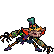

<!-- 本页上半部分由 tools/docs/gen_hero_docs.py 按仓库里现在的数据生成，手改会被覆盖；「开发记录」以下是手写的，生成时原样保留。 -->

# 史密奇 Smeech



| 项目 | 内容 |
|---|---|
| id | `tft_smeech` |
| 所属的包 | tft 包（金铲铲之战系列，mod_id `tft`） |
| 分路 | 打野 |
| 分类 / 标签 | 刺客（Assassin） · AD / Melee |
| 高清帧 | PPU 2.4 |
| 附加包 | 无 |

其他预览：[skills](../preview/tft_smeech_skills.gif)、[逐帧预览](../preview/tft_smeech_frames.png)、[特效表](../preview/tft_smeech_effects.png)

## 现在的技能

下面是游戏里显示的技能说明（`tft/text/champion.i18n` 的简体中文，去掉了颜色和图标），冷却、距离来自 `tft/champion/tft_smeech.data_champion`；1 秒 = 60 tick。

### 普攻 / 被动

*攻击间隔 0.9 秒 · 攻击距离 23000*

双爪轮流挥抓，造成100% 攻击力物理伤害。伏击专家：暴击率25%；技能也能暴击，技能暴击造成220%伤害。

### 技能1 · 废铁黑客

*冷却 7 秒 · 施放距离 45000 · 施放：指定目标 · 敌人（不含防御塔）*

跳向范围内生命最低的敌人，连斩3次，每次造成25 + 70% 攻击力物理伤害；目标阵亡则再跳一次，伤害为70%。

### 技能2 · 拆解

*冷却 8 秒 · 施放距离 26000 · 施放：指定目标 · 敌人（不含防御塔）*

双爪撕扯目标，造成45 + 110% 攻击力物理伤害，并使其护甲降低30%，持续4秒。

### 大招 · 废铁狂潮

*冷却 50 秒 · 施放距离 50000 · 施放：指定目标 · 敌方英雄*

1.2秒内不受控制、减伤30%，接连跳斩最多5名未被斩过的敌人，每次造成55 + 100% 攻击力物理伤害并获得10%暴击率（5秒）。

### 数值

攻击力 90（每级 +16）、生命 940（每级 +90）、护甲 28（每级 +8）、魔抗 22（每级 +4）、移速 1100（每级 +12）、暴击 25（每级 +0）。

## 相关脚本和素材

- [`tools/kit/build_smeech.py`](../../tools/kit/build_smeech.py)
- [`tools/kit/setup_smeech.py`](../../tools/kit/setup_smeech.py)
- [`tools/lol/extract_smeech.py`](../../tools/lol/extract_smeech.py)
- [`tools/art/preview_smeech.py`](../../tools/art/preview_smeech.py)
- [`tools/art/rig_smeech.py`](../../tools/art/rig_smeech.py)
- [`assets/source/smeech/`](../../assets/source/smeech)

## 开发记录

| 部分 | 内容 |
|---|---|
| 定位 | tft 包（`tft_smeech`）的第十四个英雄，打野（Assassin，近战物理刺客）。《双城之战》里祖安的化工男爵史密奇：灰褐绒毛的小怪物，一对横着的大尖耳，戴青绿高礼帽和黄铜护目镜，两条橄榄绿机械手臂末端是细长的黄铜爪，脚下是黄铜高跷。金铲铲第 13 赛季的三费（`TFT13_Gremlin`「史密奇」，炼金男爵 / 伏击专家，物理刺客，射程 1，生命 777，攻击 70，暴击 25%，法力 20/70），技能「废铁黑客」：跳向 4 格内装备最少的敌人连斩 3 下，目标阵亡就再跳一次（伤害降低 30%）。用户选了**打野**和方案 A「废铁伏击手」：技能1 照金铲铲（改成跳向生命最低的敌人），被动伏击、普攻双爪连撕、技能2 拆解、大招废铁狂潮是我们加的。模型在 Riot 客户端的 `TFTSet13.wad.client`（`tft13_gremlin.skn`，106 根骨骼，一张贴图；动作只有路径哈希，按内容命名） |
| 普攻 / 被动 | **双爪连撕**（近战，打塔）：左右爪轮流挥抓（`attack` / `attack2` 两套帧和音效），第 10 tick 100% 攻击力。**伏击**：自带 25% 暴击率（普攻按游戏的规矩暴击，2 倍）；技能也能暴击，由 tft.dll 按他的暴击率掷骰（用效果给的确定性种子，预演和观战一致），技能暴击造成 220% 伤害并亮暴击爆星 |
| 技能1 | **废铁黑客**（冷却 7 秒，距离 45000，打野怪也会放）：起跳（播 `leap`），第 13 tick 由 tft.dll 把他落到 45000 内**生命最低**的敌人身前 20000 处（先英雄、再小兵野怪；都没有就用 AI 选的目标），之后第 8、16、24 tick 各斩一下（播 `stabs`）：25 + 70% 攻击力的物理伤害，能暴击。目标被斩死就再跳一次，新目标的三下各打 70% |
| 技能2 | **拆解**（冷却 8 秒，距离 26000）：第 10 tick 双爪撕扯目标，45 + 110% 攻击力的物理伤害（能暴击），并使其护甲降低 30%，持续 4 秒（头顶一块裂开的碎盾） |
| 大招 | **废铁狂潮**（冷却 50 秒，敌方英雄在 50000 以内时放）：1.2 秒内不受控制、减伤 30%，从第 6 tick 起每 12 tick 跳一次，共 5 次：跳到身边 45000 内这次大招还没打过的敌人身前（先英雄、再生命最低），55 + 100% 攻击力物理伤害（能暴击），每跳一次获得 10% 暴击率，持续 5 秒（可叠加）。没有能跳的就不动 |
| 数值 | 攻击 90（+16）、生命 940（+90）、护甲 28（+8）、魔抗 22（+4）、移速 1100（+12），暴击率 25%，攻击间隔 0.9 秒，射程 23000 |
| 平衡 | 经典引擎模拟（打野，两边三套阵容，纯数据版：技能每下按平均暴击算、技能1 跳 AI 的目标、大招随机跳英雄）：草稿 −0.16（同一批 tft_violet 纯数据版 +2.29，league_khazix +0.47）；攻击和三个技能的比例调高一档 +1.75，再高一档 +3.82（太强），两者之间 +2.37 / +2.72；**定稿**取再低一档：+1.24 / +1.25（种子 1–8 / 9–16；tft_violet +2.29 / +0.84）。游戏里 tft.dll 专挑生命最低的目标，模拟做不到，所以留了余量 |
| tft.dll | 数据做不到的部分在 tft 包自己的代码里（[`addons/tft/src/smeech.rs`](../../addons/tft/src/smeech.rs)，和荏妮、刀疤、敖兴、石甲虫、蔚奥莱、范德尔、可酷伯、洛里斯、麦迪、希尔科、拉露恩、诺拉一起编成 `tft.dll`）：被动 `tft_smeech:ambush` 记下参数；`tft_smeech:hack`（挑生命最低的目标、落地、排三下斩击 `slash1-3`，斩死就再跳一次）、`tft_smeech:rip`、`tft_smeech:hop`（下一个没打过的敌人、落地、斩、叠暴击）都按他的暴击率掷骰。所有记号都挂在单位身上（不存静态表），预演和观战两个模拟同时跑也互不干扰。日志写到 `%APPDATA%/TeamSamoyed/TeamfightManager2/data/tft_smeech.log`。`build_smeech.py` 每次核对代码的默认参数和数据一致 |
| 塞拉斯 / 佛耶戈 / 妮蔻 / 俄洛伊 / 悠米 | 塞拉斯偷到的是大招的纯数据版（`build_smeech.sylas_ult`：每跳随机挑一名英雄，按平均暴击算伤害，特效表复制进附加包；`sylas_steal_check.py` 模拟里跳斩特效出现 18 次）。佛耶戈 / 妮蔻的表（刺客类）、俄洛伊的幽灵图和悠米骑上去的高度（21）都加上了他 |
| 精灵图（高清帧 PPU 2.4） | Codex 第 0 步画了 A（金铲铲的待机，站在高跷上、一只爪子举在脸边）和 B（伏击蹲姿，双爪张开），各交了一张大的初稿和一张小的精修稿，精修稿约 7.5 / 6 px 一格，按它自己的格子读回；A 太窄（游戏里只有 18–22 像素宽，邻居 35–50），用户定 **B-1、帽顶到爪尖 36 游戏像素、PPU 2.4**（[`tools/art/design_smeech_model.py`](../../tools/art/design_smeech_model.py)：128×87，一格一个像素，两只眼睛重画成同一行的黑瞳孔）。姿势包的骨架是他自己的动作按帧投影出来的（[`tools/art/pack_smeech_poses.py`](../../tools/art/pack_smeech_poses.py)：头放大 2.2 倍，手臂画到中指爪尖；格子用 9 px，12 px 放不下 128 格宽的蹲姿），Codex 画了 20 个姿势，守住了 9 px 格子和定稿的 36 色；[`tools/art/design_smeech_poses.py`](../../tools/art/design_smeech_poses.py) 在站着的帧按礼帽对齐贴上定稿的头，清掉 Codex 自己的礼帽、错位的红耳朵（q_crouch 里画成了一块披风）和残渣，倒地两帧保留 Codex 的头（礼帽掉了）。走路：Codex 的 8 帧每帧身体大小都不一样（「走路时身体和头有点不协调」「还是变形吧」），改用 [`tools/art/design_smeech_walk.py`](../../tools/art/design_smeech_walk.py)：8 帧都用 run5 的上半身（头、马甲、两条手臂），两条高跷腿按荏妮之前凯特琳的跑步画法逐帧画（脚踝 8 个相位、膝盖按 run5 的大小腿长度解出，杆子用 run5 的黄铜色，膝关节和鞋取 run5 的像素平放，远腿暗一档），支撑脚踩地带出起伏；中间试过的蹲姿走路用户不要（「这个走路姿势还不如之前」），已撤回。[`tools/art/rig_smeech.py`](../../tools/art/rig_smeech.py) 拼成走路（8 帧，每帧 125 毫秒）、两套爪击、起跳和三连斩、拆解、大招（5 次扑斩）、受击、阵亡（礼帽掉落 → 倒地） |
| 特效 | 8 张 + 3 个技能图标，Codex 画的（[`tools/art/pack_smeech_fx.py`](../../tools/art/pack_smeech_fx.py) 的提示词，参考是金铲铲里他自己的粒子贴图 [`tools/lol/fx_ref_smeech.py`](../../tools/lol/fx_ref_smeech.py)：爪痕白金、化学荧光绿、暴击红橙、废铁灰、祖安灰土五组色阶）。Codex 自己缩出的 1 倍版把细爪痕弄碎了，[`tools/art/import_smeech_fx.py`](../../tools/art/import_smeech_fx.py) 全部从原稿按块重读（每帧只读自己那一段），逐帧左右对称，切成 `tft_smeech_fx`；大招的绿光画在他身后（z −1，画在身上会挡住爪子）。图标用 Codex 的 64×64 |
| 音效 | 他自己的金铲铲音效（Riot 客户端第 13 赛季：两种爪击和击中、暴击、技能的起跳和斩击），技能1 配英文语音；落地和拆解借卡兹克（E、Q），撕护甲借图奇（E），大招的起手和每次起跳借卡兹克（R、E），每次斩击借易大师（Q），最后一下借雷恩加尔（强化 Q）（[`tools/lol/extract_smeech.py`](../../tools/lol/extract_smeech.py)，17 段） |
| 选人卡片 | 帽顶到爪尖 36 游戏像素：`banpick_center` (2, −17)（按规则 −39 减去最高点 −22，礼帽离卡顶 1 像素），不另设缩放。脸 (14, −17)（两眼之间）。待机按 `tools/art/hero_reels.py` 剪进两套爪击的帧，卡片轮播普攻、技能2、三连斩、大招 |

重新生成（素材来自本机的金铲铲客户端，音频和 Riot 的渲染不进仓库）：

```bash
python tools/lol/extract_smeech.py --riot "D:\Riot Games\League of Legends" --lol "D:\WeGameApps\lol" --vgmstream <vgmstream-cli.exe>
python tools/kit/build_smeech.py                  # 技能数据（被动和技能调用 tft.dll），数字都在脚本的参数表 P 里；--plain 是平衡模拟用的纯数据
python tools/kit/setup_smeech.py                  # 五种语言的文字、音效配置、tft 包共享文件里他的键
python tools/art/design_smeech_hd.py              # Codex 第 0 步的原图读回
python tools/art/design_smeech_model.py           # 定稿 B-1（128×87）
python tools/art/design_smeech_poses.py           # Codex 的姿势：贴定稿的头、清残渣（走路帧不写）
python tools/art/design_smeech_walk.py            # 走路 8 帧：run5 的上半身 + 按相位画的高跷腿
python tools/art/import_smeech_fx.py              # 特效 -> tft_smeech_fx，图标
python tools/art/rig_smeech.py                    # 1 倍帧和 2.4 的原帧
python tools/art/ppu_restyle.py --hero smeech     # 外描边
python tools/art/ppu_hd.py --hero smeech          # hd_ / lo_ 帧（要在 hero_reels 之前）
python tools/art/hero_reels.py --hero tft_smeech  # 待机和选人卡片的小动作
python tools/art/preview_smeech.py                # 预览和每个技能单独的 GIF
python tools/art/review_smeech_actions.py --out <文件夹> --sheet   # 和金铲铲原版逐个动作对照的 GIF
python addons/league_sylas/make_override.py       # 塞拉斯偷到的废铁狂潮
cargo test --manifest-path addons/Cargo.toml -p tft   # tft.dll 的单元测试
```
