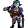

<!-- 本页上半部分由 tools/docs/gen_hero_docs.py 按仓库里现在的数据生成，手改会被覆盖；「开发记录」以下是手写的，生成时原样保留。 -->

# 斯特卜 Steb



| 项目 | 内容 |
|---|---|
| id | `tft_steb` |
| 所属的包 | tft 包（金铲铲之战系列，mod_id `tft`） |
| 分路 | 辅助 |
| 分类 / 标签 | 功能型（Util） · AP / Magic / Melee / Tank / Heal / Shield |
| 高清帧 | PPU 2.6 |
| 附加包 | 无 |

其他预览：[skills](../preview/tft_steb_skills.gif)、[逐帧预览](../preview/tft_steb_frames.png)、[特效表](../preview/tft_steb_effects.png)

## 现在的技能

下面是游戏里显示的技能说明（`tft/text/champion.i18n` 的简体中文，去掉了颜色和图标），冷却、距离来自 `tft/champion/tft_steb.data_champion`；1 秒 = 60 tick。

### 普攻 / 被动

*攻击间隔 1.5 秒 · 攻击距离 25000*

双警棍轮流打击，造成100% 攻击力物理伤害。战地医疗：自己受到治疗时，最近的2名友方英雄也回复该治疗量的25%。

### 技能1 · 战地医疗

*冷却 5.5 秒 · 施放距离 30000 · 施放：指定目标 · 敌人（不含防御塔）*

给自己打一针，回复120 + 60% 法强生命，再重击目标造成170 + 120% 法强魔法伤害并眩晕0.75秒。

### 技能2 · 通缉令

*冷却 10 秒 · 施放距离 60000 · 施放：无目标 · 敌方英雄*

通缉附近生命最高的敌方英雄5秒：它受到的伤害提高25%；它在通缉中阵亡时，自己和附近友方攻速提高30%（5秒）。

### 大招 · 医疗背包

*冷却 40 秒 · 施放距离 50000 · 施放：无目标 · 敌方英雄*

打开医疗背包：自己和周围友方英雄获得120 + 50% 法强的护盾（4秒），自己减伤30%；之后每0.5秒为周围友方回复25 + 12% 法强生命，共6次。

### 数值

攻击力 68（每级 +6）、法强 45（每级 +16）、生命 1150（每级 +110）、护甲 38（每级 +7）、魔抗 30（每级 +4）、移速 980（每级 +10）。

## 相关脚本和素材

- [`tools/kit/build_steb.py`](../../tools/kit/build_steb.py)
- [`tools/kit/setup_steb.py`](../../tools/kit/setup_steb.py)
- [`tools/lol/extract_steb.py`](../../tools/lol/extract_steb.py)
- [`tools/art/preview_steb.py`](../../tools/art/preview_steb.py)
- [`tools/art/rig_steb.py`](../../tools/art/rig_steb.py)
- [`assets/source/steb/`](../../assets/source/steb)

## 开发记录

| 部分 | 内容 |
|---|---|
| 定位 | tft 包（`tft_steb`）的第十六个英雄，辅助（Util，近战法术坦克型治疗）。《双城之战》里皮尔特沃夫的鱼人执法官斯特卜：浅海绿皮肤、青绿飞机头、尖尖的鱼鳍耳、脸颊上有鳞点，穿蓝色执法官制服，背一个大棕皮急救背包，手里两根带侧把手的海克斯警棍。金铲铲第 13 赛季的一费（`TFT13_Fish`「斯特卜」，执法官 / 格斗家，法术坦克）：技能「战地医疗」，被动是受到治疗时最近的两名友军也回复 25%，主动给自己回血并打击目标。用户选的方案 A「战地军医」：被动和技能1沿用战地医疗，技能2 做成执法官羁绊的通缉令，大招是我们自己的医疗背包 |
| 普攻 / 被动 | **双警棍连击**（近战，打塔）：两根警棍轮流打（`attack` / `attack2` 帧），100% 攻击力。**战地医疗**：他受到任何治疗（自己的、队友给的、吸血），离他最近的 2 名受伤友方英雄（60000 以内）各回复这次治疗量的 25%；数据读不到生命，tft.dll 每拍看他的生命，多出来的就是治疗，用引擎的治疗给队友（算治疗统计） |
| 技能1 | **战地医疗**（冷却 5.5 秒，距离 30000，打野怪也会放）：第 8 tick 给自己打一针，回复 120 + 60% 法强生命（被动再分给队友），第 22 tick 一棍砸在目标身上，170 + 120% 法强魔法伤害并眩晕 0.75 秒（眩晕是我们加的：不加的话他没有控制，模拟里 −0.55） |
| 技能2 | **通缉令**（冷却 10 秒，距离 60000，打英雄）：第 10 tick 由 tft.dll 找 80000 以内当前生命最多的敌方英雄，挂 5 秒通缉（受到的伤害 +25%）；它在通缉中倒下，他和 70000 以内的友方英雄攻速 +30%，5 秒 |
| 大招 | **医疗背包**（冷却 40 秒，距离 50000，打英雄时）：第 24 tick 打开背包，他和 40000 以内的友方英雄各得 120 + 50% 法强的护盾（4 秒），他自己减伤 30%（4 秒）；从那一刻起每 0.5 秒一次、共 6 次，他和周围友方各回复 25 + 12% 法强生命（他回的那份又经被动分给最近的两名队友） |
| 数值 | 攻击 68（+6）、法强 45（+16）、生命 1150（+110）、护甲 38（+7）、魔抗 30（+4）、移速 980（+10），攻击间隔 1.5 秒，射程 25000 |
| 平衡 | 经典引擎模拟（辅助，对原版牧师、武僧、吟游诗人、附魔师、道士，两边三套阵容，纯数据版：被动给范围内所有队友 25%、通缉随机挑一个英雄、没有赏金）：草稿（Q 80 + 70% 每 7 秒、E +15%、R 每 50 秒）−2.46（同一批 tft_loris 纯数据版 +1.40）；Q 170 + 120% 每 5.5 秒、E +25%、R 每 40 秒、法强 45、Q 回血 120、R 护盾 120 −0.55（伤害和洛里斯一样了，但没有控制）；Q 的重击加 0.75 秒眩晕 **+1.82**（换一批种子 +0.93）= 定稿 |
| tft.dll | 数据做不到的部分在 tft 包自己的代码里（[`addons/tft/src/steb.rs`](../../addons/tft/src/steb.rs)，和其他 tft 英雄一起编成 `tft.dll`）：被动 `tft_steb:medic`（每拍比较他的生命，分享治疗，队友身上亮 `p_heal`，同一个人 30 拍内只亮一次；看通缉中的人倒下没有，倒下就发赏金 `e_rush`）；效果 `wanted`（挑生命最多的敌方英雄挂通缉）。通缉中的人按模拟（种子、来历、比赛、局）分开记，预演和观战同时跑互不干扰。日志写到 `%APPDATA%/TeamSamoyed/TeamfightManager2/data/tft_steb.log`（SPAWN / SHARE / WANTED / BOUNTY）。`build_steb.py` 每次核对代码的默认参数和数据一致 |
| 塞拉斯 / 佛耶戈 / 妮蔻 / 俄洛伊 / 悠米 | 塞拉斯偷到的是大招的纯数据版（`build_steb.sylas_ult`：治疗按范围分给附近队友，特效表复制进附加包）。佛耶戈 / 妮蔻的表（功能型）、俄洛伊的幽灵图和悠米骑上去的高度都加上了他 |
| 精灵图（高清帧 PPU 2.6） | 参考是金铲铲客户端里他自己的模型（身体、背包、警棍三个子网格各用自己的贴图；动作片段按路径找到了 idle / run / attack1 / attack2 / spell / death）。Codex 第 0 步画了 A（待机，一根警棍扛肩、一根朝下）和 B（深蹲，双棍平举），原稿约 8 / 9 px 一格，按它自己的格子读回。用户定 **A-1、40 游戏像素、PPU 2.6**（[`tools/art/design_steb_model.py`](../../tools/art/design_steb_model.py)：80×106，一格一个像素，两只眼珠补成 2×2）。姿势包的骨架是他自己的动作按帧投影出来的（[`tools/art/pack_steb_poses.py`](../../tools/art/pack_steb_poses.py)：警棍按贴图找黄铜头，背包画轮廓；金铲铲的战斗动作是侧身对着目标，背对镜头的帧换了角度），Codex 画了 12 个姿势；[`tools/art/design_steb_poses.py`](../../tools/art/design_steb_poses.py) 贴定稿的头，手臂和身体之间一两格宽的细缝、小洞补成描边。跑步单独一个包（[`tools/art/pack_steb_run.py`](../../tools/art/pack_steb_run.py)，用户：「走路要有交叉步啊 别做错了」）：他的跑步一个循环 1.30 秒，取整个循环的 8 个时刻（含两次交错），近侧腿用定稿的颜色画在上面、远侧腿暗一档，每帧写明两只靴尖的格子。Codex 的腿轮流在前画对了，但每帧上半身不一样、警棍乱跳，[`tools/art/design_steb_run.py`](../../tools/art/design_steb_run.py) 8 帧都用 run3 的上半身（贴一次定稿的头），每帧用它自己的腿，腰只往下压（不拉长腿），起伏 3 格；大腿顶留在衣摆下面，衣摆和腿之间的空隙填裤子的暗色（第一版把大腿顶削平留了洞，用户：「我怎么看到像素缺失？」）；按片段间隔分 880 毫秒一个循环 |
| 特效 | 13 张 + 3 个技能图标，Codex 画的（[`tools/art/pack_steb_fx.py`](../../tools/art/pack_steb_fx.py) 的提示词，参考是金铲铲里他自己的粒子贴图 [`tools/lol/fx_ref_steb.py`](../../tools/lol/fx_ref_steb.py)：警棍的海克斯青、治疗绿和白十字、执法官的蓝金徽章、通缉的红准星）。全部左右对称，没有会飞的图。[`tools/art/import_steb_fx.py`](../../tools/art/import_steb_fx.py) 按 Codex 的 1 倍版切成 `tft_steb_fx` 和 `tft_steb_big`（地上的医疗圈），图标用 Codex 的 64×64 |
| 音效 | 普攻、暴击（通缉令）、技能施放和命中是他自己的金铲铲音效（Riot 客户端第 13 赛季），技能1 配英文语音；分享治疗和大招的治疗借索拉卡（W / R），打针借娑娜（W），通缉标记借凯特琳（R 锁定），赏金借金克丝（被动），打开背包借塔里克（R），护盾借拉克丝（W）（[`tools/lol/extract_steb.py`](../../tools/lol/extract_steb.py)，16 段） |
| 选人卡片 | 发顶到脚底 40.8 游戏像素：`banpick_center` (2, −9)（按规则 −39 减去最高点 −30.0），不另设缩放。脸 (3, −34)（两眼之间）。待机按 `tools/art/hero_reels.py` 剪进普攻帧，卡片轮播普攻、战地医疗、通缉令、医疗背包 |

重新生成（素材来自本机的金铲铲客户端，音频和 Riot 的渲染不进仓库）：

```bash
python tools/lol/extract_steb.py --riot "D:\Riot Games\League of Legends" --lol "D:\WeGameApps\lol" --vgmstream <vgmstream-cli.exe>
python tools/kit/build_steb.py                  # 技能数据（被动和通缉令调用 tft.dll），数字都在脚本的参数表 P 里；--plain 是平衡模拟用的纯数据
python tools/kit/setup_steb.py                  # 五种语言的文字、音效配置、tft 包共享文件里他的键
python tools/art/design_steb_hd.py              # Codex 第 0 步的原图读回
python tools/art/design_steb_model.py           # 定稿 A-1（80×106）
python tools/art/design_steb_poses.py           # Codex 的姿势：贴定稿的头
python tools/art/design_steb_run.py             # 跑步 8 帧：run3 的上半身 + 每帧自己的腿
python tools/art/import_steb_fx.py              # 特效 -> tft_steb_fx / tft_steb_big，图标
python tools/art/rig_steb.py                    # 1 倍帧和 2.6 的原帧
python tools/art/ppu_restyle.py --hero steb     # 外描边
python tools/art/ppu_hd.py --hero steb          # hd_ / lo_ 帧（要在 hero_reels 之前）
python tools/art/hero_reels.py --hero tft_steb  # 待机和选人卡片的小动作
python tools/art/preview_steb.py                # 预览和每个技能单独的 GIF
python tools/art/review_steb_actions.py --out <文件夹> --sheet   # 和金铲铲原版逐个动作对照的 GIF
python addons/league_sylas/make_override.py     # 塞拉斯偷到的医疗背包
cargo test --manifest-path addons/Cargo.toml -p tft   # tft.dll 的单元测试
```
