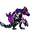

<!-- 本页上半部分由 tools/docs/gen_hero_docs.py 按仓库里现在的数据生成，手改会被覆盖；「开发记录」以下是手写的，生成时原样保留。 -->

# 赛芬 Sy'fen



| 项目 | 内容 |
|---|---|
| id | `tft_syfen` |
| 所属的包 | tft 包（金铲铲之战系列，mod_id `tft`） |
| 分路 | 打野 |
| 分类 / 标签 | 近战（Melee） · AD / Melee / CC |
| 高清帧 | PPU 2.52 |
| 附加包 | 无 |

其他预览：[skills](../preview/tft_syfen_skills.gif)、[逐帧预览](../preview/tft_syfen_frames.png)、[特效表](../preview/tft_syfen_effects.png)

## 现在的技能

下面是游戏里显示的技能说明（`tft/text/champion.i18n` 的简体中文，去掉了颜色和图标），冷却、距离来自 `tft/champion/tft_syfen.data_champion`；1 秒 = 60 tick。

### 普攻 / 被动

*攻击间隔 1 秒 · 攻击距离 30000*

翼爪和甩尾交替攻击，造成100% 攻击力物理伤害。幽影低语：他的伤害让敌人缩小4秒（护甲、魔抗-20%）；打缩小的敌人叠怒气，每层+5攻击力，最多5层。

### 技能1 · 噬咬

*冷却 8 秒 · 施放距离 32000 · 施放：指定目标 · 敌人（不含防御塔）*

扑上去咬住目标，造成40 + 160% 攻击力物理伤害，无视33%护甲，回复30 + 30% 攻击力生命。

### 技能2 · 翼刃横扫

*冷却 10 秒 · 施放距离 30000 · 施放：指定目标 · 敌人（不含防御塔）*

张开双翼横扫身边，造成40 + 100% 攻击力物理伤害并减速30%（1.5秒）。

### 大招 · 暴走

*冷却 40 秒 · 施放距离 72000 · 施放：指定目标 · 敌方英雄*

龙吼后冲向最远的敌方英雄（免疫控制），路上的敌人受到30 + 140% 攻击力物理伤害并晕眩1.25秒，最后猛咬一口造成60 + 235% 攻击力物理伤害，无视33%护甲。

### 数值

攻击力 84（每级 +14）、生命 1150（每级 +112）、护甲 36（每级 +8）、魔抗 28（每级 +5）、移速 1040（每级 +10）。

## 相关脚本和素材

- [`tools/kit/build_syfen.py`](../../tools/kit/build_syfen.py)
- [`tools/kit/setup_syfen.py`](../../tools/kit/setup_syfen.py)
- [`tools/lol/extract_syfen.py`](../../tools/lol/extract_syfen.py)
- [`tools/art/preview_syfen.py`](../../tools/art/preview_syfen.py)
- [`tools/art/rig_syfen.py`](../../tools/art/rig_syfen.py)
- [`assets/source/syfen/`](../../assets/source/syfen)

## 开发记录

| 部分 | 内容 |
|---|---|
| 定位 | tft 包（`tft_syfen`）的第二十一个英雄，打野（近战）。金铲铲第 7.5 赛季（巨龙之巢）的四费 `TFT7_DragonPurple`「赛芬」（幽影龙 / 格斗家 / 龙神，AD 战士，射程 1）：一头弓着身子直立的双足飞龙，前肢就是翅膀，品红头甲、两根暗红弯角、长尾巴尖是一把刀刃。金铲铲原技能「暴走」做大招，其余按用户选的方案 A「暴走猎杀」（2026-10-30）自己设计 |
| 普攻 / 被动 | **翼爪连击**（近战 30000，打塔）：第 12 tick 出手，翼爪（attack）和甩尾（attack2）交替，各 100% 攻击力。**幽影低语**（tft.dll）：他打出的每一下伤害（技能也算）让敌人缩小 4 秒，护甲、魔抗各 −20%；打已经缩小的敌人叠一层怒气，每层 +5 攻击力，最多 5 层，5 秒不叠全部消失（金铲铲幽影龙羁绊的做法） |
| 技能1 | **噬咬**（冷却 8 秒，距离 32000，打野怪也会放）：后仰，第 14 tick 扑向目标（速度 3500），咬住造成 40 + 160% 攻击力物理伤害，无视 33% 护甲（咬的那一 tick 给自己 33% 破甲），回复 30 + 30% 攻击力生命 |
| 技能2 | **翼刃横扫**（冷却 10 秒，距离 30000）：张开双翼，第 16 tick 合拢横扫，42000 以内的敌人受 40 + 100% 攻击力物理伤害，减速 30%（1.5 秒） |
| 大招 | **暴走**（金铲铲原技能，冷却 40 秒，距离 72000，有敌方英雄时）：龙吼（从吼到咬完免疫控制），第 14 tick 起冲向 72000 以内**最远**的敌方英雄（tft.dll 找人，每 tick 4500，最多 16 tick，停在它身前），路线两边 20000 以内的敌人每人一次 30 + 140% 攻击力物理伤害并晕眩 1.25 秒；第 34 tick 咬住冲向的那个人，60 + 235% 攻击力物理伤害，无视 33% 护甲 |
| 数值 | 攻击 84（+14）、生命 1150（+112）、护甲 36（+8）、魔抗 28（+5）、移速 1040（+10），攻击间隔 1 秒，射程 30000（他的长嘴伸到站位前方 29 游戏像素，25000 会咬进目标身体里） |
| 平衡 | 经典引擎模拟（打野，对原版忍者、恶魔、猎人、狼人、吸血鬼，两边三套阵容，纯数据版：缩小挂在普攻的目标上、怒气按平均层数，大招是穿透冲锋 + 回咬）：草稿 +1.79 / +1.90（种子 1–8 / 9–16；范德尔纯数据 +1.73 / +1.48）；怒气按满层 +2.29；每层怒气 6→5、咬击 260→240% +1.59；接上美术后射程 25000→30000 +1.78 / +1.79，咬击 235%：**+1.59**（种子 1–32） |
| tft.dll | [`addons/tft/src/syfen.rs`](../../addons/tft/src/syfen.rs)：被动 `tft_syfen:whisper`（`on_attack` 里看目标有没有 `tft_syfen_p_shrink`：有就叠怒气 `tft_syfen_p_rage`，没有就亮缩小、播璐璐的变形声；然后给目标挂上缩小）；原生效果 `tft_syfen:rampage`（找最远的敌方英雄，`entity_set_pos` 每 tick 推一步、`queue_effect` 接下一步 `tft_syfen:rush`，撞到路线附近的敌人）和 `tft_syfen:bite`（咬冲向的那个人，不在 40000 内就咬最近的敌人）；死亡时播死亡声。日志 `data/tft_syfen.log`（SPAWN / SHRINK / FURY / RAMPAGE / RAM / ARRIVE / BITE） |
| 塞拉斯 / 佛耶戈 / 妮蔻 / 俄洛伊 / 悠米 | 塞拉斯偷到的暴走是纯数据版（`build_syfen.sylas_ult`：穿透冲锋撞晕、回咬），特效表复制进附加包；佛耶戈 / 妮蔻的表（近战）、俄洛伊的灵魂（194 个）、悠米坐骑的头顶高度 24 |
| 精灵图（高清帧 PPU 2.52） | 参考是金铲铲客户端里他自己的模型（56 个关节：双足骨架，翅膀 l_wing / R_Wing 长在手上，尾巴 Tail_a–g；动作片段按路径找到 idle / run / attack1 / attack2 / spell / death / celebration，另有一段 3.73 秒的出场）。第 0 步 Codex 画了 A（3/4）和 B（侧面），用户选 **B-1、40 游戏像素、PPU 2.52**（B 按它自己 6 px 一格读回是 140×111，缩到 101 行：128×101）。第 2 步 Codex 照他自己的动作片段画了 13 个姿势和 8 帧四肢着地的跑步（骨架包 [`tools/art/pack_syfen_poses.py`](../../tools/art/pack_syfen_poses.py)） |
| 动作 | Codex 自己的成品把每张统一缩成 0.9 倍，原稿里跑步的身体又画小了一圈（约 0.85 倍）——所以从原稿按它自己的格子读，按弯角的面积把每张缩放到定稿的身体大小（[`tools/art/design_syfen_poses.py`](../../tools/art/design_syfen_poses.py)），头没转的帧贴定稿的脸。[`tools/art/rig_syfen.py`](../../tools/art/rig_syfen.py)：普攻翼爪 / 甩尾各起手 + 出手；噬咬后仰 + 低扑；翼刃横扫张翼 + 合拢；暴走咆哮 + 低身冲锋 + 低头猛咬；死亡后仰 + 趴地 |
| 跑步 | 金铲铲原版四肢着地的跑步（一整个 0.667 秒循环取 8 帧，两条后腿交错在第 2、6 帧，脚尖量过）；第 1、2、6 帧 Codex 画得比参考图靠前 10–16 格，按参考图里每帧头的位置挪回去，跑起来不跳 |
| 特效 | 12 张 + 3 个技能图标，Codex 画（[`tools/art/pack_syfen_fx.py`](../../tools/art/pack_syfen_fx.py) 的提示词，参考是他自己第 7 赛季的粒子贴图 [`tools/lol/fx_ref_syfen.py`](../../tools/lol/fx_ref_syfen.py)），全部左右对称；[`tools/art/import_syfen_fx.py`](../../tools/art/import_syfen_fx.py) 导入时去掉了翼刃横扫和龙吼最后几帧两边从相邻格带进来的细条 |
| 音效 | 普攻、暴击（噬咬的扑击）和技能攻击（暴走的起手和咬击）是他自己的金铲铲音效（Riot 客户端 Map22 里第 7 赛季的音效包，事件名是 `Play_sfx_tft7_DragonPurple` 后面直接接动作名）；缩小借璐璐的变形术，咬合借科加斯的盛宴，横扫和撞击借瑟庄妮，冲锋借赫卡里姆，龙吼和死亡借峡谷的小龙（[`tools/lol/extract_syfen.py`](../../tools/lol/extract_syfen.py)，15 个） |
| 选人卡片 | 弯角尖到脚底 40 游戏像素：`banpick_center` (3, −10)（按规则 −39 减去最高点 −29）。脸 (23, −28)（眼睛）。待机按 `tools/art/hero_reels.py` 剪进翼爪的起手帧，卡片轮播普攻、噬咬、翼刃横扫、暴走 |

重新生成（素材来自本机的金铲铲客户端，音频和 Riot 的渲染不进仓库）：

```bash
python tools/lol/extract_syfen.py --riot "D:\Riot Games\League of Legends" --vgmstream <vgmstream-cli.exe>
python tools/kit/build_syfen.py                     # 技能数据（被动和大招调用 tft.dll），数字都在脚本的参数表 P 里；--plain 是平衡模拟用的纯数据
python tools/kit/setup_syfen.py                     # 五种语言的文字、音效配置、tft 包共享文件里他的键
python tools/art/design_syfen_hd.py                 # Codex 第 0 步的原图读回
python tools/art/design_syfen_model.py              # 定稿 B-1（128×101）
python tools/art/design_syfen_poses.py              # Codex 的姿势：从原稿读、按弯角统一身体大小、换成定稿的颜色、贴定稿的脸
python tools/art/import_syfen_fx.py                 # 特效 -> tft_syfen_fx / tft_syfen_big，图标
python tools/art/rig_syfen.py                       # 1 倍帧和 2.52 的原帧
python tools/art/ppu_restyle.py --hero syfen        # 外描边
python tools/art/ppu_hd.py --hero syfen             # hd_ / lo_ 帧（要在 hero_reels 之前）
python tools/art/hero_reels.py --hero tft_syfen     # 待机和选人卡片的小动作
python tools/art/preview_syfen.py                   # 预览和每个技能单独的 GIF
python tools/art/review_syfen_actions.py --out <文件夹> --sheet   # 和金铲铲原版逐个动作对照的 GIF
cargo test --manifest-path addons/Cargo.toml -p tft   # tft.dll 的单元测试
```
