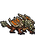

<!-- 本页上半部分由 tools/docs/gen_hero_docs.py 按仓库里现在的数据生成，手改会被覆盖；「开发记录」以下是手写的，生成时原样保留。 -->

# 泰拉 Terra



| 项目 | 内容 |
|---|---|
| id | `tft_terra` |
| 所属的包 | tft 包（金铲铲之战系列，mod_id `tft`） |
| 分路 | 上单 |
| 分类 / 标签 | 近战（Melee） · AD / Melee / Tank / CC / Shield |
| 高清帧 | PPU 1.45 |
| 附加包 | 无 |

其他预览：[skills](../preview/tft_terra_skills.gif)、[逐帧预览](../preview/tft_terra_frames.png)、[特效表](../preview/tft_terra_effects.png)

## 现在的技能

下面是游戏里显示的技能说明（`tft/text/champion.i18n` 的简体中文，去掉了颜色和图标），冷却、距离来自 `tft/champion/tft_terra.data_champion`；1 秒 = 60 tick。

### 普攻 / 被动

*攻击间隔 1.1 秒 · 攻击距离 30000*

岩爪一拍，造成100% 攻击力物理伤害。巨岩之躯：受到的伤害永久减少18%。

### 技能1 · 裂地咬

*冷却 8 秒 · 施放距离 34000 · 施放：指定目标 · 敌人（不含防御塔）*

低头扑咬目标，造成40 + 130% 攻击力 + 50% 护甲物理伤害（=护甲+魔抗），减速30%（1.5秒）。

### 技能2 · 龙威咆哮

*冷却 12 秒 · 施放距离 30000 · 施放：指定目标 · 敌人（不含防御塔）*

仰天咆哮，嘲讽周围敌人1.5秒，自己获得80 + 80% 攻击力的岩石护盾（3秒）。

### 大招 · 地震

*冷却 40 秒 · 施放距离 40000 · 施放：指定目标 · 敌方英雄*

重踏三次（施放中免疫控制），每踏对周围敌人造成30 + 70% 攻击力 + 32% 护甲物理伤害；之后护甲和魔抗+60（8秒）。

### 数值

攻击力 81（每级 +9）、生命 1380（每级 +125）、护甲 58（每级 +9）、魔抗 48（每级 +7）、移速 990（每级 +10）。

## 相关脚本和素材

- [`tools/kit/build_terra.py`](../../tools/kit/build_terra.py)
- [`tools/kit/setup_terra.py`](../../tools/kit/setup_terra.py)
- [`tools/lol/extract_terra.py`](../../tools/lol/extract_terra.py)
- [`tools/art/preview_terra.py`](../../tools/art/preview_terra.py)
- [`tools/art/rig_terra.py`](../../tools/art/rig_terra.py)
- [`assets/source/terra/`](../../assets/source/terra)

## 开发记录

| 部分 | 内容 |
|---|---|
| 定位 | tft 包（`tft_terra`）的第二十三个英雄，上单（坦克）。金铲铲第 7.5 赛季（巨龙之巢）的五费 `TFT7_DragonEarth`「泰拉」（巨岩龙 / 龙神，AD 坦克，射程 1）：一头四条腿趴伏的大地巨龙，头、脖子和背上是灰绿色的大块岩石甲板，黄色发光的眼睛和两排石牙，米白石骨加橙色翼膜的翅膀收在背上，红褐色的身子和细长尾巴，尾巴末端一簇石刺。金铲铲原技能「地震」做大招，巨岩龙羁绊（巨岩格减伤 18%）做被动，其余按用户选的方案 A「地震巨岩」（2026-10-31）自己设计 |
| 普攻 / 被动 | **岩爪**（射程 30000，打塔）：第 14 tick 前身一压、爪子拍下，100% 攻击力。**巨岩之躯**（tft.dll）：受到的伤害永久减少 18%（每条命一开始就挂上，每 30 tick 看一次，没了就补上） |
| 技能1 | **裂地咬**（冷却 8 秒，距离 34000）：蹲伏，第 14 tick 腾空扑向目标（`MoveToTarget`），落地猛咬：40 + 130% 攻击力，再加她当时护甲 + 魔抗的 50%（tft.dll 算这一部分，地震后的岩甲也算），减速 30%（1.5 秒） |
| 技能2 | **龙威咆哮**（冷却 12 秒，距离 30000）：展翅，第 14 tick 仰头咆哮：42000 以内的敌人（含小兵野怪）被嘲讽 1.5 秒，自己获得 80 + 80% 攻击力的岩石护盾（3 秒） |
| 大招 | **地震**（金铲铲原技能，冷却 40 秒，距离 40000，有敌方英雄时）：整个施放 110 tick 免疫控制；抬身、重踏三次（第 30、58、86 tick），每一踏 48000 以内的敌人受 30 + 70% 攻击力 + 护甲与魔抗的 32%（tft.dll）物理伤害；第三踏之后护甲和魔抗各 +60，持续 8 秒 |
| 数值 | 攻击 81（+9）、生命 1380（+125）、护甲 58（+9）、魔抗 48（+7）、移速 990（+10），攻击间隔 1.1 秒，射程 30000 |
| 平衡 | 经典引擎模拟（上路，对原版斗士、处刑者、骑士、狂战士、枪兵、长柄战士，两边三套阵容，纯数据版：被动是第一次普攻挂上的永久减伤，护甲魔抗那一部分按中期的 250 算成固定伤害）：草稿 +0.10（石傲玉纯数据同种子 +1.31）；护甲魔抗按 250、攻击 82、Q 130%、大招 70% + 30% +0.62；生命 1380、攻击间隔 66、嘲讽 1.5 秒 +1.28 / +0.69；攻击 84、Q 吃 50%、大招吃 35% +1.92 / +1.32；美术定稿后射程按岩爪出手时吻部伸到的 30 游戏像素改成 30000：+2.15 / +2.19，于是攻击 81、大招吃 32%：**+0.94 / +1.37**（种子 1–8 / 9–16；石傲玉纯数据同种子 +1.31 / +1.14） |
| tft.dll | [`addons/tft/src/terra.rs`](../../addons/tft/src/terra.rs)：被动 `tft_terra:monolith`（每条命挂上永久的减伤增益 `tft_terra_p_rock`，死亡时播死亡声）；原生效果 `tft_terra:q_bite`、`tft_terra:r_quake`（在同一下上补她护甲 + 魔抗的 50% / 32% 物理伤害）。日志 `data/tft_terra.log`（SPAWN / HIDE / BITE / QUAKE） |
| 塞拉斯 / 佛耶戈 / 妮蔻 / 俄洛伊 / 悠米 | 塞拉斯偷到的地震是纯数据版（`build_terra.sylas_ult`：三踏，护甲魔抗那一部分算成固定伤害，之后的岩甲），特效表复制进附加包；佛耶戈 / 妮蔻的表（近战）、俄洛伊的灵魂（196 个）、悠米坐骑的头顶高度 24 |
| 精灵图（高清帧 PPU 1.45） | 参考是金铲铲客户端里她自己的模型（106 个关节：Spine1–4、脖子和头、下巴、腮、四条腿、Tail1–6、两只翅膀各 4 根翼指；动作片段按路径哈希连着，待机是没有前缀的 `idle.anm`，另有一段 2 秒名字不明的低头扑咬）。第 0 步 Codex 画了 A（3/4）和 B（侧面），用户选 **A-1、36 游戏像素、PPU 1.45**（A 按它自己 14 px 一格读回正好 86×52，1:1）；眼睛补了一格高光。第 2 步 Codex 照她自己的动作片段画了 12 个姿势和 6 帧低飞（骨架包 [`tools/art/pack_terra_poses.py`](../../tools/art/pack_terra_poses.py)：头放大 1.7 倍到定稿的比例；金铲铲的飞行把身子转向镜头，这里身子用待机的、翅膀和腿用飞行的） |
| 动作 | Codex 每张都画大了约 1.4 倍、而且各不一样：用不变形的「眼睛到吻尖」量出它的设计格约 12.6 px，每张按这个读回到定稿的体型（[`tools/art/design_terra_poses.py`](../../tools/art/design_terra_poses.py)：每格取原稿中心附近最多的定稿颜色——取平均会把灰绿石甲和描边混成褐色、把眼睛丢掉）；头基本水平的贴定稿的脸，仰头咆哮那张保留 Codex 的（贴上去会落到胸口）。[`tools/art/rig_terra.py`](../../tools/art/rig_terra.py)：按后腿对齐；普攻抬身 + 下压；裂地咬蹲伏 + 腾空扑 + 落地咬；龙威咆哮展翅 + 仰头；地震三次抬身 + 重踏（踏地正好落在第 30、58、86 tick）+ 收尾咆哮；死亡侧倒 + 趴下 |
| 移动 | 金铲铲里她是飞着移动的。Codex 的 6 帧飞行不是同一个身子（run4、run5 扭了、run6 缩成一团），所以只用身子一致的三帧：翅膀最高、偏高、平展，按眼睛横竖对齐（头不动、只有翅膀和腿在动），离地 5.5 游戏像素、跟着扇翅上下浮一两格 |
| 特效 | 10 张 + 3 个技能图标，Codex 画（[`tools/art/pack_terra_fx.py`](../../tools/art/pack_terra_fx.py) 的提示词，参考是她自己第 7 赛季的粒子贴图和熔岩巨兽的碎石 [`tools/lol/fx_ref_terra.py`](../../tools/lol/fx_ref_terra.py)：陨坑、发光的金橙色裂纹），全部左右对称。[`tools/art/import_terra_fx.py`](../../tools/art/import_terra_fx.py)：围着她的特效放在她身体中间（站立点往后 5 游戏像素），地震的陨坑环以椭圆中心对准地面；3 个图标 Codex 缩得糊成一片，从 1254 像素的原稿重新缩到 64 |
| 音效 | 普攻、裂地咬（暴击音）、地震的起手、三踏、命中、护盾和岩甲、两段咆哮是她自己的金铲铲音效（Riot 客户端 Map22 里第 7 赛季的音效包，`Play_sfx_tft7_DragonEarth…`）；普攻命中借熔岩巨兽、裂地咬命中借斯卡纳、嘲讽借拉莫斯，死亡借峡谷的小龙（[`tools/lol/extract_terra.py`](../../tools/lol/extract_terra.py)，15 个） |
| 选人卡片 | 翼骨尖到脚底 36 游戏像素：`banpick_center` (0, −14)（按规则 −39 减去最高点 −24.5，和诺姆希一样）。脸 (17, −16)（眼睛）。待机按 `tools/art/hero_reels.py` 剪进大招的重踏帧，卡片轮播普攻、裂地咬、龙威咆哮、地震 |

重新生成（素材来自本机的金铲铲客户端，音频和 Riot 的渲染不进仓库）：

```bash
python tools/lol/extract_terra.py --riot "D:\Riot Games\League of Legends" --vgmstream <vgmstream-cli.exe>
python tools/kit/build_terra.py                     # 技能数据（被动、Q、大招调用 tft.dll），数字都在脚本的参数表 P 里；--plain 是平衡模拟用的纯数据
python tools/kit/setup_terra.py                     # 五种语言的文字、音效配置、tft 包共享文件里她的键
python tools/art/design_terra_hd.py                 # Codex 第 0 步的原图读回
python tools/art/design_terra_model.py              # 定稿 A-1（86×52）
python tools/art/design_terra_poses.py              # Codex 的姿势：按定稿的体型从原稿读回、换成定稿的颜色、贴定稿的脸
python tools/art/import_terra_fx.py                 # 特效 -> tft_terra_fx / tft_terra_big，图标
python tools/art/rig_terra.py                       # 1 倍帧和 1.45 的原帧
python tools/art/ppu_restyle.py --hero terra        # 外描边
python tools/art/ppu_hd.py --hero terra             # hd_ / lo_ 帧（要在 hero_reels 之前）
python tools/art/hero_reels.py --hero tft_terra     # 待机和选人卡片的小动作
python tools/art/preview_terra.py                   # 预览和每个技能单独的 GIF
python tools/art/review_terra_actions.py --out <文件夹> --sheet   # 和金铲铲原版逐个动作对照的 GIF
cargo test --manifest-path addons/Cargo.toml -p tft   # tft.dll 的单元测试
```
