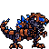

<!-- 本页上半部分由 tools/docs/gen_hero_docs.py 按仓库里现在的数据生成，手改会被覆盖；「开发记录」以下是手写的，生成时原样保留。 -->

# 海克斯霸龙 T-Hex

| 项目 | 内容 |
|---|---|
| id | `tft_thex` |
| 所属的包 | tft 包（金铲铲之战系列，mod_id `tft`） |
| 分路 | 上单 |
| 分类 / 标签 | 近战（Melee） · AD / Melee / Tank / CC / Shield |
| 高清帧 | PPU 1.9 |
| 附加包 | 无 |

其他预览：[skills](../preview/tft_thex_skills.gif)

## 现在的技能

下面是游戏里显示的技能说明（`tft/text/champion.i18n` 的简体中文，去掉了颜色和图标），冷却、距离来自 `tft/champion/tft_thex.data_champion`；1 秒 = 60 tick。

### 普攻 / 被动

*攻击间隔 1.17 秒 · 攻击距离 38000*

每次攻击连射4发子弹，每发30% 攻击力物理伤害；每第四次攻击最后一发额外30 + 40% 攻击力。驾驶员弹射：阵亡时机甲爆炸，周围敌人受到100 + 100% 攻击力物理伤害，击退并晕眩1.5秒。

### 技能1 · 追踪导弹

*冷却 9 秒 · 施放距离 60000 · 施放：指定目标 · 敌人（不含防御塔）*

背部导弹舱翻开，向附近随机敌人发射6枚导弹，每枚造成20 + 40% 攻击力物理伤害。

### 技能2 · 霸龙冲撞

*冷却 12 秒 · 施放距离 55000 · 施放：指定目标 · 敌人（不含防御塔）*

冲向目标一口咬住，造成40 + 90% 攻击力物理伤害，击退并减速30%（1.5秒）。

### 大招 · 海克斯军械库

*冷却 50 秒 · 施放距离 60000 · 施放：指定目标 · 敌方英雄*

获得300 + 120% 攻击力护盾（4秒），导弹舱全开：每秒向目标射出贯穿激光，共3道，造成80 + 130% 攻击力物理伤害，每穿过一个敌人-70%（最低10%）；每道激光伴随4枚导弹，每枚15 + 25% 攻击力。

### 数值

攻击力 84（每级 +11）、法强 20（每级 +8）、生命 1450（每级 +110）、护甲 60（每级 +8）、魔抗 50（每级 +7）、移速 950（每级 +10）。

## 相关脚本和素材

- [`tools/kit/build_thex.py`](../../tools/kit/build_thex.py)
- [`tools/kit/setup_thex.py`](../../tools/kit/setup_thex.py)
- [`tools/lol/extract_thex.py`](../../tools/lol/extract_thex.py)
- [`tools/art/preview_thex.py`](../../tools/art/preview_thex.py)
- [`tools/art/rig_thex.py`](../../tools/art/rig_thex.py)
- [`assets/source/thex/`](../../assets/source/thex)

## 开发记录

| 部分 | 内容 |
|---|---|
| 定位 | tft 包（`tft_thex`）的英雄，上单（近战，机甲斗士，物理伤害，护盾，倒下时还要炸一下）。金铲铲第 16 赛季的五费 `TFT16_THex`「海克斯霸龙」（海克斯机甲 / 皮尔特沃夫 / 枪手，繁中「機械暴龍」，英文 T-Hex，射程 2，原技能「海克斯军械库」）：深藏青机身盖着铜色装甲、嵌着海克斯蓝色面板的机械霸王龙，背上一排蓝水晶尖刺和两块能翻开的导弹舱，铜色头盔、蓝色面罩，近处的前爪是六管加特林。技能是我们按金铲铲第 16 赛季的原技能和海克斯机甲羁绊（驾驶员上下机）自己设计的，用户 2026-11-02 定为上单（「方案A 上单」） |
| 普攻 / 被动 | **加特林弹幕**（距离 38000，打塔）：从第 10 tick 起每 3 tick 一发，连射 4 发追踪子弹，每发 30% 攻击力；每第四次攻击（隐藏计数 a_n1..a_n3）最后一发多 30 + 40% 攻击力。**驾驶员弹射**（tft.dll）：每条命开始时驾驶员跳进机甲（一声音效）；倒下时机甲在原地爆开，40000 以内的敌人受 100 + 100% 攻击力物理伤害、被击退（每 tick 1800，12 tick）并晕眩 1.5 秒（纯数据版没有：数据里没有「倒下」这个时机） |
| 技能1 | **追踪导弹**（冷却 9 秒，距离 60000，打兵和野怪）：第 14 tick 背上导弹舱翻开，6 枚导弹每 4 tick 一枚，落在 60000 以内随机的敌人身上，每枚 20 + 40% 攻击力 |
| 技能2 | **霸龙冲撞**（冷却 12 秒，距离 55000，打兵和野怪）：冲向目标（`MoveToTarget`，每 tick 2400）一口咬住：40 + 90% 攻击力，击退（每 tick 1500，10 tick），减速 30% 1.5 秒 |
| 大招 | **海克斯军械库**（金铲铲原技能，冷却 50 秒，距离 60000，打英雄）：护盾 300 + 120% 攻击力 4 秒，导弹舱全开站着打 3 拍（第 20 tick 起每 60 tick 一拍）：每拍从嘴里射出一道贯穿激光（tft.dll `tft_thex:laser`：90000 长、14000 宽，第一个敌人 80 + 130% 攻击力，每多穿过一个少 70%，最少 10%；纯数据版：线上每个敌人 60%），再加 4 枚导弹落在 60000 以内随机的敌人身上，每枚 15 + 25% 攻击力。塞拉斯偷到的是纯数据版 |
| 数值 | 攻击 84（+11）、法强 20（+8）、生命 1450（+110）、护甲 60（+8）、魔抗 50（+7）、移速 950（+10），攻击间隔 70 tick，距离 38000 |
| 平衡 | 经典引擎模拟（上单，纯数据版，种子 1–8）：初稿 -2.99；v2（生命 1350，双抗 55/45，护盾 250）-1.56；v4（生命 1450，双抗 60/50，护盾 300，攻击 80，导弹 40%，子弹 30%）+0.18；v5（攻击 84，激光 130%）+1.47，种子 9–16 +0.38，平均约 +0.93；v8（攻击 82，激光 120%）+0.35 / +0.11。定 v5。对照岩宝 +1.60。死亡爆炸和激光递减只在游戏里有 |
| tft.dll | [`addons/tft/src/thex.rs`](../../addons/tft/src/thex.rs)：被动 `tft_thex:pilot`（每条命跳进机甲的声音，记下最后的位置，倒下时在那里爆炸：伤害、击退、晕眩、`p_blast` 特效和音效）；效果 `tft_thex:laser`（把激光线上的敌人按远近排好，伤害逐个递减）。日志 `data/tft_thex.log`（SPAWN / PILOT / LASER / EJECT） |
| 塞拉斯 / 佛耶戈 / 俄洛伊 / 悠米 | 塞拉斯偷到的「海克斯军械库」是纯数据版（激光线上每人 60%），按近战类；佛耶戈的灵魂（近战）、妮蔻、俄洛伊的灵魂、悠米坐在它头上的高度 28 |
| 精灵图（高清帧 PPU 1.9） | 参考是金铲铲客户端 TFTSet16 里它的模型（`tft16_thex_16`，89 个关节：R_Weapon 加特林、L_Hand 机械爪、L/R_Back_Cover1–3 导弹舱、尾巴 5 节）和它的动作（待机、跑、加特林、转身、咆哮、导弹舱展开的两段引导、起身、倒下）。第 0 步 Codex 画了 A（待机）和 B（导弹舱全开），用户选 A-1（Codex 第一稿按它自己 10 px 的格子读回，101×76）40 像素高、PPU 1.9（76 行，1:1） |
| 动作 | [`tools/art/design_thex_poses.py`](../../tools/art/design_thex_poses.py)：Codex 的 17 个姿势每张格子 8–9 px，按蓝色面罩和身体面积读回到定稿大小（8 张跑步共用一个大小，不然每步都会一胖一瘦），贴回定稿的头盔、面罩和眼睛（下颌不贴：它随动作开合）。站着的姿势按两只脚的中点对齐（攻击后坐时仰身，按头对齐脚会滑十来格），跑步按头对齐；跑步第 2 帧那条腿伸得笔直，头比别的帧高 13 格，削短小腿到 84 行；倒地时眼睛跟面罩一起熄灭。[`rig_thex.py`](../../tools/art/rig_thex.py)：跑步用 Codex 的 8 帧（金铲铲 1.27 秒一个完整步态）；普攻前三发子弹让枪身往后震一格，最后一发才换成后坐的姿势（瞄准和后坐每 50 毫秒来回切会闪）；大招每拍激光身体往后震一格 |
| 特效 | 用户给的一张 Gemini 图（12 张特效、3 个图标）由 [`tools/art/process_thex_fx.py`](../../tools/art/process_thex_fx.py) 处理：抠掉深灰底；多数特效只画了一张，缺的帧从它们放大、淡出、把火光和烟拆开来补；导弹落下用两张图拼成（导弹三个高度 + 爆炸 + 光环）；导弹发射去掉了灰色烟柱（在游戏里是压在身体中间的一块灰），从背上导弹舱的位置飞出；大招护盾原图是实心的蓝球，会把霸龙整个挡住，掏空成 3 格宽的光环；子弹和激光上下对称、朝右，其余左右对称 |
| 音效 | [`tools/lol/extract_thex.py`](../../tools/lol/extract_thex.py) 的 13 段：金铲铲第 16 赛季它自己的加特林、暴击、大招施放和护盾，海克斯机甲羁绊的驾驶员上机和弹射；库奇的导弹发射、爆炸和地毯式轰炸（倒下），雷克顿和雷恩加尔的咬击，维克托的激光 |
| 选人卡片 | 40 游戏像素高；卡片动图轮流放普攻、导弹、冲撞、大招，待机停在瞄准那一帧；图鉴中心按英雄联盟的规则（−13），选人卡片 −10（技能和大招比站着高，头顶会被卡片框裁掉一点，和别的英雄一样按站姿定） |
