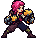

<!-- 本页上半部分由 tools/docs/gen_hero_docs.py 按仓库里现在的数据生成，手改会被覆盖；「开发记录」以下是手写的，生成时原样保留。 -->

# 蔚奥莱 Violet



| 项目 | 内容 |
|---|---|
| id | `tft_violet` |
| 所属的包 | tft 包（金铲铲之战系列，mod_id `tft`） |
| 分路 | 打野 |
| 分类 / 标签 | 近战（Melee） · AD / Melee / CC |
| 高清帧 | PPU 2 |
| 附加包 | 无 |

其他预览：[skills](../preview/tft_violet_skills.gif)、[逐帧预览](../preview/tft_violet_frames.png)、[特效表](../preview/tft_violet_effects.png)

## 现在的技能

下面是游戏里显示的技能说明（`tft/text/champion.i18n` 的简体中文，去掉了颜色和图标），冷却、距离来自 `tft/champion/tft_violet.data_champion`；1 秒 = 60 tick。

### 普攻 / 被动

*攻击间隔 0.93 秒 · 攻击距离 24000*

挥拳造成100% 攻击力物理伤害。搏击手：每次命中额外造成5% 攻击力真实伤害，全能吸血10%；每条命第一次生命低于50%时，2秒内回复15%最大生命。

### 技能1 · 1-2-3连招

*冷却 8 秒 · 施放距离 30000 · 施放：指定目标 · 敌人（不含防御塔）*

两记刺拳各造成50% 攻击力物理伤害，再一记上勾拳造成40 + 120% 攻击力物理伤害并击飞0.5秒。

### 技能2 · 冲拳

*冷却 10 秒 · 施放距离 45000 · 施放：指定目标 · 敌人（不含防御塔）*

冲向敌人一拳打退，造成40 + 100% 攻击力物理伤害。

### 大招 · 底城怒拳

*冷却 50 秒 · 施放距离 50000 · 施放：指定目标 · 敌方英雄*

跳进敌群双拳砸地，周围的敌人受到120 + 130% 攻击力物理伤害并被击飞0.8秒；之后5秒内攻速+40%、吸血+5%，队里每有一个家人攻速再+10%。

### 数值

攻击力 82（每级 +17）、生命 940（每级 +100）、护甲 30（每级 +8）、魔抗 24（每级 +4）、移速 1050（每级 +11）。

## 相关脚本和素材

- [`tools/kit/build_violet.py`](../../tools/kit/build_violet.py)
- [`tools/kit/setup_violet.py`](../../tools/kit/setup_violet.py)
- [`tools/lol/extract_violet.py`](../../tools/lol/extract_violet.py)
- [`tools/art/preview_violet.py`](../../tools/art/preview_violet.py)
- [`tools/art/rig_violet.py`](../../tools/art/rig_violet.py)
- [`assets/source/violet/`](../../assets/source/violet)

## 开发记录

| 部分 | 内容 |
|---|---|
| 定位 | tft 包（`tft_violet`）的第九个英雄，打野（Melee，近战拳手）。《双城之战》第一幕里少女时代的蔚：祖安街头的拳手、爆爆的姐姐、范德尔的养女，两只手各戴一只比头还大的铁拳套。金铲铲第 13 赛季的一费（`TFT13_Red`，家人 / 搏击手，射程 1，生命 650，法力 20/65），只有一个技能「1-2-3连招」（两记刺拳各 135% 攻击，再一记上勾拳 330% 攻击并击飞 0.25 秒）和搏击手羁绊（全能吸血、额外真实伤害，半血时回一口气）。用户选了**打野**和方案 A「搏击手·1-2-3连招」：被动和技能1 照金铲铲，技能2 冲拳、大招底城怒拳是我们加的。模型在 Riot 客户端的 `TFTSet13.wad.client`（`tft13_red.skn`，63 根骨骼，没有手指；动作只有路径哈希，按内容命名） |
| 普攻 / 被动 | 拳套直拳（近战，100% 攻击，打塔）。**搏击手**：每一下（普攻、连招、冲拳、砸地）额外造成 5% 攻击的真实伤害；第一次出手起全能吸血 10%；每条命第一次掉到一半血以下，2 秒内回复 15% 最大生命（tft.dll 的被动每拍看生命：数据读不到生命） |
| 技能1 | **1-2-3连招**（冷却 8 秒，距离 30000，小兵野怪也放）：两记刺拳各 50% 攻击，再一记上勾拳 40 + 120% 攻击并击飞 0.5 秒（第 8、20、36 tick 打中，对着动作帧） |
| 技能2 | **冲拳**（冷却 10 秒，距离 45000）：扑向目标（MoveToTarget），到达时一拳（播自己的 `punch` 动作）：40 + 100% 攻击，短短地打退一下（1200 × 4：打得太远会把敌人推出队友的输出范围，洛里斯的教训） |
| 大招 | **底城怒拳**（冷却 50 秒，敌方英雄在 50000 以内时放）：跳向目标（MoveToTarget），落地双拳砸地（播自己的 `slam` 动作）：32000 以内的敌人受到 120 + 130% 攻击并被击飞 0.8 秒；之后 5 秒怒火：攻速 +40%、吸血 +5%，队里每有一个家人（爆爆、范德尔、金克丝；联盟的蔚就是长大的她，不算）攻速再 +10%（tft.dll） |
| 数值 | 攻击 82（+17）、生命 940（+100）、护甲 30（+8）、魔抗 24（+4）、移速 1050（+11），攻击间隔约 0.93 秒（以联盟的蔚为参照：一费的她更轻、出拳更快） |
| 平衡 | 经典引擎模拟（打野，对忍者、恶魔、猎人、狼人、吸血鬼，两边三套阵容，纯数据版：没有半血回气）：草稿 +2.71（同一批 league_vi +2.08、tft_vander 不含 tft.dll +0.06）；真实伤害 8% → 5%、生命 980 → 940、攻击 84 → 82、怒火吸血 10% → 5%，**定稿** +2.06 / +0.93（种子 1–8 / 9–16，league_vi +2.08 / +1.99）。tft.dll 里的半血回气和家人攻速没有进模拟 |
| tft.dll | 数据做不到的部分在 tft 包自己的代码里（[`addons/tft/src/violet.rs`](../../addons/tft/src/violet.rs)，和范德尔、可酷伯、洛里斯、麦迪、希尔科、拉露恩、诺拉一起编成 `tft.dll`）：被动 `tft_violet:pugilist`（每条命第一次半血时挂 `p_wind` 回血、播 `p_burst` 和音效），`tft_violet:fury`（砸地时按家人队友数给怒火加攻速）。`build_violet.py` 每次核对代码的默认参数和数据一致。范德尔的家人加成也算上了她（用户：「范德尔的家人加成也算上蔚奥莱」） |
| 塞拉斯 / 佛耶戈 / 妮蔻 / 俄洛伊 | 她的大招用了 tft.dll，塞拉斯偷到的是纯数据版（`sylas_ult()`：起跳、砸地击飞和固定的怒火，不带她被动的真实伤害；特效表复制进附加包；`sylas_steal_check.py` 模拟里砸地和击飞的特效出现 25 次）。佛耶戈 / 妮蔻的表（近战类）和俄洛伊的幽灵图都加上了她 |
| 精灵图（高清帧 PPU 2.0） | Codex 第 0 步画了 A（金铲铲的宽站姿）和 B（双拳举起的格斗架势）两张，实际格子 A 约 9 px、B 约 5.5 px（要求的是 11 px），按它自己的格子读回；用户定 **B-1、高 38、PPU 2.0**（[`tools/art/design_violet_model.py`](../../tools/art/design_violet_model.py)：68×76，缩小后糊掉的两只眼睛和眉毛逐格重画）。姿势包的骨架是她自己的动作按帧投影出来的（[`tools/art/pack_violet_poses.py`](../../tools/art/pack_violet_poses.py)，头放大 1.7 倍对上定稿，两只手都套金圈），Codex 画了 19 个姿势，实际格子 9–12 px、每张不一样，[`tools/art/design_violet_poses.py`](../../tools/art/design_violet_poses.py) 按每张自己的格子读回、按「格子 / 12」缩到定稿密度（画大了的几张再按参考缩回）、换回定稿的颜色、贴回定稿的头（被击倒那帧留 Codex 自己后仰的头，倒地那帧把定稿的头转成仰躺）；[`tools/art/rig_violet.py`](../../tools/art/rig_violet.py) 横向按 Codex 画的位置、竖向全部落地（它画的脚底高低差了好几格），拼成普攻（蓄力 → 弓步直拳 → 收势）、技能1（刺拳 → 换手刺拳 → 蓄力 → 跳起上勾拳 → 落地）、技能2（扑出，到达才播打中的一拳）、大招（下蹲 → 腾空，落地才播落地 → 砸地）、受击、阵亡（被打得后仰 → 仰面倒地）。贴头时让定稿的下巴对上 Codex 画的下巴：Codex 的头比定稿的 Q 版头小、下巴下面就是举起的拳套，按颜色找位置又不许头高出它画的头顶，下巴低了 3–8 行压在拳套上（用户：「头和身体不协调啊 头都和手绑在一起了」），现在多出来的高度往上长（`CHIN`：跑步和九个姿势）。**跑步**前后画了三轮：第一轮四帧每帧在前的都是近侧那条腿（用户：「走路腿没有前后交换啊」，「你让codex重画吧」），重画成 8 帧（[`tools/art/pack_violet_run.py`](../../tools/art/pack_violet_run.py)：近侧红腿藏青大腿、永远画在上面，1–5 帧它在前、6–8 帧远侧的在前），两条腿轮流在前了，但每帧都是大劈叉，两只靴尖差 29–55 格（原版 6–38），没有交叉那一下（用户：「怎么走路看起来没有明显的交叉步」）；第三轮只重画 1、5、6、7、8 帧（[`tools/art/pack_violet_run_cross.py`](../../tools/art/pack_violet_run_cross.py)，每帧写明两只靴尖差几格，第 6 帧两腿交叉成 X），2–4 帧留用。8 帧按 Codex 自己的大小读（头和定稿的差不多大；第 5 帧头画得最小，缩 0.95），每帧 117 毫秒（她的跑步 933 毫秒一圈），头在一列上，着地的靴子只往后退。直起身跑比蹲着的站姿高（83–89 行对 76） |
| 特效 | 10 张 + 3 个技能图标，Codex 画的（[`tools/art/pack_violet_fx.py`](../../tools/art/pack_violet_fx.py) 的提示词，参考是金铲铲里她自己的粒子贴图 [`tools/lol/fx_ref_violet.py`](../../tools/lol/fx_ref_violet.py)：星形拳光、电光、旋风、烟尘），全部左右对称：直拳和刺拳的星形打击、上勾拳的旋风电光柱、冲拳的尘土和方形冲击波、砸地的大冲击波、击飞的碎石、怒火的粉红电光、回气的绿光。[`tools/art/import_violet_fx.py`](../../tools/art/import_violet_fx.py) 切成 `tft_violet_fx` / `tft_violet_big`（帧边上邻帧切下来的碎点清掉）；Codex 缩成的 64 px 图标糊了，从它的高清原稿重新缩 |
| 音效 | 她自己的金铲铲音效（Riot 客户端 Map22 `MODE_TFT_Set13_Champs_SFX`：普攻、第二种普攻、暴击，连招的小、大两种打击），冲拳的冲刺、起跳、砸地、怒火和回气借长大后的蔚（Q 的冲刺、R 的起跳、E 的冲击波、W 的打击、被动护盾），大招配第 13 赛季的英文语音（[`tools/lol/extract_violet.py`](../../tools/lol/extract_violet.py)，13 段） |
| 选人卡片 | 头发到脚底 38 游戏像素：`banpick_center` −6，不另设缩放。脸 (4, −30)。待机按 `tools/art/hero_reels.py` 剪进连招和普攻的帧，卡片轮播普攻、技能1、冲拳、砸地 |

重新生成（素材来自本机的金铲铲客户端，音频和 Riot 的渲染不进仓库）：

```bash
python tools/lol/extract_violet.py --riot "D:\Riot Games\League of Legends" --lol "D:\WeGameApps\lol" --vgmstream <vgmstream-cli.exe>
python tools/kit/build_violet.py                  # 技能数据（调用 tft.dll），数字都在脚本的参数表 P 里；--plain 是平衡模拟用的纯数据
python tools/kit/setup_violet.py                  # 五种语言的文字、音效配置、tft 包共享文件里她的键
python tools/art/design_violet_hd.py              # Codex 第 0 步的原图读回
python tools/art/design_violet_model.py           # 定稿 B-1 缩到 76 行
python tools/art/design_violet_poses.py           # Codex 的姿势和跑步（各按自己的格子读回，定稿的颜色和头，下巴对下巴）
python tools/art/import_violet_fx.py              # 特效 -> tft_violet_fx / tft_violet_big，图标
python tools/art/rig_violet.py                    # 1 倍帧和 2.0 的原帧
python tools/art/ppu_restyle.py --hero violet     # 外描边
python tools/art/ppu_hd.py --hero violet          # hd_ / lo_ 帧（要在 hero_reels 之前）
python tools/art/hero_reels.py --hero tft_violet  # 待机和选人卡片的小动作
python tools/art/preview_violet.py                # 预览和每个技能单独的 GIF
python tools/art/review_violet_actions.py --out <文件夹> --sheet   # 和金铲铲原版逐个动作对照的 GIF
python addons/league_sylas/make_override.py       # 塞拉斯偷到的底城怒拳
cargo test --manifest-path addons/Cargo.toml -p tft   # tft.dll 的单元测试（蔚奥莱、范德尔、可酷伯、洛里斯、麦迪、希尔科、拉露恩、诺拉）
```
