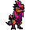

<!-- 本页上半部分由 tools/docs/gen_hero_docs.py 按仓库里现在的数据生成，手改会被覆盖；「开发记录」以下是手写的，生成时原样保留。 -->

# 呲呲 Zippy



| 项目 | 内容 |
|---|---|
| id | `tft_zippy` |
| 所属的包 | tft 包（金铲铲之战系列，mod_id `tft`） |
| 分路 | 打野 |
| 分类 / 标签 | 近战（Melee） · AD / Melee / CC / Shield |
| 高清帧 | PPU 2.2 |
| 附加包 | 无 |

其他预览：[skills](../preview/tft_zippy_skills.gif)、[逐帧预览](../preview/tft_zippy_frames.png)、[特效表](../preview/tft_zippy_effects.png)

## 现在的技能

下面是游戏里显示的技能说明（`tft/text/champion.i18n` 的简体中文，去掉了颜色和图标），冷却、距离来自 `tft/champion/tft_zippy.data_champion`；1 秒 = 60 tick。

### 普攻 / 被动

*攻击间隔 0.97 秒 · 攻击距离 26000*

抬腿一蹬，造成100% 攻击力物理伤害。冒险家之魂：身边每有一个友方英雄，护甲和魔抗+10（最多4个）。

### 技能1 · 后空翻踢

*冷却 7 秒 · 施放距离 30000 · 施放：指定目标 · 敌人（不含防御塔）*

后空翻踢中目标，造成30 + 140% 攻击力物理伤害并击飞0.67秒。

### 技能2 · 翻滚冲锋

*冷却 10 秒 · 施放距离 60000 · 施放：指定目标 · 敌人（不含防御塔）*

缩成羽毛球滚向敌人，路上的敌人受到40 + 80% 攻击力物理伤害；身边友方英雄移速+20%（2.5秒）。

### 大招 · 翻滚突袭

*冷却 40 秒 · 施放距离 70000 · 施放：指定目标 · 敌方英雄*

获得120 + 100% 攻击力护盾（2秒），跃起砸向生命百分比最高的敌方英雄（免疫控制），造成80 + 220% 攻击力物理伤害，晕眩1.5秒并略微击退。

### 数值

攻击力 78（每级 +13）、生命 1020（每级 +106）、护甲 38（每级 +7）、魔抗 30（每级 +5）、移速 1070（每级 +10）。

## 相关脚本和素材

- [`tools/kit/build_zippy.py`](../../tools/kit/build_zippy.py)
- [`tools/kit/setup_zippy.py`](../../tools/kit/setup_zippy.py)
- [`tools/lol/extract_zippy.py`](../../tools/lol/extract_zippy.py)
- [`tools/art/preview_zippy.py`](../../tools/art/preview_zippy.py)
- [`tools/art/rig_zippy.py`](../../tools/art/rig_zippy.py)
- [`assets/source/zippy/`](../../assets/source/zippy)

## 开发记录

| 部分 | 内容 |
|---|---|
| 定位 | tft 包（`tft_zippy`）的第二十四个英雄，打野（战士）。金铲铲第 7 赛季（巨龙之巢）的三费 `TFT7_DragonGuild`「呲呲」（冒险家 / 龙神，AD 战士，射程 1）：一只两条腿站立的小迅猛龙（模型和克烈的坐骑斯嘎尔是同一副骨架，没有骑手），圆圆的橙褐色脑袋、头顶玫红尖刺、脸周围一圈黑色尖片、半闭的大紫眼，喉咙到肚子一块紫色围兜，脖子两侧垂着玫红长羽毛，背上洋红马鞍（金边、金环），脚踝紫色绑带，尾巴上一排粉色尖鳍。金铲铲原技能「翻滚突袭」做大招，冒险家羁绊（呲呲给的是护甲和魔抗）做被动，其余按用户选的方案 A「冒险家突击」（2026-10-31）自己设计 |
| 普攻 / 被动 | **利爪踢**（射程 26000，打塔）：第 12 tick 抬腿一蹬，100% 攻击力。**冒险家之魂**（tft.dll）：每 15 tick 数一次身边 50000 以内活着的友方英雄（不算自己，最多 4 个），每个给它 +10 护甲和魔抗（`tft_zippy_p_guild`，脚下一圈淡金环），一个也没有就摘掉 |
| 技能1 | **后空翻踢**（冷却 7 秒，距离 30000，敌人含小兵野怪）：第 16 tick 后空翻两脚往上踢中：30 + 140% 攻击力，击飞 0.67 秒 |
| 技能2 | **翻滚冲锋**（冷却 10 秒，距离 60000）：施放时身边 50000 以内的友方英雄（含自己）移速 +20%（2.5 秒）；第 8 tick 缩成羽毛球往目标滚（`RushTime` 每 tick 3500、14 tick，穿过敌人），滚过的敌人受 40 + 80% 攻击力 |
| 大招 | **翻滚突袭**（金铲铲原技能，冷却 40 秒，距离 70000，有敌方英雄时）：立刻获得 120 + 100% 攻击力的护盾（2 秒）；第 12 tick 跃起缩成球（到落地前免疫控制），tft.dll 找 70000 以内**生命百分比最高**的敌方英雄（没有就用 AI 选的目标），每 tick 跳 4000、最多 20 tick，落在它身前：80 + 220% 攻击力物理伤害、晕眩 1.5 秒、往后撞开一小段 |
| 数值 | 攻击 78（+13）、生命 1020（+106）、护甲 38（+7）、魔抗 30（+5）、移速 1070（+10），攻击间隔 0.97 秒，射程 26000 |
| 平衡 | 经典引擎模拟（打野，对原版忍者、恶魔、猎人、狼人、吸血鬼，两边三套阵容，纯数据版：被动是每次普攻挂上两个队友的护甲魔抗，大招冲向 AI 选的目标）：草稿 +3.03（赛芬纯数据同种子 +2.31、范德尔 +1.73）；生命 1000、攻击 76、大招 200%、加速 15% +2.42；再 Q 130%、E 70% +0.21 / +1.29；取中间（生命 1020、攻击 78、Q 140%、E 80% 和加速 20%、大招 220%）：**+1.85**（种子 1–16；范德尔 +1.73 / +1.48），三费比三费的对照略强一点 |
| tft.dll | [`addons/tft/src/zippy.rs`](../../addons/tft/src/zippy.rs)：被动 `tft_zippy:guild`（数队友、挂护甲魔抗，有队友来时播一声，死亡时播死亡声）；原生效果 `tft_zippy:leap`（选生命百分比最高的敌方英雄）和 `tft_zippy:hop`（一 tick 一 tick 跳过去，落地时伤害、晕眩、击退，播撞击和落地声、亮 `tft_zippy_r_hit`）。日志 `data/tft_zippy.log`（SPAWN / GUILD / LEAP / LAND / LAND MISS） |
| 塞拉斯 / 佛耶戈 / 妮蔻 / 俄洛伊 / 悠米 | 塞拉斯偷到的翻滚突袭是纯数据版（`build_zippy.sylas_ult`：护盾，冲向他的目标，同样的伤害、晕眩、击退），特效表复制进附加包；佛耶戈 / 妮蔻的表（近战）、俄洛伊的灵魂（197 个）、悠米坐骑的头顶高度 26 |
| 精灵图（高清帧 PPU 2.2） | 参考是金铲铲客户端里它自己的模型（67 个关节都叫 `Mount_*`；颜色贴图在 bin 里没有路径，只有哈希；动作片段 `tft7_dragonguild_<名字>.anm`：idle、run、attack1（后空翻踢）、spell（缩成球滚动）、death（其实是仰头踢腿，不是倒下）、celebration，另有两段名字不明的：跳起缩成球、从球里弹开落地）。第 0 步 Codex 画了 A（3/4）和 B（侧面），用户选 **A-1、38 游戏像素、PPU 2.2**（A 按它自己 17 px 一格读回正好 52×83，1:1；脸不用改）。第 2 步 Codex 照它自己的动作片段画了 12 个动作、8 帧跑步和 2 帧死亡（骨架包 [`tools/art/pack_zippy_poses.py`](../../tools/art/pack_zippy_poses.py)：头放大 1.5 倍；骨架里玫红长羽毛是斯嘎尔的「耳朵」骨骼） |
| 动作 | Codex 的格子基本是要的 10 px，身体却画大了 1.0–1.4 倍：按马鞍的金色、眼睛和面积量出每张的倍数，从原稿按自己的格子读回、缩到定稿的体型（[`tools/art/design_zippy_poses.py`](../../tools/art/design_zippy_poses.py)），换成定稿的颜色、贴定稿的脸（后仰倒下和闭眼倒地保留 Codex 的）。[`tools/art/rig_zippy.py`](../../tools/art/rig_zippy.py)：普攻抬膝 + 蹬出；后空翻踢蹲 + 翻（抬高 14 格）+ 踢（抬高 16 格）+ 落地；翻滚冲锋蜷起 + 羽毛球每帧顺时针转四分之一圈；翻滚突袭蹲 + 跃起 + 球在空中转 + 张开 + 砸地；死亡后仰 + 缩成球躺下 |
| 移动 | 第一版跑步用户说「感觉走路换腿有点问题」：Codex 八帧都是两腿一前一后分开、从不交错，而且亮的近侧腿七帧都在前。于是单独做了跑步重画包（[`tools/art/pack_zippy_run.py`](../../tools/art/pack_zippy_run.py)，塞薇卡的做法）：金铲铲跑步一整圈 0.8 秒取 8 帧，写明每帧两只脚尖的格子、谁在前，第 3、8 帧两腿交错；近侧腿用定稿的亮色并画在上面，远侧腿整条暗一档。Codex 重画的这版每格约 7 px、头 1:1，按 7 px 读回（[`tools/art/design_zippy_run.py`](../../tools/art/design_zippy_run.py)），按脸对齐成一列，每帧时长按片段的间隔（120、135、105、80、80、100、120、60 毫秒） |
| 特效 | 9 张 + 3 个技能图标，Codex 画（[`tools/art/pack_zippy_fx.py`](../../tools/art/pack_zippy_fx.py) 的提示词，参考是它自己第 7 赛季的粒子贴图和克烈的 [`tools/lol/fx_ref_zippy.py`](../../tools/lol/fx_ref_zippy.py)：冲击环、打中的闪光、护盾泡泡），玫红羽毛、金色星星、尘土，护盾是天蓝色的泡泡，全部左右对称。[`tools/art/import_zippy_fx.py`](../../tools/art/import_zippy_fx.py)：打中的放在身体上，起滚 / 起跳的尘土留在地上，护盾泡泡罩着它（底边比脚低一点） |
| 音效 | 普攻（暴击音）、后空翻踢、羽毛球翻滚、跃起、撞击、加速、被动、语音是它自己的金铲铲音效（Riot 客户端 Map22 里第 7 赛季的音效包，`Play_sfx_tft7_DragonGuild…`，本来就是斯嘎尔的音效换了名字）；翻滚撞到人、大招的护盾和落地借克烈，死亡借峡谷的锋喙鸟（[`tools/lol/extract_zippy.py`](../../tools/lol/extract_zippy.py)，16 个） |
| 选人卡片 | 头顶尖刺到脚底 38 游戏像素：`banpick_center` (0, −12)（按规则 −39 减去最高点 −26.5）。脸 (10, −26)（眼睛）。待机按 `tools/art/hero_reels.py` 剪进普攻的起手帧，卡片轮播普攻、后空翻踢、翻滚冲锋、翻滚突袭 |

重新生成（素材来自本机的金铲铲客户端，音频和 Riot 的渲染不进仓库）：

```bash
python tools/lol/extract_zippy.py --riot "D:\Riot Games\League of Legends" --vgmstream <vgmstream-cli.exe>
python tools/kit/build_zippy.py                     # 技能数据（被动、大招调用 tft.dll），数字都在脚本的参数表 P 里；--plain 是平衡模拟用的纯数据
python tools/kit/setup_zippy.py                     # 五种语言的文字、音效配置、tft 包共享文件里它的键
python tools/art/design_zippy_hd.py                 # Codex 第 0 步的原图读回
python tools/art/design_zippy_model.py              # 定稿 A-1（52×83）
python tools/art/design_zippy_poses.py              # Codex 的姿势：按定稿的体型从原稿读回、换成定稿的颜色、贴定稿的脸
python tools/art/design_zippy_run.py                # Codex 重画的跑步（每格 7 px，1:1）
python tools/art/import_zippy_fx.py                 # 特效 -> tft_zippy_fx / tft_zippy_big，图标
python tools/art/rig_zippy.py                       # 1 倍帧和 2.2 的原帧
python tools/art/ppu_restyle.py --hero zippy        # 外描边
python tools/art/ppu_hd.py --hero zippy             # hd_ / lo_ 帧（要在 hero_reels 之前）
python tools/art/hero_reels.py --hero tft_zippy     # 待机和选人卡片的小动作
python tools/art/preview_zippy.py                   # 预览和每个技能单独的 GIF
python tools/art/review_zippy_actions.py --out <文件夹> --sheet   # 和金铲铲原版逐个动作对照的 GIF
cargo test --manifest-path addons/Cargo.toml -p tft   # tft.dll 的单元测试
```
